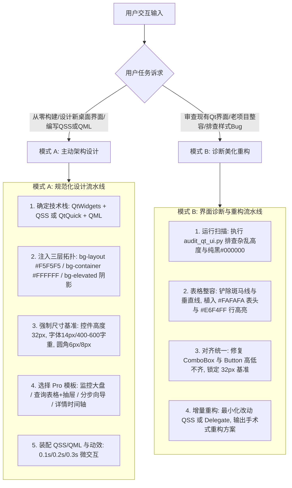

# AntQt: 企业级 PC 桌面端 Ant Design 规范化套件

本技能将 Ant Design 4 大设计价值观（自然、确定、意义感、生长性）与 Ant Design Pro 企业级中后台桌面模板无缝移植到 Qt 桌面端（QtWidgets / QtQuick QML / C++ / PySide6 / PyQt）。

---

## 1. 核心工作引擎

---

## 2. 模式 A：主动架构设计清单 (Proactive UI Architecture)

当从零构建桌面应用或增加新功能模块时，必须严格执行以下 **5 项核心设计法则**：

1. **三层表面拓扑与克制用色**：
   - 窗口底板强制 `bg-layout` (`#F5F5F5`)；卡片与容器为 `bg-container` (`#FFFFFF`)；弹窗与浮层为 `bg-elevated` 带阴影。
   - 主品牌色 `#1677FF` 严格限制在 Primary 按钮、选中态 Tab 与高亮链接上，严禁全屏大面积铺蓝。详见 [tokens_and_metrics.md](./references/tokens_and_metrics.md)。
2. **强制 32px 控件标尺与 14px 视距排版**：
   - 按钮 (`QPushButton`)、单行输入框 (`QLineEdit`)、下拉框 (`QComboBox`) 统一锁定高度 `32px`，严禁高低错落；
   - 基础字号严格采用 `14px` (行高 22px)，字重仅限 `400` 与 `600`。报表与金额数字必须启用 `tabular-nums` 等宽对齐。
3. **圆角与几何分级**：
   - 交互控件圆角 `6px`，卡片与弹窗圆角 `8px`，标签 `4px`。胶囊圆角（9999px）**严格仅用于徽标与头像**，禁止按钮使用全圆角。
4. **选择 Ant Design Pro 桌面模板骨架**：
   - **工作台/监控大盘**：4 列 KPI 指标卡 + 65% 主趋势图 + 35% 实时动态列表。
   - **高级查询表格**：顶部折叠查询表单 + 批量操作栏 + 48px 表头纯净表格 + 右侧 380px 滑动详情抽屉。
   - **分步配置向导**：顶部步骤条 + 居中 600px 限制宽度卡片表单 + 底部吸底固定操作栏。详见 [pro_desktop_archetypes.md](./references/pro_desktop_archetypes.md)。
5. **双技术栈资产开箱即用**：
   - QtWidgets: 直接引入 [ant_light_theme.qss](./examples/qss/ant_light_theme.qss) 或 [ant_dark_theme.qss](./examples/qss/ant_dark_theme.qss)；
   - QtQuick: 引入 [AntTheme.qml](./examples/qml/AntTheme.qml) 与 [AntButton.qml](./examples/qml/AntButton.qml)。

---

## 3. 模式 B：老界面诊断与重构 (Diagnostic Modernization)

当用户给出已有 Qt 代码或抱怨界面丑陋、不协调时，按如下步骤执行手术式整容：

1. **五大视觉坏味道诊断**：
   - **纯黑文本**：使用 `#000000` 导致刺眼。$\to$ 替换为 Ant 中性文字 `rgba(0,0,0,0.88)` / `#1F1F1F` 与次要文本 `#595959`。
   - **高低不一**：Button 28px、ComboBox 34px、Edit 30px 导致中线锯齿。$\to$ 统一强制锁定 32px。
   - **表格杂乱**：默认带凹凸边框与灰白斑马线。$\to$ 抹平垂直网格线，表头设为 `#FAFAFA` 600字重，行高 48px，开启整行 Hover `#E6F4FF` 高亮。
   - **圆角冲突**：部分直角、部分圆角、部分胶囊圆角。$\to$ 统整为控件 6px / 容器 8px。
   - **按钮无主次**：一屏出现多个刺眼强色块。$\to$ 落实“单主按钮原则”，次要按钮降级为 Default 或 Text。
2. **自动化辅助**：
   - 运行 `python3 scripts/audit_qt_ui.py <path>` 快速扫描视觉规范违规点；
   - 运行 `python3 scripts/generate_palette.py --seed "#1677FF"` 自动生成 10 阶衍生色。

---

## 4. 深度参考手册

- [设计 Token 与尺寸标尺手册](./references/tokens_and_metrics.md)：HSB 10 阶色系算法、三层表面拓扑、14px 桌面排版、4px/8px 网格与圆角。
- [60+ 基础组件映射字典](./references/components_dictionary.md)：通用、布局、导航、录入、展示、反馈六大类组件在 Qt Widgets 与 QML 中的精准映射。
- [Ant Design Pro 桌面端模板架构](./references/pro_desktop_archetypes.md)：工作台监控大盘、查询表格与右侧抽屉、分步向导、详情时间轴规范。
- [Qt 核心底层机制与避坑指南](./references/qt_mechanics_and_gotchas.md)：QSS 动态属性 `unpolish/polish` 刷新、QGraphicsDropShadowEffect 阴影、表格 Delegate 与高分屏适配。
- [可运行 PyQt6 查询表格与抽屉模板](./examples/templates/pyqt6_query_table_demo.py)：开箱即用的 Pro 桌面范例代码。
