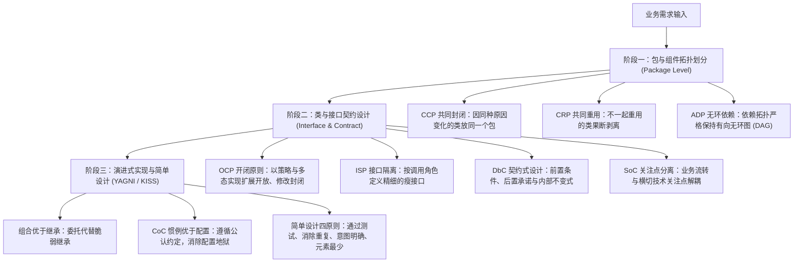

# Object-Oriented & Evolutionary Design Guide

本技能融合马丁·福勒的**演进式设计 (Evolutionary Design)**、Uncle Bob 的**组件架构原则**与酷壳（陈皓）高阶设计心法，指导系统在中观（包/组件）与微观（类/接口）维度的结构设计与建模。

---

## 1. 核心设计哲学：分层演进与契约解耦

---

## 2. 常用架构设计三步走流程

### 阶段一：包与组件拓扑划分 (中观架构)
1. **防霰弹式修改（CCP 共同封闭）**：将概念紧密、大概率因同一类业务变更而同时修改的类聚集在同一个包内。
2. **包瘦身与依赖隔离（CRP 共同重用）**：如果包内某些工具类/辅助类没有被一起重用，果断抽取到独立的细粒度子包。
3. **依赖无环验证（ADP 无环依赖）**：
   - 检查包依赖拓扑是否存在闭环（如 `A -> B -> C -> A`）；
   - 若出现循环，通过**依赖倒置 (DIP)** 反转依赖，或**提取公共抽象包**消除环路。
- 详见：[包与组件划分设计原则](./references/component_and_package.md)

### 阶段二：类与接口契约定义 (微观模型)
1. **接口精简与隔离（ISP）**：从调用方的角色定义接口（Role Interface），避免大而全的胖接口。
2. **扩展开放与修改封闭（OCP）**：预判多变业务逻辑，提取为 Strategy 接口，核心调度代码不再频繁改动。
3. **契约化约束（DbC）**：
   - **前置条件**：明确入参校验边界，不满足直接 Fail-Fast；
   - **后置条件**：明确输出状态承诺（如非空集合）；
   - **状态不变式**：维持核心领域状态合法性。
- 详见：[接口契约与高级设计原则](./references/interface_and_contract.md)

### 阶段三：演进式落地与简单设计
1. **拒绝 BDUF（过度预先设计）**：遵循 YAGNI，只设计当前必须的抽象，消除“夸夸其谈未来性”。
2. **关系抉择**：严格推行“组合优于继承”，通过“隐藏委托”遵守迪米特法则。
3. **惯例优于配置（CoC）**：遵循主流工程目录与命名约定，避免海量冗余配置文件。
- 详见：[面向对象设计准则深度解析](./references/design_principles.md)
