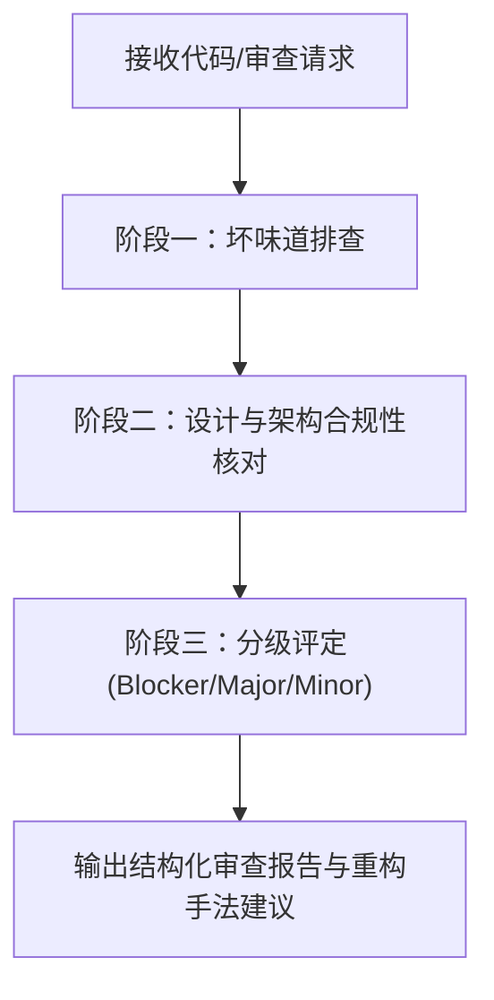

# 代码审查与坏味道诊断指南

本技能为代码审查提供工业级标准诊断流程，以马丁·福勒《重构》第 3 章的 22 种代码坏味道为核心依据。

---

## 1. 审查工作流



### 阶段一：坏味道排查
对照坏味道清单，逐一筛查代码是否存在设计腐化迹象：
- 详细坏味道定义、表现与治疗手法查阅：[22种代码坏味道手册](./references/code_smells.md)
- 快速核查清单：[审查快速核对表](./references/review_checklist.md)

### 阶段二：设计与架构合规性核对
1. **单一职责 (SRP)**：类或模块是否被多种不同原因修改？
2. **依赖合理性**：是否存在循环依赖、过度耦合的消息链或特征依恋？
3. **可测性**：代码是否容易编写自动化单元测试？是否存在难以模拟的全局状态或隐式副作用？

### 阶段三：分级输出报告
审查报告必须结构化，包含以下要素：
1. **问题概述**：发现的关键质量缺陷及风险。
2. **坏味道清单**：
   - **[Blocker/Major]**：严重影响可维护性、并发安全、高耦合（如霰弹式修改、重复复杂逻辑、大上帝类）。
   - **[Minor/Style]**：局部优化项（如参数过多、魔法数、缺少卫语句）。
3. **精准改进方案**：针对每个坏味道，给出《重构》中对应的标准手法（如 `Extract Method (6.1)`、`Replace Conditional with Polymorphism (9.6)`）及示例。

---

## 2. 审查报告模板样例

```markdown
### 🔍 代码审查报告

#### 一、 总体评价
代码实现了基础业务功能，但存在局部圈复杂度过高、职责未分离的坏味道，建议按以下方案分步重构。

#### 二、 发现的坏味道与缺陷
1. **【Major】3.5 Divergent Change（发散式变化）**
   - **位置**：`OrderProcessor.java` 第 45-120 行
   - **问题**：`OrderProcessor` 既负责订单状态流转，又直接处理微信/支付宝支付网关细节，违反单一职责。
   - **推荐手法**：采用 `Extract Class (7.3)` 提炼出独立的 `PaymentGateway` 组件。

2. **【Major】3.10 Switch Statements（条件分支惊悚现身）**
   - **位置**：`calculateDiscount()` 函数
   - **问题**：使用嵌套 switch 判断 VIP 级别，未来新增级别需全量修改。
   - **推荐手法**：采用 `Replace Conditional with Polymorphism (9.6)` 以策略或多态类代替。

3. **【Minor】3.4 Long Parameter List（过长参数列）**
   - **位置**：`createReport(dateStart, dateEnd, filterType, isVip, outputFormat)`
   - **推荐手法**：采用 `Introduce Parameter Object (10.9)` 引入 `ReportQueryCriteria` 对象。
```
