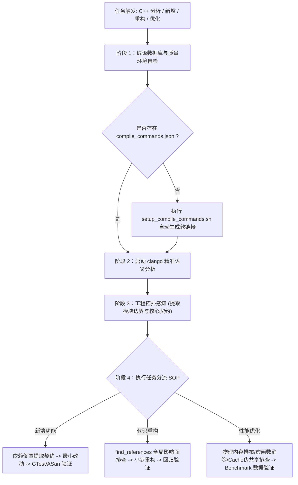

# C++ 代码智能分析与架构感知专家指南 (cpp-code-intelligence)

本技能为 Antigravity Agent 提供**工业级 C++ 工程全生命周期智能分析与开发支持**，杜绝 Naive RAG（纯文本检索）在 C++ 复杂工程（宏展开、模板元编程、隐式转换、头文件展开）中的幻觉问题，实现真正“编译期精确度”的代码认知。

---

## 1. 核心架构与自动化工作流



---

## 2. 工具链支持与 MCP 语义工具

本环境已预装 **`clangd-18`**，并配置了 **`clangd` MCP Server**（位于 `~/.gemini/config/mcp_config.json`）。Agent 在分析 C++ 代码时，应优先调用以下原生能力：

| 语义分析能力 | 对应 MCP 工具 / 操作 | 核心用途 |
| :--- | :--- | :--- |
| **跳转定义** | `find_definition` | 精准定位宏定义、类定义、函数实现，穿透头文件迷宫 |
| **查找所有引用** | `find_references` | 重构与改动前进行**全局影响面分析 (Impact Analysis)** |
| **函数调用链** | `get_call_hierarchy` | 分析函数的调用者 (Incoming Calls) 与被调用者 (Outgoing Calls) |
| **类继承拓扑** | `get_type_hierarchy` | 识别 Base Classes 与 Derived Classes，掌握多态继承体系 |
| **文档符号树** | `get_document_symbols` | 极速提取源文件/头文件的所有类、方法、成员签名 |
| **实时编译诊断** | `get_diagnostics` | 直接获取 Clang 编译前端给出的错误、告警与类型不匹配提示 |
| **工作区符号搜索**| `workspace_symbol_search`| 全局快速定位类名、接口名、枚举名 |

---

## 3. 标准作业流程 (SOP)

### 场景 A：分析 C++ 代码库与梳理架构
1. **执行项目快速体检**：
   ```bash
   bash ~/.gemini/config/skills/cpp-code-intelligence/scripts/inspect_project.sh .
   ```
2. **就绪编译数据库**：
   ```bash
   bash ~/.gemini/config/skills/cpp-code-intelligence/scripts/setup_compile_commands.sh .
   ```
3. **架构拓扑提炼**：
   - 梳理顶层头文件包含关系与核心数据流。
   - 若项目无架构说明，建议输出或更新 `ARCHITECTURE.md`，明确标记各核心模块的边界职责。

---

### 场景 B：增加新功能 (Feature Addition)
1. **接口契约识别**：
   - 通过 `find_definition` 与 `get_type_hierarchy` 找到扩展点接口（如纯虚抽象基类）。
   - 确认生命周期管理方式（`std::shared_ptr` / `std::unique_ptr` / 引用）与并发线程所有权。
2. **最小侵入设计**：
   - 严格遵循开闭原则（OCP）与依赖倒置（DIP）。
   - 优先通过组合或派生扩展，严禁随意在基础头文件中增加重量级依赖。
3. **TDD 与质量闭环**：
   - 依据 `cpp-testing` 编写 GoogleTest/Catch2 测试用例。
   - 开启 ASan/UBSan 消毒剂进行内存与未定义行为验证。
   - 严格遵循 `RULE[user_global]`：严禁私自自动 commit，必须向用户汇报改动。

---

### 场景 C：重构代码 (Refactoring)
1. **全局影响面调查 (Impact Analysis)**：
   - 准备重构某个核心方法或类之前，**必须**先调用 `find_references` 统计全局所有调用方。
   - 评估改动是属于“模块内私有重构”还是“公开公共接口破坏”。
2. **小步快跑安全重构**：
   - 联动 `refactoring` 技能，严格按照马丁·福勒 68 种标准手法实施（如提取函数、重命名、以多态取代条件表达式）。
   - 改动后调用 `get_diagnostics` 确保零编译警告与零破坏。
   - 运行既有测试用例，确保行为 100% 保真。

---

### 场景 D：性能与底层优化 (Performance & Optimization)
1. **数据与事实驱动**：
   - 严禁凭空盲目猜测瓶颈，依据 `RULE[user_global]` 编写最小可独立运行的 Benchmark Demo 测量基准数据。
2. **底层物理设计排查**：
   - 联动 `systems-data-design`：排查结构体内存对齐（Padding）、Cache Line 伪共享（并发高频变量添加 `alignas(64)`）。
   - 联动 `cpp-idioms` 与 `effective-cpp`：排查隐式拷贝构造（推行 `std::move` 与完美转发）、将无状态虚函数优化为 CRTP（静态多态）以消除 vtable 间接寻址开销。
3. **对比验证**：
   - 提供优化前后的实测数据对比（吞吐量、延时、内存占用峰值）。

---

## 4. 深度参考手册与脚本一览

### 4.1 核心参考手册 (Progressive Disclosure)
- [编译数据库与 Clangd 配置深度指南](./references/compilation_database_guide.md)：CMake、Ninja、Bear 导出细节与 Clangd 后台索引配置。
- [智能体 C++ 工程 SOP 与影响面分析](./references/sop_and_impact_analysis.md)：详细的新增功能挂载、重构影响面分析与性能基准测试规范。

### 4.2 辅助自动化脚本
- **编译数据库就绪脚本**：
  `~/.gemini/config/skills/cpp-code-intelligence/scripts/setup_compile_commands.sh`
- **项目架构快速探查脚本**：
  `~/.gemini/config/skills/cpp-code-intelligence/scripts/inspect_project.sh`
- **代码质量与增量静态检查**：
  `~/.gemini/config/skills/cpp-code-quality/scripts/run_check.sh --mode=diff`
