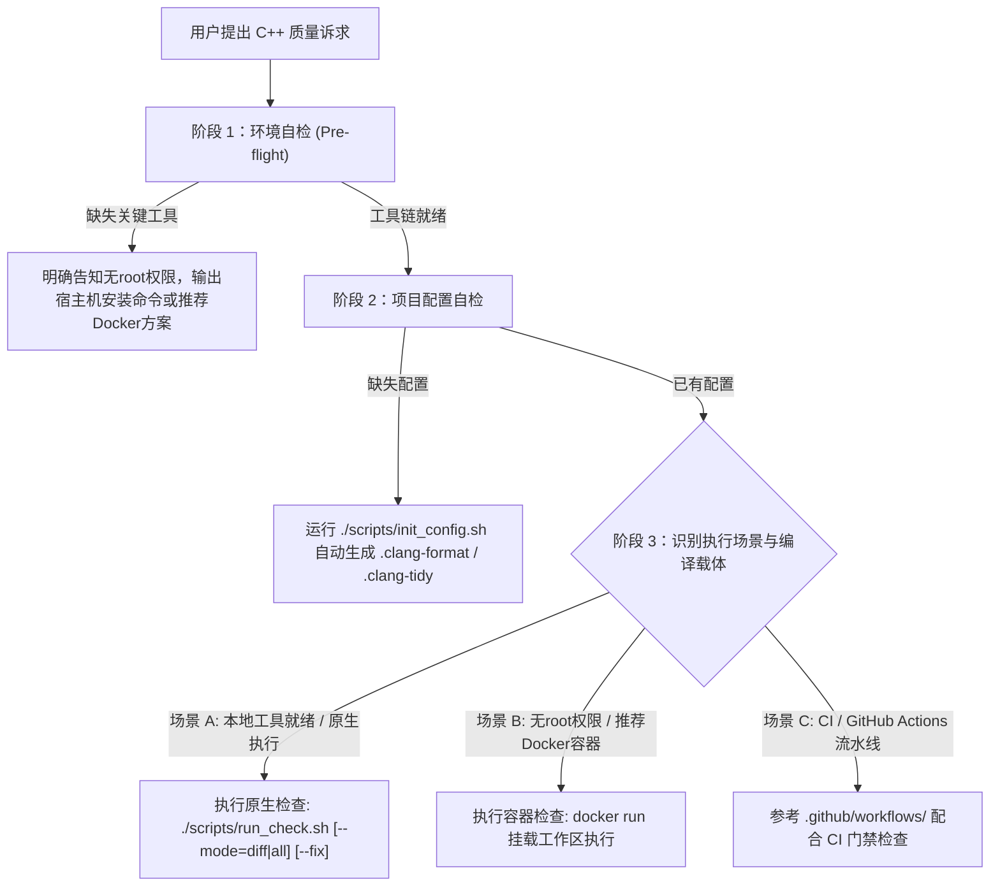

# C++ 代码质量、格式化与静态检查指南

本技能专为现代 C++ 工程提供全套自动化质量守护，涵盖**环境自检、权限防死锁、项目配置初始化、增量代码检查与全量静态分析**。

---

## 1. 核心工作流与场景决策树



---

## 2. 行为准则与权限防御原则（CRITICAL）

1. **严禁盲目执行交互式 sudo**：
   - 在非特权沙箱或无免密 sudo 的环境中，**严禁私自尝试调用 `sudo apt-get` 或 `sudo yum`**。
   - 否则会引发交互式密码输入挂起，导致任务假死。
2. **主动告知与实证输出**：
   - 当检测到环境缺少 `clang-format`、`clang-tidy` 或 `cppcheck` 时，**必须第一时间主动明确告知用户**：
     > *“当前环境缺少 root 权限，无法自动安装依赖。请您在宿主机终端手动执行安装命令，或使用 Docker 容器方案。”*
   - 同时附带精确、单行可直接复制的包管理器安装命令。
3. **构建环境感知（Native vs Docker vs CI）**：
   - 复杂 C++ 项目可能采用宿主机本地编译、Docker 容器交叉编译、或 GitHub Actions 云端构建；
   - 检查代码前切勿盲目覆写 CMake 配置或破坏现有的 build 缓存。

---

## 3. 常见场景执行指南

### 场景 1：检查工具链环境 (Pre-flight)
当用户要求 *“检查代码质量工具链”* 或正式检查前：
1. 执行内置自检脚本：
   ```bash
   ./.agents/skills/cpp-code-quality/scripts/env_check.sh
   ```
2. 若工具缺失且无 root 权限，明确汇报给用户：
   * Ubuntu / Debian 宿主机安装：`sudo apt-get update && sudo apt-get install -y clang-format clang-tidy cppcheck`
   * 或提示用户直接通过 Docker 容器免安装执行。

### 场景 2：初始化新项目或补全配置
当项目根目录缺少 `.clang-format` 或 `.clang-tidy` 时：
1. 执行初始化脚本：
   ```bash
   ./.agents/skills/cpp-code-quality/scripts/init_config.sh .
   ```
2. 自动生成：
   * `.clang-format`：Google 风格，右对齐指针（`char *p`），行宽 120 列；
   * `.clang-format-ignore`：自动排除 `third_party/`, `build/`, `vendor/`；
   * `.clang-tidy`：开启 `bugprone-*`, `cppcoreguidelines-*`, `performance-*` 等高信噪比规则，并通过 `HeaderFilterRegex` 屏蔽三方库头文件。

### 场景 3：老项目增量检查（只检查新代码）
当用户要求 *“这是老项目，只查刚改动的代码”*、*“只对新增代码执行检查”* 时：
1. 增量排查：
   ```bash
   # 仅检查 git diff 变动文件与修改行
   ./.agents/skills/cpp-code-quality/scripts/run_check.sh --mode=diff
   ```
2. 增量自动排版修复：
   ```bash
   ./.agents/skills/cpp-code-quality/scripts/run_check.sh --mode=diff --fix
   ```

### 场景 4：全量项目扫描与格式化
当用户要求 *“对整个项目执行全量静态分析与格式化”* 时：
1. 检查格式并应用排版：
   ```bash
   ./.agents/skills/cpp-code-quality/scripts/run_check.sh --mode=all --fix
   ```
2. 若宿主机未安装，采用 Docker 容器方式（零宿主污染）：
   ```bash
   docker run --rm -v "$(pwd):/src" -w /src ghcr.io/muttleyxd/clang-tools:18 clang-format -i $(git ls-files '*.cpp' '*.h' | grep -v 'third_party/')
   ```

---

## 4. 核心参考手册

- [代码格式化规范 (.clang-format)](./references/clang_format_spec.md)：Google C++ 规范基线、右对齐指针与 120 列宽深度解析。
- [静态检查高信噪比规则集 (.clang-tidy)](./references/clang_tidy_rules.md)：内存安全、性能隐患、现代 C++ 最佳实践与误报抑制。
- [增量检查与三方库隔离机制](./references/incremental_and_thirdparty.md)：`clang-format-diff` 原理、`HeaderFilterRegex` 与 CMake `SYSTEM` 关键字。
