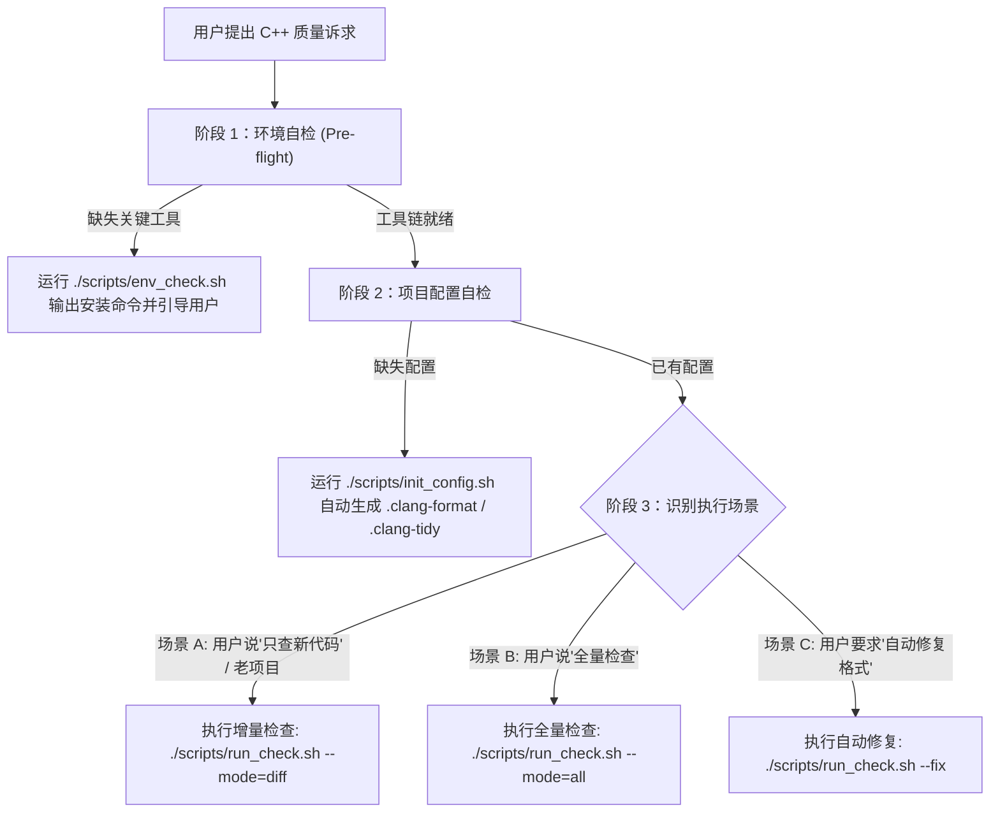

# C++ Code Quality, Formatting & Static Analysis Guide

本技能专为现代 C++ 工程提供全套自动化质量守护，涵盖**环境自检、项目配置初始化、增量代码检查与全量静态分析**。

---

## 1. 核心工作流与场景决策树 (Workflow)



---

## 2. 常见场景执行指南

### 场景 1：检查工具链环境
当用户问 *“检查一下我环境里装没装 C++ 工具”* 或执行检查前自检：
1. 执行内置脚本：
   ```bash
   ./.agents/skills/cpp-code-quality/scripts/env_check.sh
   ```
2. 若缺少工具，直接将输出的发行版安装命令清晰反馈给用户（如 Ubuntu: `sudo apt-get install -y clang-format clang-tidy cppcheck cmake`）。

### 场景 2：初始化新项目或补全配置
当用户要求 *“初始化 C++ 代码风格与检查配置”* 或项目根目录缺少配置文件时：
1. 执行初始化脚本：
   ```bash
   ./.agents/skills/cpp-code-quality/scripts/init_config.sh .
   ```
2. 自动生成：
   * `.clang-format`：Google 风格，右对齐指针（`char *p`），行宽 120 列；
   * `.clang-format-ignore`：自动排除 `third_party/`, `build/`, `vendor/`；
   * `.clang-tidy`：开启 `bugprone-*`, `cppcoreguidelines-*`, `performance-*` 等高信噪比规则，并通过 `HeaderFilterRegex` 屏蔽三方库头文件。

### 场景 3：老项目增量检查（只检查新代码）
当用户要求 *“这是老项目，只查刚改动的代码”*、*“只对新增代码执行检查”* 时：
1. 执行增量脚本：
   ```bash
   # 仅检查 git diff 变动文件与修改行
   ./.agents/skills/cpp-code-quality/scripts/run_check.sh --mode=diff
   ```
2. 若需自动修复格式：
   ```bash
   ./.agents/skills/cpp-code-quality/scripts/run_check.sh --mode=diff --fix
   ```

### 场景 4：全量项目扫描
当用户要求 *“对整个项目执行全量静态分析”* 时：
```bash
./.agents/skills/cpp-code-quality/scripts/run_check.sh --mode=all
```

---

## 3. 核心参考手册

- [代码格式化规范 (.clang-format)](./references/clang_format_spec.md)：Google C++ 规范基线、右对齐指针与 120 列宽深度解析。
- [静态检查高信噪比规则集 (.clang-tidy)](./references/clang_tidy_rules.md)：内存安全、性能隐患、现代 C++ 最佳实践与误报抑制。
- [增量检查与三方库隔离机制](./references/incremental_and_thirdparty.md)：`clang-format-diff` 原理、`HeaderFilterRegex` 与 CMake `SYSTEM` 关键字。
