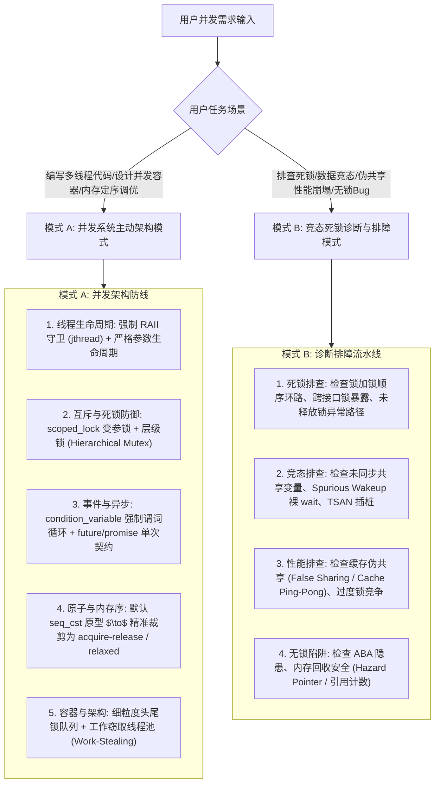

# C++ 高性能并发编程与多线程架构指南

本技能提炼自 ISO C++ 并发标准委员会核心专家 Anthony Williams 的权威圣经 **《C++ Concurrency in Action》（第2版）**，系统整理现代 C++（C++11/14/17/20）从线程生命周期、同步原语、底层内存模型与原子定序，到锁基与无锁数据结构设计、线程池架构及并发排障测试的全栈工程规范。

---

## 1. 核心执行引擎

---

## 2. 模式 A：现代 C++ 并发主动设计清单

在编写任何多线程代码或设计并发模块时，**无需用户提醒，必须第一时间主动落实以下 5 大并发铁律**：

1. **线程生命周期强制 RAII 守护**：
   - 严禁裸 `std::thread` 随意 `detach()` 或脱离作用域析构（触发 `std::terminate`）；
   - 强制使用 C++20 `std::jthread` 或基于 RAII 的 `joining_thread` 包装器；
   - 传入线程函数的参数注意深浅拷贝，严禁向异步线程传递悬空局部引用/指针，详见 [references/thread_management_and_raii.md](./references/thread_management_and_raii.md)。
2. **互斥锁与死锁全自动防御**：
   - 多锁并发必须使用 `std::scoped_lock`（C++17）或 `std::lock` 一次性加锁，彻底杜绝死锁循环；
   - 复杂的系统级模块采用层级锁（Hierarchical Mutex）在编译期或运行期强制单向加锁顺序；
   - 读多写少场景采用 `std::shared_mutex` + `std::shared_lock`；一次性安全初始化采用 `std::call_once`，详见 [references/mutexes_locks_and_deadlock_defense.md](./references/mutexes_locks_and_deadlock_defense.md)。
3. **条件变量与异步任务标准化**：
   - `std::condition_variable` 的 `wait()` **必须传递谓词 Lambda 循环判断**（`cv.wait(lock, []{ return ready; });`），严禁无谓词裸调用以防御伪唤醒（Spurious Wakeup）；
   - 一次性操作优先选用 `std::future` / `std::promise` / `std::packaged_task` 代替低级轮询，详见 [references/synchronization_primitives_and_async.md](./references/synchronization_primitives_and_async.md)。
4. **内存模型与原子定序精准裁剪**：
   - 原型验证阶段优先选用 `std::memory_order_seq_cst`（顺序一致性）确保逻辑正确；
   - 极致吞吐优化阶段，按需求精准降级为 `acquire-release` 构造 Happens-Before 同步链，仅对纯计数器使用 `memory_order_relaxed`；
   - 彻底防范指令重排与内存可见性陷阱，详见 [references/memory_model_and_atomic_orderings.md](./references/memory_model_and_atomic_orderings.md)。
5. **高性能并发数据结构与线程池**：
   - 拒绝大锁锁全表；队列采用独立 `head_mutex` 与 `tail_mutex` 及虚节点（Dummy Node）分离入队出队竞争；
   - 线程池采用任务窃取（Work-Stealing）架构平衡核间负载，配合 `alignas(64)` 消除伪共享（False Sharing），详见 [references/concurrent_data_structures.md](./references/concurrent_data_structures.md) 与 [references/performance_patterns_and_thread_pools.md](./references/performance_patterns_and_thread_pools.md)。

---

## 3. 模式 B：并发缺陷与竞态死锁排障模式

当用户询问“为什么程序偶尔卡死死锁”、“为什么并发测试偶现内存崩溃”、“多线程吞吐为什么随着核数增加反而下降”时，执行以下诊断流：

1. **死锁循环诊断（Deadlock Cycles）**：
   - 检查是否存在交叉加锁时序（线程 A 锁 $L_1 \to L_2$；线程 B 锁 $L_2 \to L_1$）；
   - 检查持有互斥锁期间是否调用了不可信的用户回调（外部扩展代码在回调中再次尝试获取内部锁）；
   - 提供 `std::scoped_lock` 批量原子加锁或层级锁重构方案。
2. **伪唤醒与信号丢失诊断（Spurious Wakeup & Lost Wakeup）**：
   - 检查 `condition_variable::wait` 是否脱离了互斥锁保护，或未配合共享条件变量谓词检查；
   - 检查 `notify_one()` 时机：若唤醒前已修改共享状态，确保等待线程未错过通知。
3. **性能伪共享与缓存颠簸诊断（False Sharing & Cache Ping-Pong）**：
   - 检查跨线程高频读写变量是否位于同一 Cache Line（通常 64 字节）；
   - 重构为 `alignas(std::hardware_destructive_interference_size)` 隔离热点字段。
4. **无锁内存回收与 ABA 诊断**：
   - 检查 CAS 操作 `compare_exchange_weak` 是否防御了 ABA 问题；
   - 检查节点释放时机，引入 Hazard Pointer（风险指针）或双字引用计数确保读取线程退出前节点内存不被覆写。
5. **TSAN 自动化检测指南**：
   - 指导用户使用 `-fsanitize=thread -g` 重新编译并执行测试用例，准确定位竞态堆栈，详见 [references/concurrency_testing_and_sanitizers.md](./references/concurrency_testing_and_sanitizers.md)。

---

## 4. 核心参考手册与实证代码

- [线程管理与 RAII 守卫](./references/thread_management_and_raii.md)：`jthread`、生命周期管理、参数传递陷阱与硬件并发数估算。
- [互斥原语、锁策略与死锁防御](./references/mutexes_locks_and_deadlock_defense.md)：`scoped_lock`、`shared_mutex`、层级锁设计、`call_once` 安全单例。
- [同步原语、条件变量与异步任务](./references/synchronization_primitives_and_async.md)：条件变量谓词守卫、Spurious Wakeup 机制、Future/Promise 管道模式。
- [内存模型、原子操作与内存定序](./references/memory_model_and_atomic_orderings.md)：6 种内存定序全解、Happens-Before 拓扑、Acquire-Release 同步链、Fences 内存屏障。
- [并发数据结构设计（锁基与无锁）](./references/concurrent_data_structures.md)：细粒度锁队列、锁基分桶哈希表、无锁栈/队列、ABA 防御与 Hazard Pointer。
- [并发性能模式与工作窃取线程池](./references/performance_patterns_and_thread_pools.md)：Cache 伪共享防护、乒乓效应治理、Work-Stealing 线程池、C++17 并行算法。
- [并发排障、死锁检测与 TSAN 实战](./references/concurrency_testing_and_sanitizers.md)：ThreadSanitizer (TSAN) 使用指南、竞态分析与单元测试压力网。
- [C++20 并发可编译实证代码库](./examples/)：
  - [thread_safe_queue.hpp](./examples/thread_safe_queue.hpp)：基于细粒度分离锁（Head/Tail 双锁）与 Dummy 节点的工业级线程安全队列。
  - [lock_free_stack.hpp](./examples/lock_free_stack.hpp)：基于原子 CAS 与引用计数/危险指针回收机制的无锁并发栈。
  - [work_stealing_thread_pool.hpp](./examples/work_stealing_thread_pool.hpp)：现代工作窃取（Work-Stealing）多核高吞吐线程池实证。
