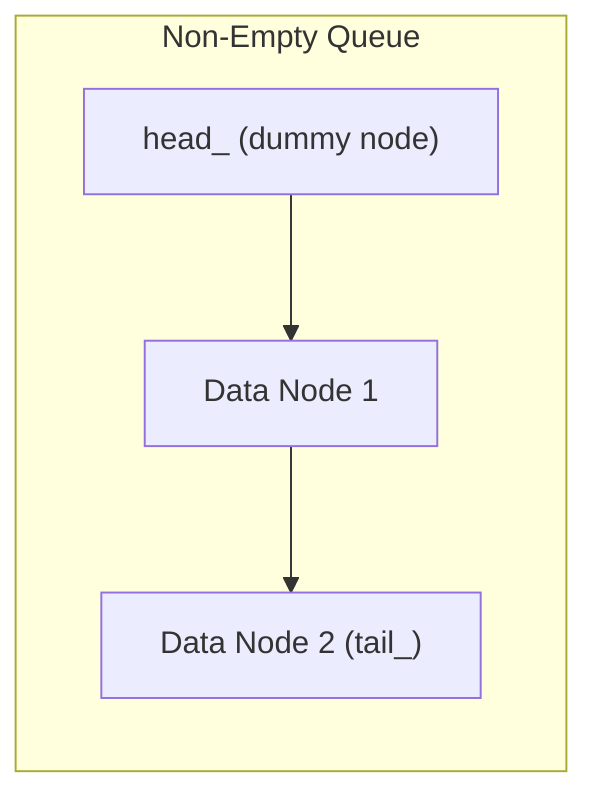

# Concurrent Data Structures: Lock-Based and Lock-Free

This reference details the design, exception safety, and memory reclamation patterns for concurrent containers based on Chapters 6 and 7 of *C++ Concurrency in Action*.

---

## 1. Exception Safety & Interface Design in Concurrent Containers

In standard STL, `std::stack::pop()` returns `void`, and `top()` inspects the element.
In concurrent environments, this two-step interface (`if (!s.empty()) { auto val = s.top(); s.pop(); }`) introduces an immediate **time-of-check to time-of-use (TOCTOU) race condition**: another thread can pop the element between `top()` and `pop()`.

However, if `T pop()` returns by value, and the copy constructor of `T` throws an exception *after* the node is removed from the internal container, the element is permanently lost!

### The 3 Solutions
1. **Pass by Reference**: `void pop(T& value);` (requires default/existing instance).
2. **Return `std::shared_ptr<T>`**: Allocate shared pointer *before* modifying data structure; copying the pointer never throws.
3. **Return by Value with noexcept move**: `T pop();` where `T` is `std::is_nothrow_move_constructible_v<T>`.

---

## 2. Lock-Based Design: Fine-Grained Dual-Lock Queue

A naive thread-safe queue with a single `mutex` serializes all operations: a slow producer completely blocks consumers even though they access opposite ends of the queue.

### Anthony Williams' Solution: Separate Head & Tail Mutexes with Dummy Node
By keeping an invariant that the queue **always contains at least one dummy node**, `head_` and `tail_` never point to the same node in a non-empty queue, allowing pushes and pops to execute 100% concurrently!



### Invariants Maintained
- `tail_->next == nullptr`.
- `head_` points to the dummy node (whose data is already popped or null).
- `push()` locks only `tail_mutex_`.
- `pop()` locks only `head_mutex_`.
- When the queue transitions between empty and 1 element, head and tail pointers are carefully synchronized without deadlock.

---

## 3. Lock-Based Lookup Table (Concurrent Hash Map)

Instead of a single global lock, partition the key space into $N$ buckets (typically a prime number like 19 or 31). Each bucket possesses its own independent `std::shared_mutex`:

- Reads on bucket $K$ acquire `shared_lock` on bucket $K$'s mutex.
- Writes on bucket $K$ acquire `unique_lock` on bucket $K$'s mutex.
- Operations on different buckets execute fully in parallel with zero lock contention!

---

## 4. Lock-Free Data Structures & Guidelines

### Levels of Freedom
- **Blocking**: Thread execution can be indefinitely suspended by another thread holding a lock.
- **Lock-Free**: At least one thread is guaranteed to make forward progress in a finite number of steps (system-wide progress guarantee).
- **Wait-Free**: *Every* thread makes progress in a bounded number of steps, regardless of the actions of other threads.

### The Memory Reclamation Problem
In a lock-free stack or queue, popping a node atomically unlinks it from the head pointer via CAS:
```cpp
Node* old_head = head_.load();
while (old_head && !head_.compare_exchange_weak(old_head, old_head->next));
```
**You cannot simply execute `delete old_head;`!**
Another concurrent reader thread may have loaded `old_head` right before the CAS, paused, and is about to dereference `old_head->next`. Deleting it causes a use-after-free crash!

### Memory Reclamation Techniques

#### 1. Hazard Pointers
Each reading thread publishes the address of the node it is currently dereferencing into a thread-local "Hazard Pointer".
When a thread pops a node, it adds the node to a "retire list". The retire list periodically scans all threads' hazard pointers and deletes only nodes that are *not* currently protected by any thread.

#### 2. Split Reference Counting
Each node contains two reference counts:
- An internal count (references from internal links).
- An external count (number of threads currently holding a reference to the node).
When both counts drop to zero, the node is safely deleted.

---

## 5. The ABA Problem

### Manifestation
1. Thread 1 reads top pointer $A$ from a lock-free stack.
2. Thread 1 is preempted.
3. Thread 2 pops $A$, pops $B$, deletes $B$, then pushes $A$ back onto the stack.
4. Thread 1 resumes and executes `compare_exchange(A, A->next)`.
5. Since top is still $A$, the CAS succeeds, but $A \to next$ is now pointing to freed memory $B$!

### Defenses
- **Tagged Pointers / Version Counters**: Pack an integer counter with the pointer (`std::atomic<TaggedPointer>`) so the address and generation increment together: `(A, 1) -> (A, 2)`.
- **Hazard Pointers**: Prevent $A$ from being freed and reallocated while Thread 1 holds a reference to it.
