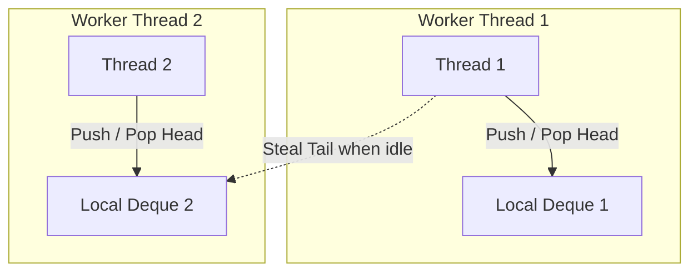

# Performance Patterns, Thread Pools, and Parallel Algorithms

This reference details multithreaded performance optimization, cache line false sharing mitigation, work-stealing thread pools, and C++17 parallel execution policies based on Chapters 8, 9, and 10 of *C++ Concurrency in Action*.

---

## 1. Factors Degrading Multithreaded Performance

### 1. Thread Oversubscription
Spawning significantly more threads than physical CPU cores forces the OS scheduler to constantly preempt threads, incurring:
- Heavy kernel context-switch overhead (saving/restoring registers, TLB flushes).
- Cold CPU instruction and data caches.

### 2. Cache Line False Sharing & Cache Ping-Pong
Modern CPUs maintain cache coherence at the granularity of a **Cache Line** (almost universally 64 bytes on x86-64 and ARM64).

If thread A updates variable `X` and thread B updates variable `Y`, and both variables happen to reside within the **same 64-byte cache line**, the hardware coherence protocol (e.g., MESI) is forced to invalidate the entire cache line across CPU cores on every single write!
This creates devastating **Cache Ping-Pong**, destroying scalability even though the code contains zero lock contention.

### Defense: Physical Cache Line Alignment
In C++17 and later, use standard interference attributes:

```cpp
#include <new>

struct alignas(std::hardware_destructive_interference_size) ThreadLocalAccumulator {
    unsigned long count{0}; // Isolated in its own 64-byte line
};

// Safe fallback for compilers without hardware_destructive_interference_size:
struct alignas(64) SafeWorkerMetric {
    uint64_t operations{0};
};
```

---

## 2. Work-Stealing Thread Pool Architecture

A simple thread pool with a single global queue and a single mutex becomes a severe scalability bottleneck beyond 4–8 cores due to lock contention on every task pop.

### The Work-Stealing Solution
1. **Thread-Local Deque**: Every worker thread maintains its own double-ended task queue (`std::deque`).
2. **Local Processing (LIFO)**: A worker pushes newly spawned tasks to the **head** of its own deque and pops tasks from the head (LIFO order maximizes CPU cache locality).
3. **Work-Stealing (FIFO)**: When a worker runs out of local tasks, it attempts to steal tasks from the **tail** of another worker's deque (FIFO order minimizes contention with the owner thread).



---

## 3. C++17 Parallel Standard Algorithms

C++17 added execution policies to `<execution>` for over 60 standard STL algorithms:

```cpp
#include <algorithm>
#include <execution>
#include <numeric>
#include <vector>

void demonstrate_parallel_algorithms(std::vector<double>& data) {
    // 1. Sequential execution (standard behavior)
    std::sort(std::execution::seq, data.begin(), data.end());

    // 2. Parallel execution (multi-threaded across CPU cores)
    std::sort(std::execution::par, data.begin(), data.end());

    // 3. Parallel and Vectorized execution (multi-threaded + SIMD vectorization)
    // CRITICAL: Operations must NOT allocate memory or acquire locks (vectorization safety!)
    std::sort(std::execution::par_unseq, data.begin(), data.end());

    // 4. Parallel Reduction (replaces std::accumulate which is strictly sequential)
    double sum = std::reduce(std::execution::par, data.begin(), data.end(), 0.0);
}
```

### Guidelines for Parallel Algorithms
- Use `std::reduce` instead of `std::accumulate` (which requires sequential order).
- Under `std::execution::par_unseq`, never acquire mutexes, call `malloc`, or use thread-local storage, as steps may interleave on the same thread via SIMD vector registers.
