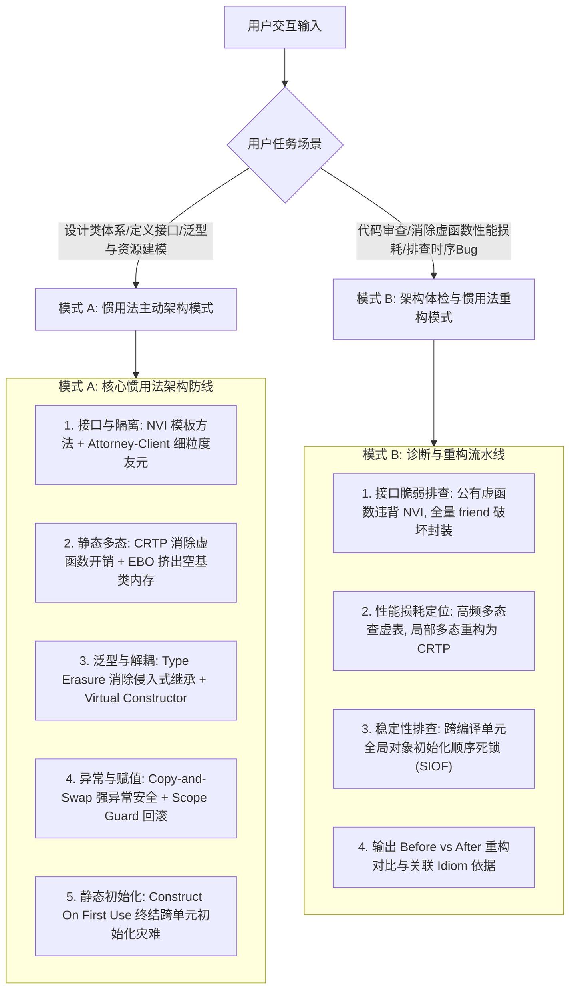

# C++ 经典惯用法与高级模式设计指南

本技能提炼自全球 C++ 社区智慧结晶 **《More C++ Idioms》(Wikibooks)**，系统整理了 75+ 工业级 C++ 经典惯用法与设计模式，覆盖接口契约、面向对象封装、模板静态多态、类型擦除、资源管理与异常安全。

---

## 1. 核心执行引擎

---

## 2. 模式 A：现代 C++ 惯用法主动设计清单

当用户要求设计类、封装组件或构建泛型库时，**无需用户提醒，必须在第一时间主动应用以下 5 大核心惯用法**：

1. **接口与实现绝对分离（NVI: Non-Virtual Interface Idiom）**：
   - **绝不暴露公有虚函数**；基类对外暴露公有非虚函数作为模板方法（Template Method），负责前置校验、日志追踪与后置审计；
   - 真正的定制多态行为下沉为 `private` 或 `protected` 虚函数供派生类重写，详见 [references/interface_and_encapsulation_idioms.md](./references/interface_and_encapsulation_idioms.md)。
2. **细粒度友元权限隔离（Attorney-Client Idiom）**：
   - 严禁直接使用 `friend class Target;` 将类的所有私有成员对外部全盘托出；
   - 强制引入专有中介 `Attorney` 类，仅为特定的 `Client` 暴露受限的私有接口，捍卫面向对象封装底线，详见 [references/interface_and_encapsulation_idioms.md](./references/interface_and_encapsulation_idioms.md)。
3. **零成本静态多态与空基类优化（CRTP & EBO）**：
   - 追求极致性能的高频调用路径，使用 CRTP（奇异递归模板模式）实现编译期静态派发，彻底消除虚函数指针（`vptr`）与虚函数表（`vtbl`）间接寻址开销；
   - 无状态的 Mixin 辅助基类依赖 EBO（Empty Base Optimization）实现 0 内存占用，详见 [references/crtp_metaprogramming_and_ebo.md](./references/crtp_metaprogramming_and_ebo.md)。
4. **非侵入式泛型值语义（Type Erasure Idiom）**：
   - 面对异构对象的多态存储与传递，拒绝强制要求继承公共基类；
   - 采用 Type Erasure（类型擦除）模式（外部值语义包装类 + 内部模板派生 Holder），实现类似 `std::function` 的灵活扩展能力，详见 [references/type_erasure_and_value_semantics.md](./references/type_erasure_and_value_semantics.md)。
5. **强异常安全与初始化时序保证（Copy-and-Swap & Construct On First Use）**：
   - 重载赋值运算符强制采用 Copy-and-Swap（按值传参生成副本 + `noexcept swap` 交换内部指针），天然获得强异常安全与自赋值安全；
   - 全局/静态单例强制采用 Construct On First Use（函数内局部静态变量），杜绝全局初始化顺序灾难，详见 [references/resource_lifecycle_and_exception_idioms.md](./references/resource_lifecycle_and_exception_idioms.md)。

---

## 3. 模式 B：代码坏味道与脆弱架构重构模式

当用户询问“这段 C++ 类的接口怎么设计更优雅”、“为什么多态调用成了性能瓶颈”、“为什么程序在 main 函数之前崩溃”时，执行以下诊断流：

1. **公有虚函数暴露诊断**：
   - 识别直接暴露的 `public virtual void process();`，指出其缺少基类拦截与前置/后置条件守护的能力；
   - 重构为 NVI 结构：公有非虚 `process()` 封装内部私有虚函数 `doProcess()`。
2. **初始化时序死锁/崩溃诊断（Static Initialization Order Fiasco）**：
   - 检查是否存在全局/静态变量跨 `.cpp` 相互依赖访问；
   - 重构为 Meyers Singleton（函数静态对象），将初始化延后至首次调用时刻。
3. **高频虚函数性能瓶颈诊断**：
   - 对数百万次/秒循环内的虚函数调用，评估多态类型是否在编译期已知；
   - 输出 CRTP 静态多态重构方案，将动态多态替换为内联友好的模板编译期单态展开。
4. **粗粒度友元破坏封装诊断**：
   - 识别大面积的 `friend class Subsystem;`；
   - 引入专有 Attorney 代理，仅暴露特定的私有辅助函数。

---

## 4. 核心参考手册与实证代码

- [接口契约与封装隔离惯用法](./references/interface_and_encapsulation_idioms.md)：NVI 模式、Attorney-Client 细粒度友元、Interface 纯虚接口与 Base-from-Member。
- [静态多态、元编程与内存优化](./references/crtp_metaprogramming_and_ebo.md)：CRTP 静态接口分派、EBO 空基类优化、SFINAE / Tag Dispatch。
- [类型擦除与高级值语义模式](./references/type_erasure_and_value_semantics.md)：Type Erasure 内部机制（手写 std::function 原理）、Virtual Constructor (clone)。
- [资源生命周期、异常安全与初始化](./references/resource_lifecycle_and_exception_idioms.md)：Copy-and-Swap 赋值、Scope Guard、Construct On First Use 消除 SIOF。
- [75+ 经典 C++ 惯用法全景演进对照表](./references/more_cpp_idioms_catalog.md)：Wikibooks 全量 75+ 惯用法在现代 C++ (C++11~20) 中的进化对照表。
- [C++20 可编译实证代码库](./examples/)：
  - [nvi_and_attorney_client.hpp](./examples/nvi_and_attorney_client.hpp)：NVI 模板方法前置后置校验 + Attorney-Client 受限友元实证。
  - [crtp_static_interface.hpp](./examples/crtp_static_interface.hpp)：CRTP 零成本静态接口分派 + C++20 `[[no_unique_address]]` 空基类优化实证。
  - [type_erasure_holder.hpp](./examples/type_erasure_holder.hpp)：手写 Concept/Model 3 层架构类型擦除与完整值语义实证。

