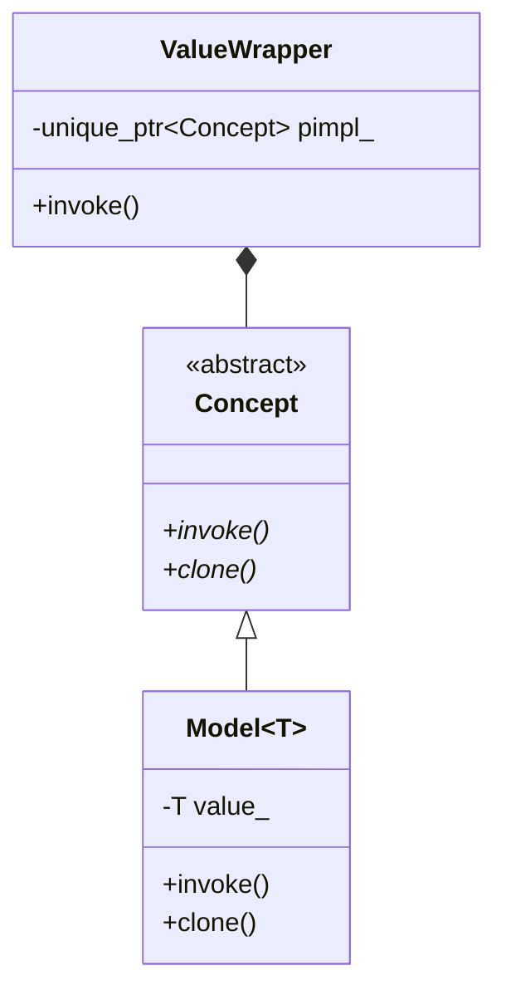

# Type Erasure and Value Semantics Idioms

This reference details the mechanics of **Type Erasure**, the **Virtual Constructor / Clone Idiom**, and value semantics architectures from *More C++ Idioms*.

---

## 1. Type Erasure Idiom

### Intent & Problem
Object-oriented runtime polymorphism requires intrusive inheritance: all types must inherit from a common base class (`Shape`, `Widget`), preventing external third-party classes or primitive types from participating without intrusive wrapping.

Conversely, generic templates provide non-intrusive duck-typing, but require templates to propagate everywhere, preventing heterogeneous collections (e.g., `std::vector<Shape>` cannot store mixed templates directly).

**Type Erasure** bridges this gap: it provides **non-intrusive runtime polymorphism with regular value semantics** (used by `std::function`, `std::any`, `std::move_only_function`).

---

### The Canonical 3-Tier Architecture



#### Tier 1: Internal Abstract Interface (`Concept`)
Declares pure virtual functions for all operations that the erased type must support, including cloning.

#### Tier 2: Templated Concrete Holder (`Model<T>`)
A class template derived from `Concept` that holds the concrete value `T` by value. It fulfills the virtual interface by forwarding calls to `T`'s member functions or free functions.

#### Tier 3: External Value Semantics Class (`ValueWrapper`)
The public-facing class that is **not** a template. It contains a smart pointer to `Concept` and exhibits normal value semantics (copyable, movable, default constructible).

---

### Handcrafted Implementation Example

```cpp
#include <iostream>
#include <memory>
#include <string>
#include <utility>

// External Value-Semantics Class
class Printable {
public:
    // Templated constructor accepts ANY type that satisfies the print contract
    template <typename T>
        requires (!std::is_same_v<std::decay_t<T>, Printable>)
    Printable(T value)
        : concept_(std::make_unique<Model<T>>(std::move(value))) {}

    // Copy Constructor via virtual clone
    Printable(const Printable& other)
        : concept_(other.concept_ ? other.concept_->clone() : nullptr) {}

    // Move Constructor & Assignments
    Printable(Printable&&) noexcept = default;
    Printable& operator=(Printable other) noexcept {
        concept_ = std::move(other.concept_);
        return *this;
    }

    void print() const {
        if (concept_) {
            concept_->do_print();
        }
    }

private:
    // Tier 1: Abstract Concept
    struct Concept {
        virtual ~Concept() = default;
        virtual void do_print() const = 0;
        virtual std::unique_ptr<Concept> clone() const = 0;
    };

    // Tier 2: Model<T>
    template <typename T>
    struct Model final : Concept {
        T value_;

        explicit Model(T val) : value_(std::move(val)) {}

        void do_print() const override {
            // Duck-typed: expects value_ to support operator<<
            std::cout << value_ << '\n';
        }

        std::unique_ptr<Concept> clone() const override {
            return std::make_unique<Model<T>>(value_);
        }
    };

    std::unique_ptr<Concept> concept_;
};
```

### Usage
```cpp
// Heterogeneous collection with VALUE semantics, NO base class needed!
std::vector<Printable> items;
items.push_back(42);
items.push_back(std::string("Hello Type Erasure"));
items.push_back(3.14159);

for (const auto& item : items) {
    item.print();
}
```

---

## 2. Virtual Constructor / Clone Idiom

### Intent & Problem
C++ constructors cannot be virtual because at the moment of construction, the dynamic type's vtable is not yet initialized. When you hold a base pointer (`Base*` or `std::unique_ptr<Base>`), you cannot create a deep copy of the exact derived type without knowing the concrete class.

### Solution
Provide a virtual `clone()` member function that delegates to the derived class's copy constructor, leveraging **covariant return types**:

```cpp
class Shape {
public:
    virtual ~Shape() = default;
    [[nodiscard]] virtual std::unique_ptr<Shape> clone() const = 0;
};

class Circle : public Shape {
public:
    explicit Circle(double radius) : radius_(radius) {}

    // Covariant return type (or returns std::unique_ptr<Circle>)
    [[nodiscard]] std::unique_ptr<Shape> clone() const override {
        return std::make_unique<Circle>(*this); // calls Circle's copy constructor
    }

private:
    double radius_;
};
```

---

## 3. Small Buffer Optimization (SBO) in Type Erasure

When wrapping lightweight callable objects, function pointers, or small structs, heap allocation (`std::make_unique<Model<T>>`) causes performance degradation and cache misses.

### Design Pattern
Allocate an inline byte array buffer (e.g., `alignas(std::max_align_t) std::byte storage_[32];`):
- If `sizeof(T) <= 32` and `std::is_nothrow_move_constructible_v<T>`: placement new into `storage_`.
- Otherwise: fallback to heap allocation (`operator new`).
- This technique is what powers high-performance production implementations of `std::function` and `std::string`.
