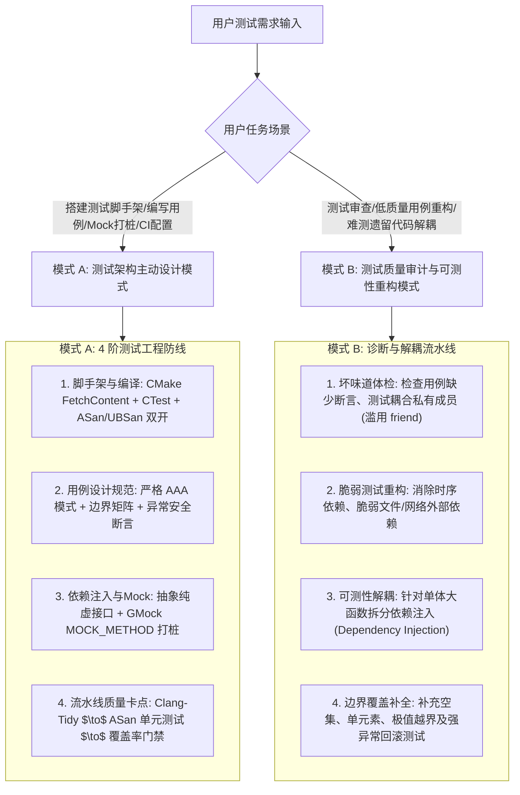

# C++ 单元测试、Mock 隔离与自动化质量流水线指南

本技能整合 **GoogleTest / GoogleMock 官方最佳实践**、**Catch2 现代 BDD 断言**、**C++ Core Guidelines 异常测试准则** 与 **LLVM Sanitizers** 工业标准，覆盖现代 C++ 测试脚手架构建、AAA 模式用例设计、依赖注入与 Mock 隔离、内存安全消毒及 CI/CD 质量卡点全流程。

---

## 1. 核心执行引擎

---

## 2. 模式 A：现代 C++ 测试主动设计清单

在为任何 C++ 项目设计测试或编写用例时，**无需用户提醒，必须第一时间主动落实以下 4 大核心规范**：

1. **工程脚手架与三消毒剂防护（C++17 Scaffolding & Sanitizers）**：
   - 以 **C++17** 为基线，通过 CMake `FetchContent` 声明式拉取 GoogleTest / Catch2（及按需拉取 RapidCheck），保持构建自包含；
   - 测试构建必须原生集成 CTest（`enable_testing()` 与 `add_test()`）；
   - Debug / Test 构建默认开启 **ASan + UBSan**（`-fsanitize=address,undefined -fno-omit-frame-pointer`）；多线程/并发模块额外配置独立 **TSan** 构建（`-DENABLE_TSAN=ON`）配合 `--gtest_repeat=50 --gtest_shuffle` 高压循环，详见 [references/cmake_and_test_toolchains.md](./references/cmake_and_test_toolchains.md) 与 [references/sanitizers_and_ci_pipeline.md](./references/sanitizers_and_ci_pipeline.md)。
2. **测试用例 AAA 模式、属性测试与故障注入（AAA, Property Testing & Fault Injection）**：
   - 用例结构必须严格按照 **Arrange $\to$ Act $\to$ Assert** 三段排布，坚持黑盒测试公开 API（**严禁滥用 `friend` 测私有方法**）；
   - 覆盖核心边界矩阵（空输入、单元素、极值、非法参数）与异常安全保证；
   - **破解 AI 自嗨测试**：对解析器、编解码、状态机与并发容器，优先使用 **RapidCheck 属性测试** 或 **libFuzzer** 校验不变式（Round-trip、幂等、无崩溃）；对文件持久化与 I/O 路径补充**故障注入测试**（模拟 `ENOSPC`/`EIO` 验证旧文件完整且无残留临时文件），详见 [references/test_design_and_aaa_pattern.md](./references/test_design_and_aaa_pattern.md)。
3. **依赖注入与 Mock 隔离策略（Mocking & Isolation）**：
   - 待测业务与高延迟/不可控外部依赖（数据库、文件 I/O、RPC、系统时钟）通过抽象接口（Interface Class）解耦；
   - 依赖项通过构造函数或模板参数注入（Dependency Injection）；
   - 使用 GoogleMock `MOCK_METHOD` 宏定义桩类，通过 `EXPECT_CALL` 严格约束调用次数（`Times`）、参数匹配器（`Eq`, `StrEq`, `Gt`）与模拟返回值（`WillOnce(Return(...))`），详见 [references/mocking_and_dependency_injection.md](./references/mocking_and_dependency_injection.md)。
4. **CI/CD 流水线与增量覆盖率门禁（Pipeline & Diff Coverage Gate）**：
   - 建立渐进式 CI 门禁：**`run_check.sh` 四关静态检查 $\to$ ASan/UBSan 全量测试 $\to$ 并发模块 TSan 压测 $\to$ 覆盖率门禁**；
   - 同时卡住**全量行覆盖率 $\ge 80\%$** 与 **增量 Diff 覆盖率 $\ge 85\%$**（`diff-cover`），防止老代码高覆盖率掩盖新增 AI 分支零覆盖，详见 [references/sanitizers_and_ci_pipeline.md](./references/sanitizers_and_ci_pipeline.md)。

---

## 3. 模式 B：测试质量体检与可测性重构模式

当用户询问“这段代码怎么写单测”、“单测运行偶现崩溃怎么排查”、“如何测试一个没有接口的单例类”时，执行以下诊断流：

1. **测试坏味道诊断**：
   - **断言匮乏（Assertion Roulette）**：单个测试内堆叠无上下文的大量断言，失败时难以定位；拆分为清晰的子测试或参数化测试（`TEST_P`）；
   - **私有窥探（Testing Private Methods）**：指出通过私有测试暴露内部实现细节是架构脆弱的标志，重构为针对公开行为或拆分辅助类；
   - **全局状态污染（Shared State Pollution）**：用例间依赖全局变量或文件读写，重构为测试夹具（Test Fixture `SetUp`/`TearDown`）隔离。
2. **不可测遗留代码解耦重构**：
   - **硬编码依赖**：类内部直接 `new ConcreteDatabaseClient()`；重构为依赖接口并在构造函数中接收 `std::shared_ptr<IDatabaseClient>`；
   - **静态单例与时钟**：将直接调用 `std::chrono::system_clock::now()` 抽象为 `ITimeProvider` 接口，以便在单测中精准模拟超时与时间跃迁。

---

## 4. 核心参考手册与实证代码

- [CMake 脚手架、FetchContent 与覆盖率配置](./references/cmake_and_test_toolchains.md)：GTest/Catch2 CMake FetchContent 模板、CTest 集成、gcov/llvm-cov 报告生成指令。
- [AAA 测试模式、边界设计与异常安全断言](./references/test_design_and_aaa_pattern.md)：AAA 规范、参数化测试（TEST_P / TYPED_TEST）、边界测试矩阵、强异常安全验证。
- [依赖注入与 GoogleMock 打桩实战](./references/mocking_and_dependency_injection.md)：接口设计、MOCK_METHOD 现代语法、EXPECT_CALL 匹配器与动作、StrictMock vs NiceMock。
- [Sanitizers 消毒剂与 CI/CD 质量流水线](./references/sanitizers_and_ci_pipeline.md)：ASan/UBSan/MSan 参数详解、黑名单抑制（suppressions）、GitHub Actions / CI 门禁流水线。
- [现代 C++ 测试实证工程](./examples/)：
  - [CMakeLists.txt.template](./examples/CMakeLists.txt.template)：开箱即用集成 GTest、ASan 与覆盖率选项的工业级 CMake 模板。
  - [test_account_service_gmock.cpp](./examples/test_account_service_gmock.cpp)：基于依赖注入、GMock MOCK_METHOD 与 AAA 模式的银行服务测试用例。
  - [test_parameterized_suite.cpp](./examples/test_parameterized_suite.cpp)：基于 GoogleTest `TEST_P` 值参数化与 `TYPED_TEST` 类型参数化的全面测试套件。
