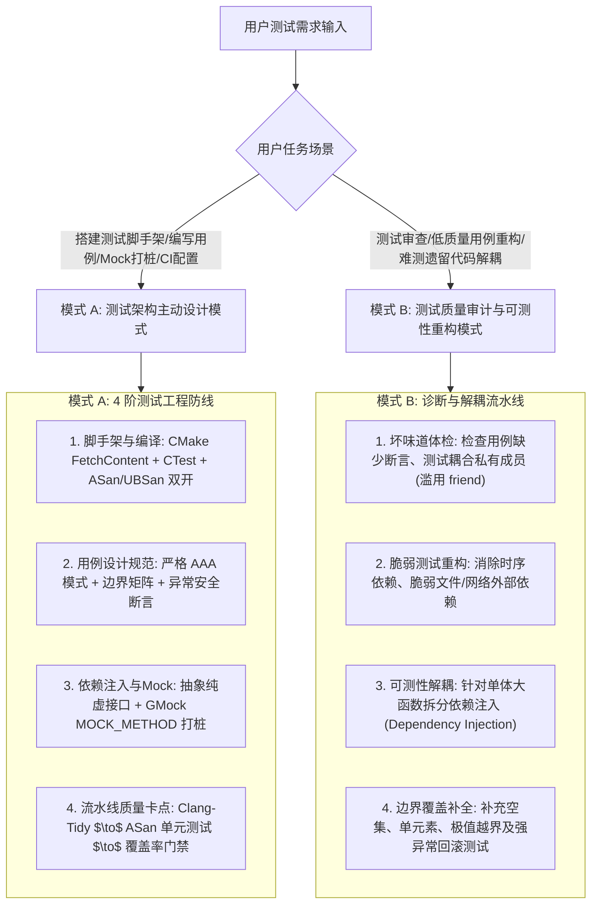

# C++ 单元测试、Mock 隔离与自动化质量流水线指南

本技能整合 **GoogleTest / GoogleMock 官方最佳实践**、**Catch2 现代 BDD 断言**、**C++ Core Guidelines 异常测试准则** 与 **LLVM Sanitizers** 工业标准，覆盖现代 C++ 测试脚手架构建、AAA 模式用例设计、依赖注入与 Mock 隔离、内存安全消毒及 CI/CD 质量卡点全流程。

---

## 1. 核心执行引擎

---

## 2. 模式 A：现代 C++ 测试主动设计清单

在为任何 C++ 项目设计测试或编写用例时，**无需用户提醒，必须第一时间主动落实以下 4 大核心规范**：

1. **工程脚手架与双消毒剂防护（Scaffolding & Sanitizers）**：
   - 优先通过 CMake `FetchContent` 声明式拉取 GoogleTest / Catch2，保持项目构建自包含，零外部环境强依赖；
   - 测试构建必须原生集成 CTest（`enable_testing()` 与 `add_test()`）；
   - Debug / Test 目标构建强制开启 **AddressSanitizer + UndefinedBehaviorSanitizer**（`-fsanitize=address,undefined -fno-omit-frame-pointer`），在测试期提前炸毁内存泄漏、越界访问与未定义行为，详见 [references/cmake_and_test_toolchains.md](./references/cmake_and_test_toolchains.md)。
2. **测试用例 AAA 模式与边界矩阵（Test Design & AAA Pattern）**：
   - 用例结构必须严格按照 **Arrange（准备上下文） $\to$ Act（执行待测动作） $\to$ Assert（验证状态与返回值）** 三段排布；
   - **坚持黑盒测试**：仅针对公开 API（Public Interface）设计断言；**严禁为了测试私有方法随意声明 `friend`**；
   - 覆盖核心边界矩阵：**空输入（Empty）、单元素（Single）、海量极值（Max/Min）、非法参数（Invalid）**；
   - 验证异常安全契约：对抛出异常的路径，必须使用 `EXPECT_THROW` / `REQUIRE_THROWS_AS` 验证基本保证与强保证，详见 [references/test_design_and_aaa_pattern.md](./references/test_design_and_aaa_pattern.md)。
3. **依赖注入与 Mock 隔离策略（Mocking & Isolation）**：
   - 待测业务与高延迟/不可控外部依赖（数据库、文件 I/O、RPC、系统时钟）通过抽象接口（Interface Class）解耦；
   - 依赖项通过构造函数或模板参数注入（Dependency Injection）；
   - 使用 GoogleMock `MOCK_METHOD` 宏定义桩类，通过 `EXPECT_CALL` 严格约束调用次数（`Times`）、参数匹配器（`Eq`, `StrEq`, `Gt`）与模拟返回值（`WillOnce(Return(...))`），详见 [references/mocking_and_dependency_injection.md](./references/mocking_and_dependency_injection.md)。
4. **CI/CD 流水线与覆盖率门禁（Pipeline Integration）**：
   - 建立四阶渐进式 CI 门禁：**代码排版格式化 $\to$ Clang-Tidy 静态分析 $\to$ ASan/UBSan 测试运行 $\to$ 代码覆盖率（llvm-cov/lcov）统计**；
   - 设置行覆盖率基准线（如 $\ge 80\%$），防止未经验证的逻辑溜入生产，详见 [references/sanitizers_and_ci_pipeline.md](./references/sanitizers_and_ci_pipeline.md)。

---

## 3. 模式 B：测试质量体检与可测性重构模式

当用户询问“这段代码怎么写单测”、“单测运行偶现崩溃怎么排查”、“如何测试一个没有接口的单例类”时，执行以下诊断流：

1. **测试坏味道诊断**：
   - **断言匮乏（Assertion Roulette）**：单个测试内堆叠无上下文的大量断言，失败时难以定位；拆分为清晰的子测试或参数化测试（`TEST_P`）；
   - **私有窥探（Testing Private Methods）**：指出通过私有测试暴露内部实现细节是架构脆弱的标志，重构为针对公开行为或拆分辅助类；
   - **全局状态污染（Shared State Pollution）**：用例间依赖全局变量或文件读写，重构为测试夹具（Test Fixture `SetUp`/`TearDown`）隔离。
2. **不可测遗留代码解耦重构**：
   - **硬编码依赖**：类内部直接 `new ConcreteDatabaseClient()`；重构为依赖接口并在构造函数中接收 `std::shared_ptr<IDatabaseClient>`；
   - **静态单例与时钟**：将直接调用 `std::chrono::system_clock::now()` 抽象为 `ITimeProvider` 接口，以便在单测中精准模拟超时与时间跃迁。

---

## 4. 核心参考手册与实证代码

- [CMake 脚手架、FetchContent 与覆盖率配置](./references/cmake_and_test_toolchains.md)：GTest/Catch2 CMake FetchContent 模板、CTest 集成、gcov/llvm-cov 报告生成指令。
- [AAA 测试模式、边界设计与异常安全断言](./references/test_design_and_aaa_pattern.md)：AAA 规范、参数化测试（TEST_P / TYPED_TEST）、边界测试矩阵、强异常安全验证。
- [依赖注入与 GoogleMock 打桩实战](./references/mocking_and_dependency_injection.md)：接口设计、MOCK_METHOD 现代语法、EXPECT_CALL 匹配器与动作、StrictMock vs NiceMock。
- [Sanitizers 消毒剂与 CI/CD 质量流水线](./references/sanitizers_and_ci_pipeline.md)：ASan/UBSan/MSan 参数详解、黑名单抑制（suppressions）、GitHub Actions / CI 门禁流水线。
- [现代 C++ 测试实证工程](./examples/)：
  - [CMakeLists.txt.template](./examples/CMakeLists.txt.template)：开箱即用集成 GTest、ASan 与覆盖率选项的工业级 CMake 模板。
  - [test_account_service_gmock.cpp](./examples/test_account_service_gmock.cpp)：基于依赖注入、GMock MOCK_METHOD 与 AAA 模式的银行服务测试用例。
  - [test_parameterized_suite.cpp](./examples/test_parameterized_suite.cpp)：基于 GoogleTest `TEST_P` 值参数化与 `TYPED_TEST` 类型参数化的全面测试套件。
