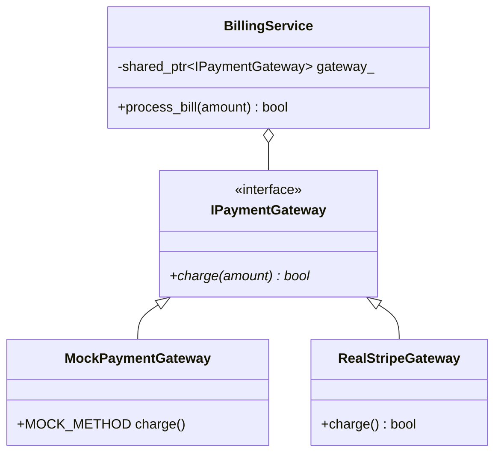

# Dependency Injection and GoogleMock Best Practices

This reference covers dependency injection (DI) patterns, interface abstractions, modern GoogleMock `MOCK_METHOD` syntax, `EXPECT_CALL` matchers and actions, and mock types (`NiceMock`, `StrictMock`).

---

## 1. Dependency Injection (DI) for Testability

Tightly coupled C++ code that calls global functions (`time(nullptr)`), instantiates concrete network clients (`new HttpSocket()`), or accesses disk files directly cannot be tested in isolation.

### The Remedy: Interface Extraction & Constructor Injection



```cpp
#include <memory>
#include <string>

// 1. Pure interface protocol
class IPaymentGateway {
public:
    virtual ~IPaymentGateway() = default;
    virtual bool charge(double amount, const std::string& token) = 0;
};

// 2. Class under test receives interface via constructor injection
class BillingService {
public:
    explicit BillingService(std::shared_ptr<IPaymentGateway> gateway)
        : gateway_(std::move(gateway)) {}

    bool process_order(double amount, const std::string& customer_token) {
        if (amount <= 0.0) return false;
        return gateway_->charge(amount, customer_token);
    }

private:
    std::shared_ptr<IPaymentGateway> gateway_;
};
```

---

## 2. GoogleMock Modern Syntax (`MOCK_METHOD`)

In modern GoogleMock (GTest 1.10+), obsolete macros (`MOCK_METHOD0`, `MOCK_METHOD1`, etc.) are replaced by the unified **`MOCK_METHOD`** macro:

```cpp
MOCK_METHOD(ReturnType, MethodName, (Args...), (Specs...));
```

### Example Mock Class
```cpp
#include <gmock/gmock.h>

class MockPaymentGateway : public IPaymentGateway {
public:
    // MOCK_METHOD(ReturnType, Name, (Arguments), (Modifiers...))
    MOCK_METHOD(bool, charge, (double amount, const std::string& token), (override));
};
```

---

## 3. Setting Expectations (`EXPECT_CALL`)

### 1. Cardinalities & Actions
```cpp
using ::testing::Return;
using ::testing::_;
using ::testing::Eq;
using ::testing::StrEq;

TEST(BillingServiceTest, ChargeInvokedWithExactAmountAndToken) {
    // Arrange
    auto mock_gateway = std::make_shared<MockPaymentGateway>();
    BillingService service(mock_gateway);

    // Expectation: charge must be called exactly once with $99.99 and "tok_secret"
    EXPECT_CALL(*mock_gateway, charge(Eq(99.99), StrEq("tok_secret")))
        .Times(1)
        .WillOnce(Return(true));

    // Act
    bool success = service.process_order(99.99, "tok_secret");

    // Assert
    EXPECT_TRUE(success);
}
```

### 2. Common Matchers
- Values: `Eq(val)`, `Ne(val)`, `Lt(val)`, `Gt(val)`, `DoubleEq(val)`.
- Strings: `StrEq("...")`, `HasSubstr("...")`, `StartsWith("...")`.
- Pointers/Fields: `NotNull()`, `Pointee(matcher)`, `Field(&Struct::member, matcher)`.
- Composite: `AllOf(m1, m2)`, `AnyOf(m1, m2)`, `Not(m)`.
- Wildcard: `_` (matches any value).

### 3. Sequential Calls (`InSequence`)
Enforce that calls occur in a strict temporal order:
```cpp
TEST(OrderWorkflowTest, StepsExecuteInStrictSequence) {
    auto mock = std::make_shared<MockWorkflow>();
    testing::InSequence seq; // Enforces ordering within this scope

    EXPECT_CALL(*mock, step1()).Times(1);
    EXPECT_CALL(*mock, step2()).Times(1);
    EXPECT_CALL(*mock, finalize()).Times(1);

    mock->execute();
}
```

---

## 4. `NiceMock`, `StrictMock`, and `NaggyMock`

By default, calling an uninteresting mock method produces a compiler warning ("Uninteresting mock function call"). You can control this behavior:

```cpp
// 1. NiceMock: Completely ignores uninteresting calls (keeps logs clean)
::testing::NiceMock<MockPaymentGateway> nice_mock;

// 2. StrictMock: Immediately FAILS the test if ANY uninteresting method is called
::testing::StrictMock<MockPaymentGateway> strict_mock;

// 3. NaggyMock: Default behavior (logs a warning on stderr)
::testing::NaggyMock<MockPaymentGateway> naggy_mock;
```

---

## 5. Compile-Time Mocking (Template Policy Mocking)

When virtual function dispatch incurs unacceptable runtime latency in high-frequency trading or embedded kernels, use template policy injection instead of pure interfaces:

```cpp
template <typename NetworkPolicy>
class HighFreqTrader {
public:
    explicit HighFreqTrader(NetworkPolicy policy) : policy_(policy) {}

    void send_order(int order_id) {
        policy_.send_packet(order_id);
    }

private:
    NetworkPolicy policy_;
};

// Mocking without virtual dispatch:
class MockNetworkPolicy {
public:
    MOCK_METHOD(void, send_packet, (int), ());
};
```
