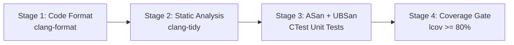

# LLVM Sanitizers and CI/CD Quality Pipeline Integration

This reference covers compiler sanitizers (ASan, UBSan, MSan, TSan), runtime environment flags, suppression ignorelists, and the 4-stage automated CI/CD quality gate.

---

## 1. LLVM Sanitizers Matrix

| Sanitizer | Compiler Flag | Bugs Detected | Typical Overhead |
|---|---|---|---|
| **AddressSanitizer (ASan)** | `-fsanitize=address` | Out-of-bounds (heap, stack, global), use-after-free, double-free, memory leaks (LSan). | ~2x CPU, ~2x RAM |
| **UndefinedBehaviorSanitizer (UBSan)** | `-fsanitize=undefined` | Signed integer overflow, null-pointer dereference, misaligned pointer, zero division. | ~1.2x CPU, Minimal RAM |
| **ThreadSanitizer (TSan)** | `-fsanitize=thread` | Multithreaded data races, deadlocks. *(Incompatible with ASan)*. | ~3x-5x CPU, ~5x-10x RAM |
| **MemorySanitizer (MSan)** | `-fsanitize=memory` | Reads of uninitialized memory. *(Requires all libraries compiled with MSan)*. | ~3x CPU, ~2x RAM |

---

## 2. Runtime Environment Flags (`ASAN_OPTIONS` & `UBSAN_OPTIONS`)

Sanitizers can be customized at runtime without recompilation:

```bash
# ASan Runtime Environment Settings
export ASAN_OPTIONS="verbosity=1:halt_on_error=1:detect_leaks=1:detect_stack_use_after_return=1:check_initialization_order=1"

# UBSan Runtime Environment Settings
export UBSAN_OPTIONS="print_stacktrace=1:halt_on_error=1"

# Execute test suite with active sanitizers
./build/tests/unit_tests
```

### Key Options
- `halt_on_error=1`: Abort the test binary immediately upon the very first sanitizer error.
- `detect_leaks=1`: Run LeakSanitizer (LSan) on process exit to ensure 100% leak-free code.
- `detect_stack_use_after_return=1`: Detect returning references to local stack variables.

---

## 3. Sanitizer Ignorelists / Suppressions

When third-party legacy libraries trigger known false positives, use a sanitizer ignorelist instead of turning sanitizers off:

```bash
# Add compiler flag:
add_compile_options(-fsanitize-ignorelist=${CMAKE_CURRENT_SOURCE_DIR}/sanitizer_ignorelist.txt)
```

### `sanitizer_ignorelist.txt` Syntax
```text
# Ignore third-party headers
src:*/third_party/legacy_lib/*

# Ignore specific functions with known benign race
fun:*LegacyCryptoHash*
```

---

## 4. The 4-Tier CI/CD Quality Pipeline

A robust continuous integration pipeline enforces code quality progressively:



### Production GitHub Actions Workflow
```yaml
name: CI Quality Pipeline

on: [push, pull_request]

jobs:
  test-and-lint:
    runs-on: ubuntu-latest
    steps:
      - name: Checkout Code
        uses: actions/checkout@v4

      - name: Install Toolchain & Dependencies
        run: |
          sudo apt-get update
          sudo apt-get install -y cmake ninja-build clang-tidy clang-format lcov

      # Stage 1: Code Format
      - name: Stage 1 - Format Check
        run: |
          find src tests -name '*.cpp' -o -name '*.hpp' | xargs clang-format --dry-run --Werror

      # Stage 2: Configure & Clang-Tidy
      - name: Stage 2 - CMake Configure & Clang-Tidy
        run: |
          cmake -B build -G Ninja \
            -DCMAKE_BUILD_TYPE=Debug \
            -DCMAKE_CXX_CLANG_TIDY="clang-tidy;-warnings-as-errors=*" \
            -DENABLE_SANITIZERS=ON \
            -DENABLE_COVERAGE=ON

      # Stage 3: Build & Run Tests with ASan + UBSan
      - name: Stage 3 - Compile & Run Tests
        env:
          ASAN_OPTIONS: "halt_on_error=1:detect_leaks=1"
          UBSAN_OPTIONS: "halt_on_error=1:print_stacktrace=1"
        run: |
          cmake --build build
          ctest --test-dir build --output-on-failure

      # Stage 4: Code Coverage Gate
      - name: Stage 4 - Coverage Gate Check
        run: |
          lcov --capture --directory build --output-file coverage.raw.info
          lcov --remove coverage.raw.info '/usr/*' '*/_deps/*' '*/tests/*' --output-file coverage.info
          lcov --summary coverage.info
```
