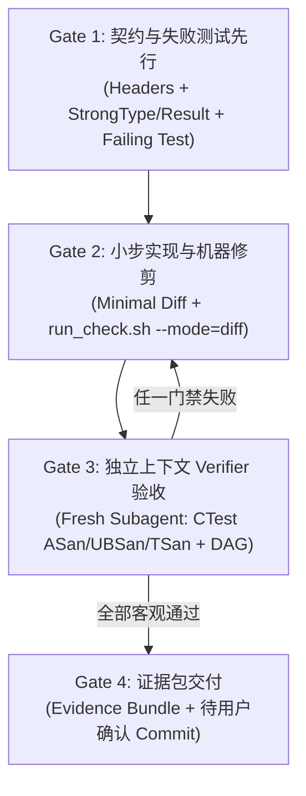

# C++17 验证闭环剧本与软件花园治理指南 (Poteto-Mode)

本技能将底层静态门禁（`cpp-code-quality`）、物理边界（`code-design`）、Paved Road 原语（`systems-data-design`）、属性/消毒测试（`cpp-testing`）与证据审查（`code-review`）串联为**不可跳步的确定性交付剧本（Playbook）**。

> **定位消歧**：单点设计建模用 `code-design`；单次代码体检用 `code-review`；编写具体单测用 `cpp-testing`；**多步骤端到端交付编排、独立 Verifier 交叉验收与代码库定期除草**使用本技能。

---

## 1. 端到端四阶硬门禁剧本 (4-Gate Playbook)



### Gate 1：契约与失败测试先行（Contract & Failing Test First）
1. **先落盘边界与头文件**：优先从 `include/core/` 复用 `StrongType`、`Result<T, E>`、`ScopeGuard`、`ChannelHandle`（Typestate）；新模块头文件严格隔离在 `include/<mod>/` 与 `src/`（CMake `PUBLIC`/`PRIVATE`）。
2. **先写失败测试**：先写覆盖边界矩阵的 AAA 单测或 RapidCheck 属性不变式测试，确认在未实现前编译/运行失败。
3. **前置边界校验**：运行 `check_include_dag.py` 确认新接口不引入环路或跨层越权。

### Gate 2：小步实现与机器修剪（Baby Steps & Automated Gates）
1. **最小增量实现**：只写通过当前测试所需的最小 C++17 代码，严禁顺手堆砌 YAGNI 抽象。
2. **强制机器门禁**（默认严格阻断；仅当用户明确指示“这是老项目”时追加 `--warn-only`）：
   ```bash
   ./.agents/skills/cpp-code-quality/scripts/run_check.sh --mode=diff
   ```
3. **错误驱动棘轮**：凡在 Gate 2 反复踩坑的 AI 错误，按 `skill-craft` 棘轮法则下沉为 `.clang-tidy` / `lint_redlines.py` / 编译选项，禁止仅往 Markdown 追加叮嘱。

### Gate 3：独立上下文 Verifier 交叉验收（Fresh-Context Verifier）
> **防确认偏误铁律**：写代码的上下文自带作者盲区。大型或高风险改动交付前，必须由**独立新上下文的 Verifier 子 Agent**（或独立测试命令流程）执行以下核验：
1. **全量编译与三消毒剂实跑**：
   - Debug 构建开启 `-Wall -Wextra -Werror` + **ASan + UBSan** 跑全量 `ctest`；
   - 涉及多线程/锁/原子操作时，额外以 **TSan** 构建并执行 `--gtest_repeat=50 --gtest_shuffle`（Ubuntu 24.04+ 高位 ASLR 环境使用 `setarch x86_64 -R`）。
2. **架构边界与红线复核**：运行 `check_include_dag.py --root .` 与 `run_check.sh --mode=diff` 确认零告警、零未豁免红线。
3. **负面路径与边界审计**：核查是否只有 Happy-Path 测试，补充越界、空输入、故障注入（如写盘中途失败）验证。

### Gate 4：证据包交付与确认门（Evidence Bundle & Human Sign-off）
- 输出精简的 **Evidence Bundle**（静态门禁退出码、实跑 `ctest` 用例数与消毒剂类型、`sizeof`/基准或冒烟日志），让人类审查者**看证据而非肉眼扫数百行语法**。
- 严禁私自 `git commit`，向用户汇报变更与证据后等待明确确认。

---

## 2. 软件花园定期除草流程 (Software Garden Pruning)

AI 会把现有代码库中的坏味道当成 Few-Shot 样本并成倍放大。当用户要求**“清理技术债 / 清理 AI Slop / 花园除草”**时，按以下低风险顺序执行：
1. **全量体检基线**：运行 `run_check.sh --mode=all --warn-only` 与 `check_include_dag.py --dump-graph` 摸清当前腐化热点；
2. **拔除死代码与僵尸头文件**：清理 `misc-include-cleaner` 冗余 `#include` 与 `cppcheck --enable=unusedFunction` 检出的死函数；
3. **统一重复轮子**：对照仓库已选型三方库（如 `utfcpp`、`reproc++`、`zstd`）全局清退手写残余轮子；
4. **棘轮固化**：把本次除草发现的共性坏味道沉淀为硬规则，防止杂草复生。
- 详细操作清单见：[软件花园除草与防杂草清单](./references/garden_pruning_checklist.md)
