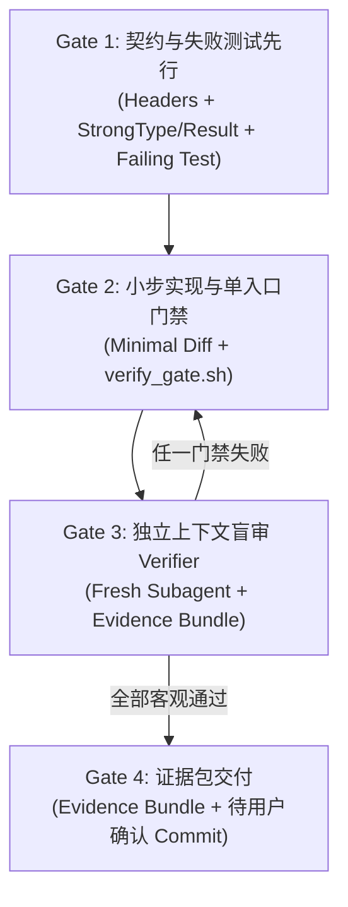

# C++17 验证闭环剧本与软件花园治理指南 (Poteto-Mode)

本技能将底层静态门禁（`cpp-code-quality`）、物理边界（`code-design`）、Paved Road 原语（`systems-data-design`）、属性/消毒测试（`cpp-testing`）与证据审查（`code-review`）串联为**不可跳步的确定性交付剧本（Playbook）**。

> **定位消歧**：单点设计建模用 `code-design`；单次代码体检用 `code-review`；编写具体单测用 `cpp-testing`；**多步骤端到端交付编排、独立 Verifier 交叉验收与代码库定期除草**使用本技能。

---

## 0. 任务复杂度分档分流（防过度流程化）

| 档位 | 适用范围 | 必须执行的流程 |
| :---: | :--- | :--- |
| **T0** | 纯文档、注释、链接修复（零代码变更） | 跳过本剧本，仅核对 `git diff` 与链接有效性 |
| **T1** | 单模块小改（$\le 3$ 文件、无跨层/并发/落盘改动） | 单上下文内完成：复现或边界测试 $\to$ 最小修复 $\to$ 运行 `verify_gate.sh` |
| **T2** | 跨模块特性、并发锁/原子变量、持久化、大重构 | **完整 4-Gate + 独立上下文盲审 Verifier + Evidence Bundle** |

---

## 1. 端到端四阶硬门禁剧本 (4-Gate Playbook)



### Gate 1：契约与失败测试先行（Contract & Failing Test First）
1. **先落盘边界与头文件**：优先从 `include/core/` 复用 `StrongType`、`Result<T, E>`、`ScopeGuard`、`ChannelHandle`（Typestate）；新模块头文件严格隔离在 `include/<mod>/` 与 `src/`（CMake `PUBLIC`/`PRIVATE`）。
2. **先写失败测试**：先写覆盖边界矩阵的 AAA 单测或 RapidCheck 属性不变式测试，确认在未实现前编译/运行失败；**若涉及二进制格式或持久化，强制包含 Header 元数据（版本/`count`/flags）位翻转与恶意超大 `count` 畸形包拒载测试**。
3. **前置边界校验**：运行 `check_include_dag.py` 确认新接口不引入环路或跨层越权。

### Gate 2：小步实现与总控门禁（Baby Steps & Single-Entry Gate）
1. **最小增量实现**：只写通过当前测试所需的最小 C++17 代码，严禁顺手堆砌 YAGNI 抽象。
2. **运行总控门禁脚本**（默认严格阻断；仅当用户明确指示“这是老项目”时追加 `--warn-only`）：
   ```bash
   ./.agents/skills/cpp-verification-playbook/scripts/verify_gate.sh --dir=. --mode=diff
   ```
   （并发改动可追加 `--tsan-repeat=20`；完整验收建议附加 `--require-tests`）
3. **错误驱动棘轮**：凡在 Gate 2 反复踩坑的 AI 错误，按 `skill-craft` 棘轮法则下沉为 `.clang-tidy` / `lint_redlines.py` / 编译选项，禁止仅往 Markdown 追加叮嘱。

### Gate 3：独立上下文盲审与归零闭环（Fresh-Context Blind Review Loop）
> **防确认偏误铁律**：T2 级改动交付前，必须通过 `invoke_subagent`（或 `swarm` 中的只读 `verifier`）在干净上下文执行两段式盲审，严禁向其透传“我已修复/通过”的作者暗示：
1. **3A — 门禁独立重跑**：Verifier 自行执行 `verify_gate.sh`（自动串联 Include DAG、`clang-analyzer` + 四关静态扫描、ASan/UBSan 全量 `ctest` 及可选 `setarch x86_64 -R` TSan 压测）。
2. **3B — 深度语义与安全审计**：按 `code-review` 与 `secure-cpp` 逐文件审查（测试是否篡改、边界与负面路径、协议校验和覆盖 Header、反序列化 `reserve(count)` 物理上界校验、锁拓扑与资源泄漏）。
3. **硬性打回循环**：**只要存在任何 Blocker 或 Major，Gate 3 必须判 `BLOCKED` 打回 Gate 2**（先补失败测试 $\to$ 修复 $\to$ 重跑 `verify_gate.sh` $\to$ 重新盲审），**循环直到 Blocker = 0 且 Major = 0 方可进入 Gate 4**。
- 详细派单 Prompt 与多模块并行 Swarm 模板见：[盲审 Verifier 与并行 Swarm 调度模板](./references/verifier_dispatch_templates.md)

### Gate 4：证据包交付与确认门（Evidence Bundle & Human Sign-off）
- 原样附上 `verify_gate.sh` 生成的 **Evidence Bundle** 汇总表（严禁伪造或补全未输出数字），让人类审查者看客观证据。
- 严禁私自 `git commit`，向用户汇报变更与证据后等待明确确认。

---

## 2. 软件花园定期除草流程 (Software Garden Pruning)

AI 会把现有代码库中的坏味道当成 Few-Shot 样本并成倍放大。当用户要求**“清理技术债 / 清理 AI Slop / 花园除草”**时，按以下低风险顺序执行：
1. **全量体检基线**：运行 `run_check.sh --mode=all --warn-only` 与 `check_include_dag.py --dump-graph` 摸清当前腐化热点；
2. **拔除死代码与僵尸头文件**：清理 `misc-include-cleaner` 冗余 `#include` 与 `cppcheck --enable=unusedFunction` 检出的死函数；
3. **统一重复轮子**：对照仓库已选型三方库（如 `utfcpp`、`reproc++`、`zstd`）全局清退手写残余轮子；
4. **棘轮固化**：把本次除草发现的共性坏味道沉淀为硬规则，防止杂草复生。
- 详细操作清单见：[软件花园除草与防杂草清单](./references/garden_pruning_checklist.md)
