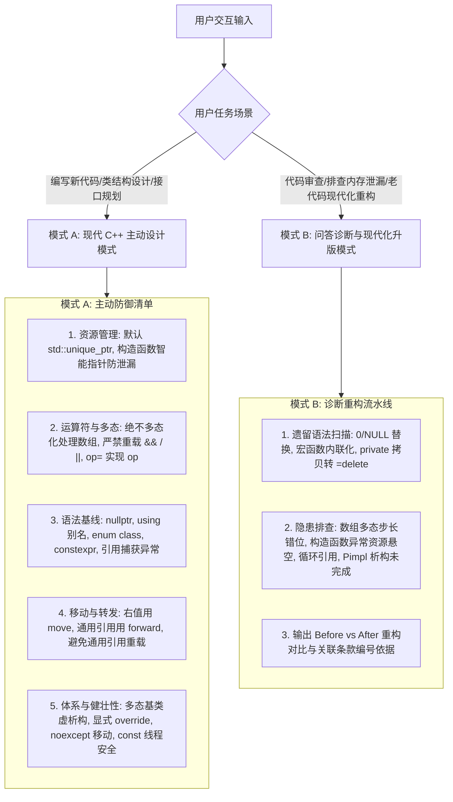

# 现代 C++ 惯用法与最佳实践指南

本技能完整沉淀自 Scott Meyers 享誉全球的 C++ 圣经三部曲（共 132 条经典原则）：
- **《Effective C++ (第3版)》**（55 个改善程序与设计的做法）
- **《More Effective C++》**（35 个改善程序与设计的全新做法）
- **《Effective Modern C++》**（42 个改善 C++11 和 C++14 的具体做法）

融会面向对象契约、多态数组陷阱、短路运算符重载禁忌、RAII 异常安全防漏、右值移动、完美转发与并发任务 API。

---

## 1. 核心执行引擎

---

## 2. 模式 A：现代 C++ 主动编码与设计模式

当用户要求设计新类、编写业务代码或实现底层模块时，**无需用户提醒，必须在第一时间主动应用以下 6 条铁律**：

1. **资源管理与构造安全（RAII & Constructor Exception Safety）**：
   - 杜绝裸 `new`/`delete`；默认使用 `std::unique_ptr`；使用 `std::make_unique` 构建；
   - 构造函数初始化多个资源时，成员变量强制直接使用智能指针管理（防中途抛异常导致析构函数不被执行而发生资源泄漏），详见 [references/resource_management_and_raii.md](./references/resource_management_and_raii.md) 与 [references/operators_and_exceptions_mec.md](./references/operators_and_exceptions_mec.md)。
2. **多态与运算符重载底线（Polymorphism & Operator Guardrails）**：
   - **绝不要对数组进行多态处理**（数组下标按 `sizeof(Base)` 步进，派生类数组指针步长错位引发内存践踏）；
   - **绝不要重载 `&&`、`||` 或 `,`**（重载剥夺语言级短路求值与求值顺序保证）；
   - 优先使用复合赋值操作符 `op=` 实现独立操作符 `op`（`lhs += rhs` 实现 `lhs + rhs`，零多余临时对象），详见 [references/operators_and_exceptions_mec.md](./references/operators_and_exceptions_mec.md)。
3. **现代语法与异常传递规范（Modern Syntax & Catch by Reference）**：
   - 空指针一律使用 `nullptr`；复杂类型使用 `using`；限域枚举使用 `enum class`；常量使用 `constexpr`；
   - **异常捕获强制按引用 `catch (const std::exception& e)`**（彻底杜绝按值捕获发生的对象切片与额外拷贝），详见 [references/type_deduction_and_modern_syntax.md](./references/type_deduction_and_modern_syntax.md)。
4. **移动语义与完美转发准则（Move & Forward Discipline）**：
   - 对右值引用（`X&&`）必须使用 `std::move`，对通用引用（`T&&`）必须使用 `std::forward`；
   - 严禁在通用引用形参上直接重载（容易吞噬常规拷贝构造），改用 Tag Dispatch 或 Concepts；
   - 严禁在按值返回局部对象时调用 `std::move`（破坏编译器 RVO / NRVO 优化），详见 [references/move_semantics_and_perfect_forwarding.md](./references/move_semantics_and_perfect_forwarding.md)。
5. **类层次与继承安全（Inheritance & Object Contracts）**：
   - 多态基类析构函数强制声明为 `virtual`；派生类重写虚函数强制显式标注 `override`；
   - 绝不在构造函数或析构函数中调用虚函数；禁止重定义继承而来的非虚函数与缺省参数；
   - 需要虚拟化构造时提供返回 `std::unique_ptr<Base>` 的 `clone()` 虚函数，详见 [references/classes_inheritance_and_lambdas.md](./references/classes_inheritance_and_lambdas.md) 与 [examples/cloneable_virtual_copy.hpp](./examples/cloneable_virtual_copy.hpp)。
6. **健壮性与并发契约（Safety & Concurrency Contracts）**：
   - 凡不抛出异常的移动操作、swap 函数强制标注 `noexcept`（解锁 STL 容器高效移动）；
   - `const` 成员函数必须保证多线程只读安全；`std::thread` 必须在析构前保证不可结合，详见 [references/concurrency_and_noexcept.md](./references/concurrency_and_noexcept.md)。

---

## 3. 模式 B：遗留代码现代化审查与重构模式

当用户询问“帮我看下这段 C++ 代码有什么问题”、“怎么把这段老 C++ 代码升级到现代 C++”时，执行以下诊断流：

1. **老旧 C++98/03 代码特征升版**：
   - 将手写非拷贝宏或私有声明（`Uncopyable`）重构为 `= delete`；
   - 将裸 `new`/`delete` 与 `auto_ptr` 重构为 `std::unique_ptr`；将宏常量/函数重构为 `constexpr` 与 `inline`。
2. **高级现代 C++ 隐患排查**：
   - **多态数组传参诊断**：检查是否将派生类数组指针传给基类指针形参；
   - **短路运算符重载排查**：检查类是否重载了 `operator&&` 或 `operator||`；
   - **Lambda 悬空引用诊断**：排查是否存在 `[&]` 默认捕获引发的局部栈变量悬空；
   - **Pimpl 析构报错诊断**：检查是否在头文件内联析构导致 `incomplete type` 报错，提供规范实现，详见 [examples/modern_pimpl_idiom.hpp](./examples/modern_pimpl_idiom.hpp)。
3. **输出重构对比与论据**：
   - 给出重构前后的 Diff；
   - 标注具体违反的《Effective C++》、《More Effective C++》或《Effective Modern C++》条款编号与核心原理。

---

## 4. 核心参考手册

- [资源管理、RAII 与智能指针](./references/resource_management_and_raii.md)：所有权模型、make 函数开销、循环引用破环与 Pimpl 惯用法。
- [运算符重载、异常安全与经典模式](./references/operators_and_exceptions_mec.md)：多态数组致命陷阱、短路运算符禁忌、构造异常防漏、引用捕获异常与 clone。
- [类型推导与现代语法基线](./references/type_deduction_and_modern_syntax.md)：模板与 auto 推导陷阱、花括号 `{}` 歧义、nullptr、别名与 constexpr。
- [移动语义、完美转发与右值引用](./references/move_semantics_and_perfect_forwarding.md)：std::move 与 std::forward 物理本质、引用折叠、通用引用重载避坑。
- [类体系设计、继承与 Lambda 闭包](./references/classes_inheritance_and_lambdas.md)：多态基类虚析构、override 守护、五大件自动生成、Lambda 捕获陷阱。
- [并发任务、线程契约与 noexcept 保证](./references/concurrency_and_noexcept.md)：noexcept 移动优化、const 线程安全、std::async vs std::thread、原子与 volatile。
- [Scott Meyers 132 条款全景演进映射表](./references/scott_meyers_132_items_matrix.md)：EC++ 55 条 + MEC++ 35 条 + EMC++ 42 条三部曲全集对照表。
