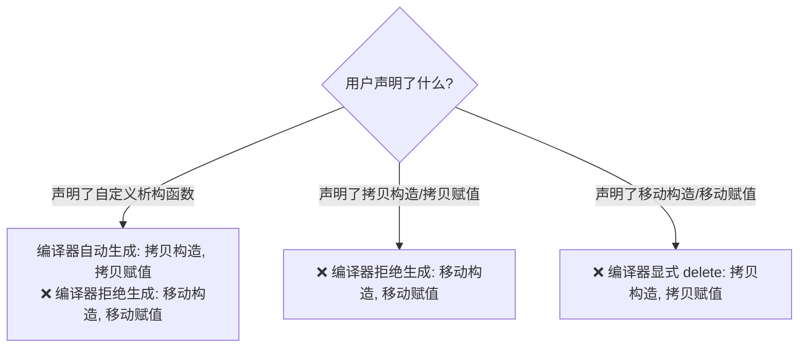

# 类体系设计、继承契约与 Lambda 闭包指南

> 整合自《Effective C++》(第 2, 4, 6 章) 与《Effective Modern C++》(第 3, 6 章)。

---

## 1. 特殊成员函数自动生成规则与“三五零法则” (条款 17)

C++11 在原有的四大函数（默认构造、析构、拷贝构造、拷贝赋值）基础上，新增了**移动构造与移动赋值**。

### 1.1 生成互斥依赖矩阵


### 1.2 三五零法则（Rule of 0 / 3 / 5）
- **零法则（Rule of Zero - 现代首选）**：如果类不直接拥有底层裸资源句柄，而是使用 `std::vector`、`std::string`、`std::unique_ptr` 等标准类型组合，**不要声明任何自定义特殊成员函数，全部交由编译器隐式合成**。
- **五法则（Rule of Five）**：若因底层封装必须自定义其中任何一个（如析构函数），**必须显式显式声明全部五个特殊成员函数**（可用 `= default`）。

---

## 2. 现代类设计硬性契约

### 2.1 显式禁用使用 `= delete` 取代私有未定义 (条款 11)
- C++98 惯用将拷贝构造函数声明在 `private:` 且不给实现；
- 现代 C++ 必须使用 `public:` 下的 `= delete`：
  - 编译器报错发生在重载决议阶段，提供更早且更直观的错误信息；
  - `= delete` 可用于任何函数（包括非成员函数和禁止特定类型推导的模板全特化）。

### 2.2 多态基类虚析构函数铁律 (EC++ 条款 7)
凡是带有任何虚函数的基类，其析构函数**必须**声明为 `virtual`：
```cpp
Base* p = new Derived();
delete p; // ❌ 若 Base 析构函数非 virtual，此操作为未定义行为 (UB)！
          // Derived 特有的成员变量析构函数根本不会被执行，引发灾难性资源泄漏！
```

### 2.3 虚函数显式标注 `override` (条款 12)
重写基类虚函数必须满足全部契约：函数名、参数类型、`const` 修饰符、引用限定符（`&` 或 `&&`）、异常规范。
漏掉任一修饰符都会导致**静默变成新函数重载而非重写**。使用 `override` 能让编译器直接抓出签名错位。

### 2.4 绝不在构造与析构函数中调用虚函数 (EC++ 条款 9)
在派生类的基类构造阶段，派生类的数据成员尚未初始化，C++ 规定此时对象的动态类型为基类类型，调用的虚函数**只绑定基类版本**。同理在析构阶段，派生类已销毁，虚函数同样降级为基类版本。

### 2.5 绝不重定义继承而来的非虚函数与缺省参数 (EC++ 条款 36, 37)
- **非虚函数是静态绑定的（Compile-time Binding）**：通过基类指针与派生类指针调用同名非虚函数会产生完全不同的行为，破坏公有继承的 "is-a" 契约；
- **缺省参数是静态绑定的，而虚函数是动态绑定的**：重定义虚函数的缺省参数会导致“执行派生类的函数体，却注入了基类的默认参数值”的怪胎行为。

---

## 3. Lambda 闭包避坑准则 (条款 31-34)

### 3.1 杜绝默认捕获模式（Default Capture Modes）
- **禁止 `[&]` 默认引用捕获**：局部栈变量的生命周期往往短于闭包（如放入线程队列或回调），极易造成悬空引用导致非法内存访问崩溃。
- **禁止 `[=]` 默认值捕获成员变量**：
  ```cpp
  class Widget {
      int id = 42;
      void addFilter() {
          // ❌ 极度危险：表面上是按值捕获 id，实际上捕获的是隐式的 this 指针！
          // 若 Widget 对象被销毁，调用 lambda 时访问 this->id 引发野指针崩溃！
          filters.push_back([=](int value) { return value > id; });
          
          // ✅ 现代安全做法 (C++14 初始化捕获): 将变量显式拷贝到闭包内
          filters.push_back([id = this->id](int value) { return value > id; });
      }
  };
  ```

### 3.2 优先使用 Lambda 而非 `std::bind` (条款 34)
- Lambda 可读性极高，编译器优化友好（易于直接内联）；
- `std::bind` 语法冗长繁琐（`_1`, `_2` 占位符），在面对函数重载时必须手动强转函数指针，在现代 C++ 中应彻底弃用。
