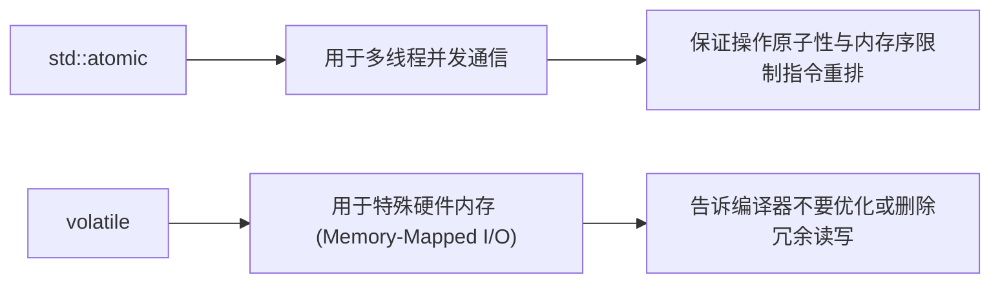

# 并发任务、线程契约与 noexcept 保证指南

> 整合自《Effective Modern C++》(第 3 章条款 14, 16 及第 7 章条款 35-40)。

---

## 1. `noexcept`：性能优化的关键钥匙 (条款 14)

在现代 C++ 中，`noexcept` 不仅是接口安全契约，更是**编译器性能优化的基石**：

### 1.1 `std::vector` 扩容的“移动-拷贝决选机制”
- `std::vector` 在扩容重新分配内存时，承诺提供**强异常安全保证（Strong Exception Safety）**：即扩容若失败，容器必须回滚到原状态。
- 如果元素的**移动构造函数未声明为 `noexcept`**，编译器为了防止移动过程中抛出异常导致原对象已被破坏而无法回滚，**将被迫静默回退（Fallback）为低效的逐个深拷贝**！
- **铁律**：凡是不抛异常的**移动构造、移动赋值、swap 函数与内存释放逻辑，必须严格标注 `noexcept`**！

---

## 2. `const` 成员函数的线程安全契约 (条款 16)

在现代 C++ 中，`const` 与多线程安全紧密绑定：
- **调用者契约**：调用者会默认在多个并发线程中同时调用同一个对象的 `const` 成员函数，认定其为**只读、无数据竞态**。
- **实现者底线**：若 `const` 成员函数因计算缓存（Caching）或惰性求值（Lazy Evaluation）需要修改 `mutable` 内部变量，**必须由类内部主动提供线程安全保护**：
  - 单一变量/计数器：使用 `std::atomic<T>`；
  - 多个相关变量/复杂结构：使用 `std::mutex` 加锁。

---

## 3. 并发编程与线程生命周期契约

### 3.1 任务模型 (`std::async`) 优于裸线程 (`std::thread`) (条款 35)
| 比较维度 | 裸线程 `std::thread` | 任务模型 `std::async` |
| :--- | :--- | :--- |
| **返回值处理** | 无法直接获取，需手动通过条件变量/全局变量同步 | 通过 `std::future::get()` 轻松提取返回值 |
| **异常传播** | 子线程抛出未捕获异常直接调用 `std::terminate` 崩溃 | 异常自动捕获并存入 `future`，在 `get()` 时由主线程重新抛出 |
| **资源耗尽 (Oversubscription)** | 线程过多直接抛出 `system_error` 崩溃 | 运行时智能调度线程池与上下文切换 |

> **调度陷阱 (条款 36)**：默认策略 `std::async(fn)` 采用 `async | deferred`，可能**延后到调用 `get()` 时才在当前线程同步执行**。若必须并发，必须显式指定 `std::launch::async`。

### 3.2 析构时必须保证 `std::thread` 不可结合 (条款 37)
若 `std::thread` 对象在析构时仍然处于 `joinable()` 状态，**C++ 运行时将无条件调用 `std::terminate()` 杀死整个进程**！
```cpp
// ❌ 灾难示范：中间逻辑若提前 return 或抛出异常，t 析构时直接引发进程崩溃！
void doWork() {
    std::thread t(worker);
    if (checkError()) return; // 💥 terminate!
    t.join();
}

// ✅ RAII 守护者规范（C++20 std::jthread 或自定义 ThreadGuard）
class ThreadGuard {
    std::thread& t_;
public:
    explicit ThreadGuard(std::thread& t) : t_(t) {}
    ~ThreadGuard() {
        if (t_.joinable()) t_.join(); // 析构时兜底保证 join
    }
};
```

---

## 4. `std::atomic` 与 `volatile` 的分工铁律 (条款 40)

在 C++ 中，**`volatile` 与多线程并发绝对没有任何关系！**



- **并发计数与标志位**：一律使用 `std::atomic<bool>` / `std::atomic<int>`；
- **`volatile`**：仅在与设备驱动交互、映射内存寄存器时使用（防止编译器将多次寄存器轮询读优化为单次读取）。
