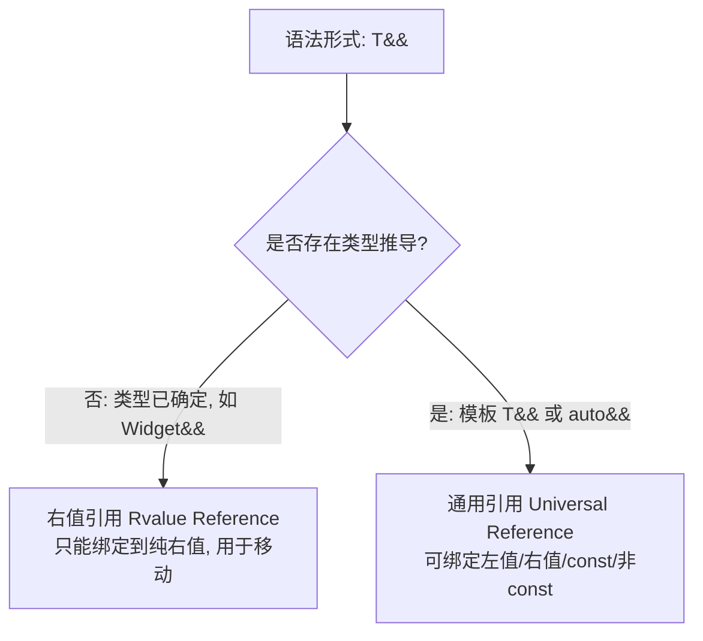

# 移动语义、完美转发与右值引用深度指南

> 整合自《Effective Modern C++》(第 5 章，条款 23-30 及条款 41)。

---

## 1. `std::move` 与 `std::forward` 的物理本质 (条款 23)

一个必须建立的根本认知：**`std::move` 和 `std::forward` 在运行时不产生任何一条 CPU 汇编指令！**
它们本质上纯粹是编译期的**类型强转函数（Cast Functions）**：
- **`std::move(x)`**：**无条件**将参数强制转换为右值引用（`static_cast<std::remove_reference_t<T>&&>(x)`）；
- **`std::forward<T>(x)`**：**有条件**强转，仅当传入的原始实参被右值初始化时，才强转为右值引用。

```cpp
// ❌ 常见误区：试图 move 一个 const 对象
void process(const std::string text) {
    // 这里的 std::move(text) 产生的是 const std::string&&！
    // 由于是 const，无法匹配目标类的移动构造函数（参数为 std::string&&）
    // 最终静默回退（Fallback）为低效的深拷贝构造函数！
    records.push_back(std::move(text)); 
}
```

---

## 2. 右值引用 vs 通用引用（转发引用）(条款 24)

语法形式同为 `T&&`，但语义截然不同：



### 严格的语法形式要求
通用引用必须严格满足 `T&&` 且**当前上下文正在发生类型推导**：
```cpp
template<typename T>
void f(T&& param);               // ✅ 是通用引用

template<typename T>
void f(std::vector<T>&& param);  // ❌ 否！这是针对 vector 的右值引用，不是通用引用

template<typename T>
void f(const T&& param);         // ❌ 否！加了 const，退化为针对 const 的右值引用
```

---

## 3. 引用折叠规则与完美转发机制 (条款 28)

在 C++ 中，**程序员直接声明引用的引用是非法的（`int& &` 编译报错）**，但在模板实例化、`auto` 推导和 `decltype` 中，编译器会根据**引用折叠（Reference Collapsing）**规则进行合流：

- **左值主导法则**：只要折叠链条中存在任一左值引用 `&`，最终结果必为左值引用 `&`；
- **纯右值法则**：**仅当两端皆为右值引用 `&&` 时，折叠结果才为右值引用 `&&`**。

```text
&  + &  --> &
&  + && --> &
&& + &  --> &
&& + && --> &&  (唯一折叠为右值的规则)
```

`std::forward` 正是利用引用折叠：当传入左值时，`T` 推导为 `Widget&`，`forward<Widget&>` 返回 `Widget&`；当传入右值时，`T` 推导为 `Widget`，`forward<Widget>` 返回 `Widget&&`。

---

## 4. 铁律：避免在通用引用上进行重载 (条款 26, 27)

通用引用具有**无与伦比的贪婪匹配能力**。在通用引用上进行函数重载，是现代 C++ 最易导致隐蔽 Bug 的陷阱。

### ❌ 灾难示范：构造函数重载
```cpp
class Person {
public:
    // 通用引用构造函数：本意接受姓名字符串
    template<typename T>
    explicit Person(T&& n) : name(std::forward<T>(n)) {}

    // 默认拷贝构造函数
    Person(const Person& rhs);
};

Person p("Alice");
// ❌ 灾难！Person clone(p); 无法调用拷贝构造函数！
// 解释：p 是非常量左值 Person&。调用拷贝构造需要将 Person& 绑定到 const Person&
// 而通用引用模板匹配 Person& 是精确完美匹配（比加 const 的拷贝构造优先级更高！）
// 导致编译器试图用 Person 对象去初始化 name 字符串，引发巨长编译报错！
```

### ✅ 解决方案：三种替代机制
1. **传值传参并 move（条款 41）**：针对成本低廉且必然拷贝的类型：
   ```cpp
   explicit Person(std::string n) : name(std::move(n)) {}
   ```
2. **标签分派（Tag Dispatch）**：将重载分发到内部私有函数；
3. **Concepts / std::enable_if 约束**：显式剔除自身类型与其派生类：
   ```cpp
   template<typename T,
       typename = std::enable_if_t<!std::is_base_of_v<Person, std::decay_t<T>>>>
   explicit Person(T&& n);
   ```

---

## 5. 返回值优化 (RVO) 与杜绝滥用 `std::move` (条款 25)

**严禁在按值返回局部对象时对其使用 `std::move`**：
```cpp
// ❌ 负优化！阻止了 RVO (Return Value Optimization)
Widget makeWidget() {
    Widget w;
    return std::move(w); // 剥夺了编译器直接在调用端栈帧构造对象的权利，强制多一次移动开销！
}

// ✅ 绝对最佳：依赖 RVO / NRVO，编译器直接在目标内存就地构造，0 拷贝 0 移动！
Widget makeWidget() {
    Widget w;
    return w;
}
```
> **例外**：当返回的是函数的传入右值引用形参时，必须显式 `return std::move(rhs);`。
