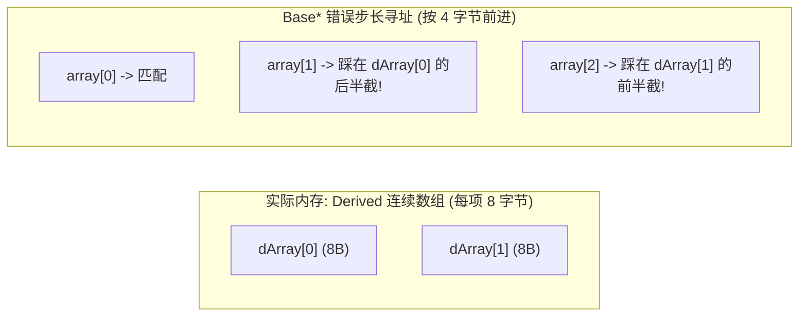

# 运算符重载、异常安全与经典模式深度指南

> 整合自《More Effective C++》(条款 3, 5-13, 21-22, 25, 31)。

---

## 1. 致命物理陷阱：绝不要多态化处理数组 (条款 3)

在 C++ 中，**将派生类对象数组隐式转换为基类指针传递，是极度隐蔽的灾难级未定义行为 (Undefined Behavior)**：

### 1.1 物理指针算术错位机制
```cpp
class Base { int b; };             // sizeof(Base) = 4
class Derived : public Base { int d; }; // sizeof(Derived) = 8

void printAll(const Base array[], int n) {
    for (int i = 0; i < n; ++i) {
        // ❌ 灾难！编译器按照 Base 类型寻址：
        // 物理地址 = array + i * sizeof(Base) = array + i * 4
        std::cout << array[i] << '\n';
    }
}

Derived dArray[10];
printAll(dArray, 10); // 💥 编译通过，但从第 2 个元素开始指针完全对不齐，内存践踏崩溃！
```



> **铁律**：多态（Polymorphism）只适用于**指针或引用的单个对象传递**；对于对象集合，**必须使用容器传递（如 `std::span<Derived>` 或 `const std::vector<Derived>&`）**，严禁以基类指针步进派生类数组。

---

## 2. 运算符重载铁律

### 2.1 绝不要重载 `&&`、`||` 或 `,` (条款 7)
C++ 内建的逻辑运算符拥有神圣的**短路求值特性（Short-Circuit Evaluation）**：
- `if (ptr != nullptr && ptr->isValid())`：若前者为假，后者**绝对不会被执行**；
- 语言保证从左到右的确定求值顺序。

**一旦为自定义类型重载了 `operator&&`**：
```cpp
// ❌ 灾难重载
bool operator&&(const MyBool& a, const MyBool& b);

if (a && b) // 语法等价于: operator&&(a, b)
```
- **短路语义彻底丧失**：在调用函数前，实参 `a` 和 `b` **必须全部计算完毕**！
- **求值顺序未定义**：C++ 规定函数参数的求值顺序完全由编译器自由决定（可能先算 `b` 再算 `a`），导致基于短路的安全守卫代码瞬间引发空指针解引用崩溃！

### 2.2 优先使用复合赋值符 `op=` 实现独立运算符 `op` (条款 22)
- `operator+=` 作为成员函数，直接修改 `*this`，**不产生任何临时对象**；
- 独立的 `operator+` 作为非成员函数，内部通过调用 `+=` 实现，既保证逻辑唯一，又最大化利用编译器 RVO：
```cpp
class Rational {
public:
    Rational& operator+=(const Rational& rhs) {
        // 核心加法实现，直接修改内部成员
        this->num_ = this->num_ * rhs.den_ + rhs.num_ * this->den_;
        this->den_ *= rhs.den_;
        return *this;
    }
};

// ✅ 基于 += 实现 +，代码零重复且高效
inline Rational operator+(Rational lhs, const Rational& rhs) {
    lhs += rhs; // lhs 是按值传递的副本，直接在副本上累加
    return lhs; // 返回局部值，触发 NRVO 完美优化
}
```

---

## 3. 构造函数异常安全防漏法则 (条款 10)

C++ 运行时的根本契约：**一个对象的构造函数如果中途抛出异常，该对象的析构函数绝不会被调用！**

### ❌ 经典构造函数泄漏
```cpp
class BookKeeper {
    Resource* r1;
    Resource* r2;
public:
    BookKeeper() 
        : r1(new Resource("db")), 
          r2(new Resource("net")) // 💥 若 r2 构造抛出异常，整个构造中断！
    {}
    ~BookKeeper() {
        delete r1; // 永远不会被执行！r1 永久泄漏！
        delete r2;
    }
};
```

### ✅ 现代黄金解法：直接以智能指针作为成员变量
```cpp
class BookKeeper {
    std::unique_ptr<Resource> r1;
    std::unique_ptr<Resource> r2;
public:
    BookKeeper() 
        : r1(std::make_unique<Resource>("db")), 
          r2(std::make_unique<Resource>("net")) // 若此处抛出，已构造完成的 r1 会自动析构！
    {}
    // 无需手动编写析构函数，遵循零法则 (Rule of Zero)
};
```

---

## 4. 异常捕获必须按引用 (条款 13)

| 捕获方式 | 潜在致命缺陷 | 评价 |
| :--- | :--- | :---: |
| `catch (Exception e)` | **对象切片（Object Slicing）**：派生类异常退化为基类，多态虚函数信息丢失；且额外产生一次拷贝开销 | ❌ **严禁使用** |
| `catch (Exception* pe)` | 调用端与抛出端权责不清：该不该 `delete pe`？谁来管理内存？极易内存泄漏 | ❌ **严禁使用** |
| `catch (const Exception& e)` | 保留完整多态动态类型，零拷贝，无所有权管理烦恼 | ✅ **唯一推荐** |

---

## 5. 虚拟构造器模式 (Virtual Copy Constructor - 条款 25)

C++ 不允许构造函数是虚函数，但在面向对象设计中，常常需要**根据一个基类指针精确复制出一个同等类型的派生类对象**。

```cpp
class Shape {
public:
    virtual ~Shape() = default;
    // 虚拟拷贝函数
    [[nodiscard]] virtual std::unique_ptr<Shape> clone() const = 0;
};

class Circle : public Shape {
public:
    [[nodiscard]] std::unique_ptr<Shape> clone() const override {
        return std::make_unique<Circle>(*this); // 虚拟化构造具体派生类
    }
};
```
在多态工厂与图元克隆中，此模式是解耦具体派生类型的最高效做法。
