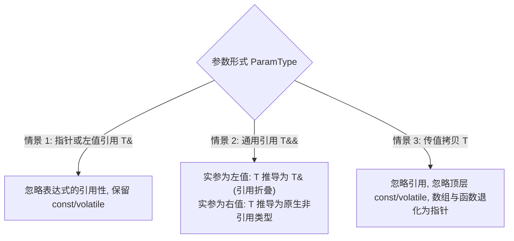

# 类型推导与现代语法基线指南

> 整合自《Effective C++》(条款 2, 3) 与《Effective Modern C++》(条款 1-10, 15)。

---

## 1. 类型推导核心体系（Template, auto, decltype）

现代 C++ 的类型系统以推导为基石，掌握三类推导规则至关重要：

### 1.1 模板与 auto 推导的三种情景
`auto` 的推导机制完全继承自模板类型推导，但在处理初始化列表 `{}` 时存在唯一差异。



### 1.2 `auto` 与花括号 `{}` 的唯一区别 (条款 2)
```cpp
auto x = 27;          // int
auto x1(27);          // int
auto x2 = { 27 };     // ❌ 陷阱: 推导为 std::initializer_list<int>！
auto x3{ 27 };        // C++11 推导为 initializer_list; C++17 修复推导为 int

template<typename T>
void f(T param);
// f({ 1, 2, 3 });    // ❌ 编译报错：模板推导无法将 {1, 2, 3} 自动推导为 initializer_list
```

### 1.3 `decltype`：保留完整类型 (条款 3)
`decltype(expr)` 永远如实反映表达式的精确类型，包括顶层 `const` 与引用；常用于泛型返回值转发：
```cpp
template<typename Container, typename Index>
decltype(auto) authAndAccess(Container&& c, Index i) { // C++14 decltype(auto)
    authenticateUser();
    return std::forward<Container>(c)[i]; // 正确保留容器元素本身的左值或右值引用性
}
```

---

## 2. 现代初始化与类型安全基线

### 2.1 花括号列表初始化 `{}` 的权衡与避坑 (条款 7)
花括号初始化是现代 C++ 推荐的通用语法，但必须警惕 `std::initializer_list` 的优先匹配陷阱：

| 语法形式 | 行为表现 | 优缺点分析 |
| :--- | :--- | :--- |
| `int x{3.14};` | ❌ **编译直接报错** | **防止窄化转换（Narrowing Conversions）**，安全防线 |
| `Widget w();` | ❌ **解析为函数声明** | 著名的 Most Vexing Parse 陷阱 |
| `Widget w{};` | ✅ **调用默认构造函数** | 彻底消除函数声明歧义 |
| `std::vector<int> v(10, 20);` | 包含 10 个元素，值均为 20 | 圆括号明确调用普通双参数构造函数 |
| `std::vector<int> v{10, 20};` | 包含 2 个元素：10 和 20 | **强烈贪婪匹配 `std::initializer_list`**，易导致逻辑错误 |

> **法则**：设计类时，若提供 `std::initializer_list` 构造函数，应确保其参数类型与普通构造函数有明显区分度，避免调用端意图颠覆。

### 2.2 `nullptr` 取代 `0` 与 `NULL` (条款 8)
- `0` 是 `int`，`NULL` 在 C++ 中通常是宏 `0` 或 `0L`；
- 当存在重载 `void f(int)` 与 `void f(void*)` 时，`f(0)` 和 `f(NULL)` 均会错误调用 `f(int)`；
- `nullptr` 拥有专属类型 `std::nullptr_t`，能隐式转换为任意指针类型，但在整型上下文完全不匹配，是泛型编程传递空指针的唯一安全选择。

### 2.3 `using` 别名取代 `typedef` (条款 9)
`using` 语法直观，且直接原生支持模板化（Alias Template），彻底终结旧式 `typedef` 嵌套结构体的丑陋写法：
```cpp
// ❌ 遗留 C++98: 必须使用 struct 包装
template<typename T>
struct MyAllocList {
    typedef std::list<T, CustomAllocator<T>> type;
};
typename MyAllocList<T>::type myList; // 使用时必须写 typename 和 ::type

// ✅ 现代 C++: 直接定义别名模板
template<typename T>
using MyAllocList = std::list<T, CustomAllocator<T>>;
MyAllocList<T> myList; // 干净利落，无需 typename
```

### 2.4 限域枚举 `enum class` (条款 10)
- **命名空间隔离**：枚举项不泄漏到外部作用域（避免命名冲突）；
- **强类型检查**：禁止隐式转换为整型，杜绝意外的算术比较；
- **支持前置声明**：默认底层类型为 `int`，可显式指定 `: uint8_t` 节省内存并切断头文件编译依赖。

### 2.5 编译期计算 `constexpr` (条款 15)
- `constexpr` 对象是编译期常量，必须用编译期已知值初始化，可直接用于数组大小、模板实参；
- `constexpr` 函数：若传入实参在编译期已知，则在编译期计算；若传入运行时变量，则退化为普通运行时函数执行（一套代码，零运行时开销）。
