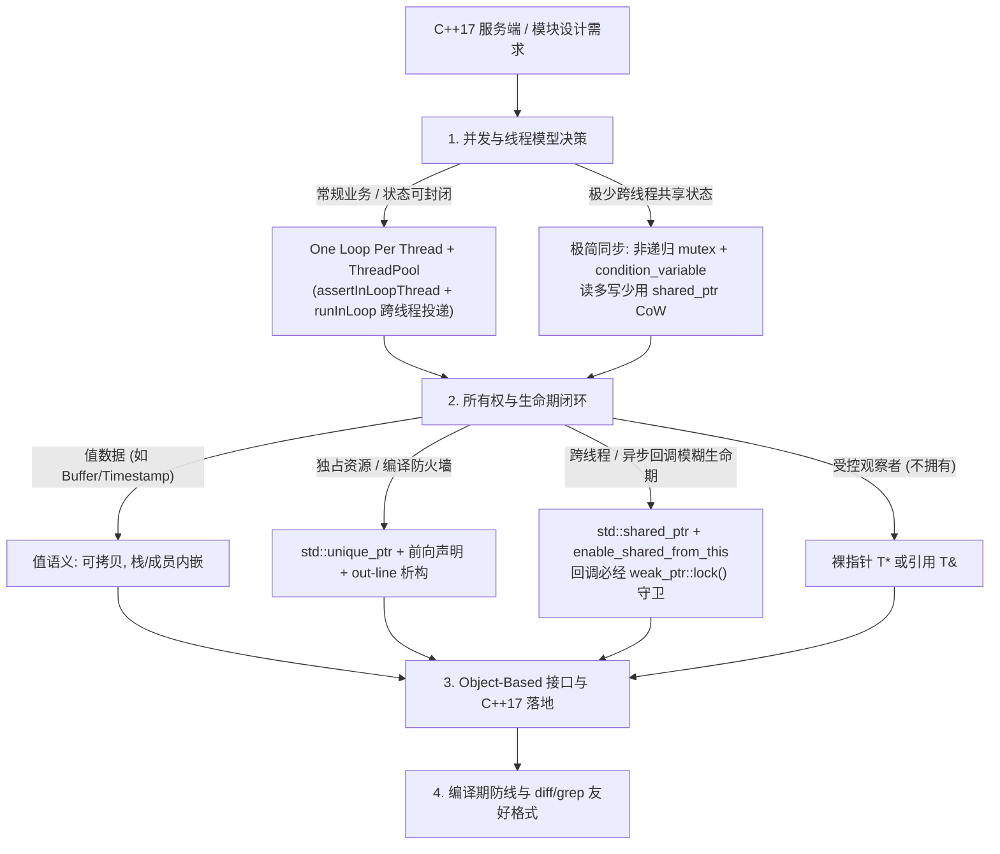

# Muduo 风格 C++17 服务端与 KISS 工程指南

本技能提炼自陈硕《Linux 多线程服务端编程：使用 muduo C++ 网络库》及 `muduo`（含 `cpp17` 分支）源码实践，核心哲学是**“工程减法”与 KISS**：用架构隔离消除共享锁，用基于对象（Object-Based）和值语义替代重度继承，用现代 C++17 标准库消除历史兼容包袱。

> **技能边界协同**：通用服务端/网络业务默认采用本技能的 KISS 线程封闭与极简同步；仅当明确构建底层无锁队列、细粒度原子序或 Work-Stealing 调度器时切入 `cpp-concurrency`；不可信输入与高危 C API 防御参见 `secure-cpp`。

---

## 1. 核心架构与编码决策流

---

## 2. 主动编码五项铁律（C++17 基线）

编写或重构服务端/基础设施代码时，默认直接落实以下 5 条准则：

1. **线程封闭优先，同步原语做减法**
   - **One Loop Per Thread**：连接与状态尽量封闭在所属 IO 线程，用 `assertInLoopThread()` 校验边界；跨线程操作通过 `runInLoop()` / `queueInLoop()` 投递，不靠到处加锁兜底。
   - **只用非递归互斥锁 + 条件变量**：`wait()` 必须配 `while` 谓词防伪唤醒；**禁用递归锁**（防掩盖持锁重入修改容器的逻辑错误）；**禁用读写锁与信号量**（读多写少改用 `shared_ptr` Copy-on-Write）；**禁止手写无锁结构**（除 `std::atomic` 计数/标志外）。
   - **临界区极小化**：任务队列消费用局部变量 `swap()` 出锁执行；高频收集/日志采用双缓冲（Double Buffering）仅在锁内交换指针，构建与析构移出临界区。详见 [references/concurrency_and_lifetime.md](./references/concurrency_and_lifetime.md)。

2. **所有权三层边界与异步防悬空**
   - **值语义 vs 资源实体**：明确区分可拷贝值类型与不可拷贝实体（`= delete` 拷贝构造与赋值）。
   - **构造与析构铁律**：构造期间严禁泄露 `this`（不注册回调、不调用 `shared_from_this()`）；绝不用成员 `mutex` 保护析构。
   - **异步回调保活**：凡是可能跨过对象销毁边界的异步回调（Reactor 事件、定时器、线程池），必须使用 `std::weak_ptr::lock()` 临时提升为 `shared_ptr` 后再执行（`Channel::tie` / `WeakCallback` 模式）。详见 [references/concurrency_and_lifetime.md](./references/concurrency_and_lifetime.md)。

3. **Object-Based 接口取代重度 OOP 继承**
   - **克制虚函数**：虚函数是 `bind-by-vtable-offset`，对外库接口尽量使用具体类 + `std::function` / **C++17 初始化捕获 Lambda**（`[self = shared_from_this(), data = std::move(buf)]` 取代 `std::bind`）；仅在派生集合完全封闭时用虚函数作内部分发跳转表（如 `Poller`）。
   - **系统调用隔离**：外部 OS 调用集中在独立 `namespace` 自由函数中转发，支持链接期替换 Mock，避免为可测性引入虚基类与运行期开销。

4. **C++17 标准替代（零 Boost 依赖）**
   - 用 `std::string_view` 替代自定义字符串视图（仅向 C API 传 `\0` 结尾串时保留轻量 `StringArg`）；
   - 用 `std::any`、`std::optional`、`std::variant` 替代 `boost::any` 与魔数约定；
   - 用 `thread_local` 替代 `__thread`，局部静态变量（Magic Statics）替代 `pthread_once` 单例；
   - `std::mutex` + `std::scoped_lock` 为默认锁封装（若项目在 CI 启用 Clang `-Wthread-safety`，再做薄封装挂 `GUARDED_BY` / `REQUIRES`）。详见 [references/cpp17_evolution_and_idioms.md](./references/cpp17_evolution_and_idioms.md)。

5. **编译防火墙、告警门禁与可维护格式**
   - **编译防火墙**：公开头文件只包含公开头文件与前向声明；成员用 `std::unique_ptr<Impl>` 时显式声明并 **out-line 定义析构函数**；`.cc` 文件首行 `#include` 对应 `.h` 验证自给自足。
   - **编译门禁**：推荐开启 `-Werror -Wconversion -Wshadow -Wold-style-cast -Woverloaded-virtual`；有 Clang 条件则开启 `-Wthread-safety`。
   - **对 `diff`/`grep` 友好的格式**：`namespace` 不缩进（利于 `diff -p` 定位类名/函数名）；多行注释用 `//`；一行只定义一个变量；禁止 C 风格强转；慎用匿名 `namespace` 与非数值类的运算符重载。详见 [references/cpp17_evolution_and_idioms.md](./references/cpp17_evolution_and_idioms.md)。

---

## 3. 代码审查与诊断清单

当用户要求“按 Muduo 风格审查代码”或“重构服务端并发逻辑”时，逐项核查以下坏味道：

- [ ] **是否存在无意义的跨线程锁？** 能否通过 `runInLoop` 线程封闭或 `shared_ptr` CoW 消除锁竞争。
- [ ] **临界区内是否做了重操作？** 是否把内存分配、文件 IO、对象析构或未知用户回调放在了持锁期间（应 `swap` 出锁执行）。
- [ ] **异步回调是否可能访问已析构对象？** Lambda/回调中是否直接捕获了裸 `this` 或强引用 `shared_ptr` 造成循环引用/意外延寿（应弱引用捕获 + `lock()`）。
- [ ] **是否过度设计了虚函数接口？** 仅作为回调/策略的基类能否简化为 `std::function` 或模板/Lambda 注入。
- [ ] **头文件是否泄露了内部依赖？** 能否改用前向声明 + `std::unique_ptr` + out-line 析构降低编译耦合。
- [ ] **是否残留前 C++17 历史包袱？** 是否仍有 `boost::any`、`std::bind` 强转成员指针、`NULL`、`__thread`、`pthread_once` 可升级为 C++17 标准设施。

---

## 4. 深入参考手册

- [并发减法与生命期管理模式](./references/concurrency_and_lifetime.md)：One Loop Per Thread、CoW、双缓冲、临界区 `swap`、`weak_ptr` 弱回调与防自毁实现。
- [Linux 多线程系统编程精要与 C++ 工程心得](./references/system_programming_and_notes.md)：多线程 `fork()`/`signal` 禁区、`eventfd`/`timerfd`/`signalfd`、值语义取舍与高频工程避坑原则。
- [C++17 现代化演进与工程习惯](./references/cpp17_evolution_and_idioms.md)：Muduo 到 C++17 对照表、编译防火墙、链接期 Mock、`diff`/`grep` 友好排版与 Clang TSA 注解。
