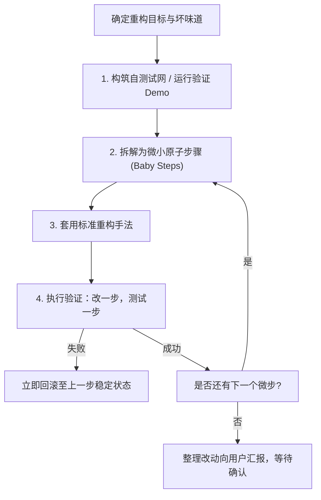

# 安全代码重构实施指南

本技能指导如何以安全、标准且严谨的方式，在不改变软件可观察行为的前提下改善其内部架构。

---

## 1. 重构铁律：安全第一与测试守护

> “重构前，先检查自己是否有一套可靠的测试机制。这些测试必须有自我检验能力。” —— 马丁·福勒

### 严谨性操作规范：
1. **绝不裸奔重构**：若目标代码缺乏单元测试，**必须首先编写测试用例或最小可运行验证 Demo 捕获当前行为**。
2. **两顶帽子法则 (Two Hats)**：
   - 戴上“重构”帽子时，**严禁添加新功能或修复潜在隐藏 Bug**，只调整代码结构；
   - 戴上“添加功能”帽子时，不再做大规模重构。绝不将两者混在一锅粥中。
3. **微步前进 (Baby Steps)**：
   - 每次只做一步最小改动（例如提炼一个函数、移动一个字段），改完立即运行测试。如果出错，能立刻定位到最近几十秒内的改动。

---

## 2. 核心参考资料库

- [坏味道与重构手法速查映射表](./references/smell_to_refactoring_map.md)：从出现的坏味道快速检索适用的重构手法。
- [68 种标准重构手法全集手册](./references/refactoring_catalog.md)：涵盖重新组织函数、搬移特性、组织数据、简化条件、简化调用、概括关系六大分类。

---

## 3. 标准重构操作范式样例

### 场景：提炼函数 (Extract Method) 与卫语句 (Guard Clauses)
1. **原状**：30+ 行长函数，包含 3 层嵌套 `if-else`。
2. **微步 1**：将异常情况改为卫语句提前返回，消除缩进。运行测试，确保结果一致。
3. **微步 2**：选中无副作用的内部计算逻辑，提炼为私有小函数 `computeSubTotal(...)`。运行测试，确保结果一致。
4. **微步 3**：用提炼后的函数替换原逻辑。运行测试，验证完毕。
