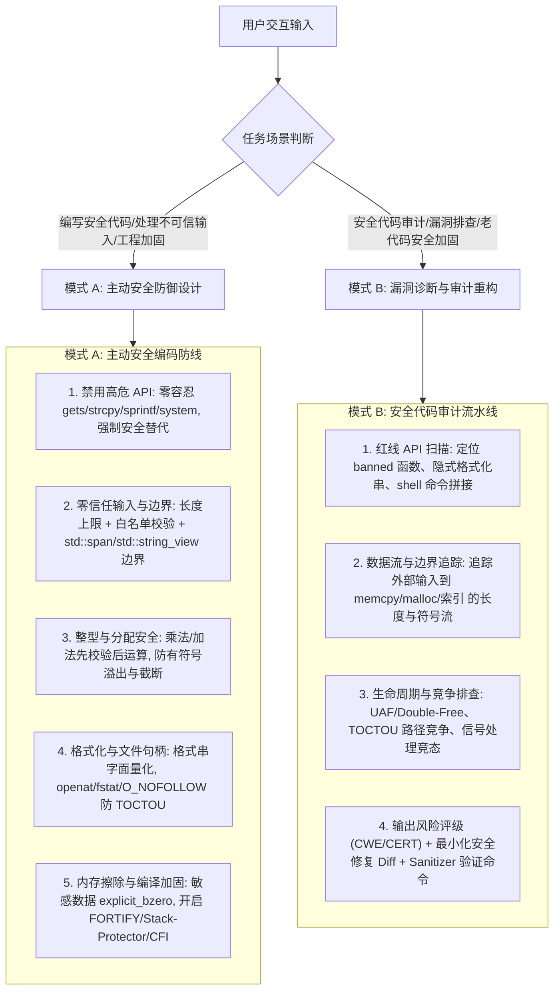

# C/C++ 安全编码与漏洞防御专家指南

本技能沉淀自 Robert C. Seacord 经典著作 **《Secure Coding in C and C++ (2nd Edition)》**（SEI 软件工程系列），并融合 **SEI CERT C/C++**、**Microsoft SDL Banned Functions** 与 **OpenSSF Compiler Hardening** 工程基线，专攻不可信输入边界防御、内存与整型安全、高危 API 治理与代码安全审计。

> **技能边界协同**：类设计/智能指针常规用法参见 `effective-cpp`；多线程锁与内存模型参见 `cpp-concurrency`；单元测试与 ASan/UBSan 流水线搭建参见 `cpp-testing`。本技能聚焦**安全威胁模型、漏洞利用机理与防御性编码红线**。

---

## 1. 核心执行引擎

---

## 2. 模式 A：主动安全防御设计准则

当编写涉及**外部输入解析（网络包、文件、CLI、环境变量）、内存操作、系统调用或敏感数据**的 C/C++ 代码时，强制应用以下 6 条安全铁律：

1. **红线 API 零容忍（Banned Functions Replacement）**：
   - 严禁使用 `gets`、`strcpy`、`strcat`、`sprintf`、`vsprintf`、`scanf("%s")`、`mktemp`、`tmpnam`、`system`、`popen`、`rand()`（安全场景）；
   - 慎用 `strncpy`、`strncat`（不保证 `\0` 结尾且极易算错剩余空间），优先使用现代 C++（`std::string`、`std::format`、`std::span`）或有界安全接口（`snprintf` + 截断检查），完整替代矩阵见 [references/banned-functions-and-cheatsheet.md](./references/banned-functions-and-cheatsheet.md)。
2. **字符串与动态内存边界防御（Strings & Heap Safety）**：
   - 所有缓冲区拷贝前必须显式校验 `src_len < dst_capacity`（预留 `\0`）；
   - 堆内存遵循唯一所有权（`std::unique_ptr` / `std::vector`）；裸指针 `free`/`delete` 后若作用域未结束立即置 `nullptr`；
   - **密钥/口令等敏感内存**释放前必须使用 `explicit_bzero()` / `memset_s()` / `SecureZeroMemory()` 擦除（禁止普通 `memset`，防编译器死代码消除优化），详见 [references/strings-and-memory.md](./references/strings-and-memory.md)。
3. **整型与分配算术安全（Integer Security）**：
   - 内存分配大小计算（如 `count * elem_size + header_len`）必须在运算前通过前置条件校验或内置溢出原语（`__builtin_mul_overflow` / C23 `<stdckdint.h>` / `SafeInt`）检查，严禁在溢出发生后再判断结果；
   - 禁止在有符号与无符号整数间隐式混用比较（防止负值转为巨大 `size_t` 绕过长度检查），详见 [references/integers-and-pointers.md](./references/integers-and-pointers.md)。
4. **指针与控制流保护（Pointer Subterfuge Defense）**：
   - 避免将函数指针或虚表对象暴露在可被相邻缓冲区溢出的同一结构体/栈帧尾部；
   - 禁止通过未校验的外部索引或偏移量直接计算函数指针/跳转表目标，详见 [references/integers-and-pointers.md](./references/integers-and-pointers.md)。
5. **格式化串与文件 I/O 安全（Format Strings & TOCTOU）**：
   - `printf`、`snprintf`、`syslog` 等格式化函数的格式串参数**必须是编译期常量字面量**，严禁 `printf(user_str)`；
   - 文件操作禁止“先 `access()`/`stat()` 检查再 `open()`”（TOCTOU 竞争），统一改用基于目录/文件描述符的原子原语（`openat()` + `O_NOFOLLOW` + `O_CREAT | O_EXCL` + `fstat()`），临时文件仅用 `mkstemp()`，详见 [references/format-io-and-toctou.md](./references/format-io-and-toctou.md)。
6. **编译期与运行期纵深加固（Compiler & Stdlib Hardening）**：
   - 发布构建强制开启编译期/链接期防线（`-D_FORTIFY_SOURCE=3`、`-fstack-protector-strong`、`-ftrivial-auto-var-init=zero`、`-Werror=format-security`、PIE/RELRO/CFI）及标准库硬化模式，详见 [references/banned-functions-and-cheatsheet.md](./references/banned-functions-and-cheatsheet.md)。

---

## 3. 模式 B：安全代码审计与漏洞修复流

当用户要求“对这段 C/C++ 代码做安全审计”、“检查有没有内存/注入漏洞”或“修复安全隐患”时，按以下 4 步执行：

1. **高危 API 与注入面快速扫描**：
   - 检索 [禁用函数与安全替代对照表](./references/banned-functions-and-cheatsheet.md) 中的红线函数；
   - 检查非常量格式化字符串、拼接构造的 `system()`/`popen()`、未规范化的路径拼接（`../` 目录穿越）。
2. **污点数据流追踪（Taint & Bounds Trace）**：
   - 定位所有外部入口（`argv`、`getenv`、`recv`/`read`、文件解析结构体），追踪其长度、索引、循环边界在传递过程中是否发生**符号位转换、整型截断或算术回绕**。
3. **内存生命周期与竞争审计**：
   - 排查异常分支/早退路径是否存在未配对释放、Double-Free 或 Use-After-Free；
   - 排查基于路径的文件系统 TOCTOU 竞争、信号处理函数中调用非异步安全函数（`malloc`/`printf`）。
4. **结构化输出审计报告与修复方案**：
   - 每条发现按 **`[严重级别] 漏洞类型 (CWE / CERT 编号) + 位置 + 触发机理 + 修复 Diff`** 输出；
   - 给出配套的编译器诊断参数或 `ASan/UBSan` 复现验证命令。

---

## 4. 核心参考手册

- [禁用函数红线与安全加固速查表](./references/banned-functions-and-cheatsheet.md)：Microsoft SDL + CERT + 大厂红线禁用 API 对照表、Top 安全编码铁律、OpenSSF 编译/标准库加固参数。
- [字符串安全与动态内存防御](./references/strings-and-memory.md)：原著第 2、4 章精粹——栈/堆缓冲区溢出、`strncpy`/`strncat` 陷阱、UAF/Double-Free 防御、敏感内存防优化擦除。
- [整型安全与指针欺骗防御](./references/integers-and-pointers.md)：原著第 3、5 章精粹——有符号/无符号转换与截断、分配溢出前置校验与 AIR 模型、vtable/函数指针/GOT 保护。
- [格式化输出、文件 I/O 与 TOCTOU 竞争](./references/format-io-and-toctou.md)：原著第 6、7、8 章精粹——`%n` 格式串利用与防御、`openat`/`O_NOFOLLOW` 消除 TOCTOU、路径规范化、命令注入与信号安全。
