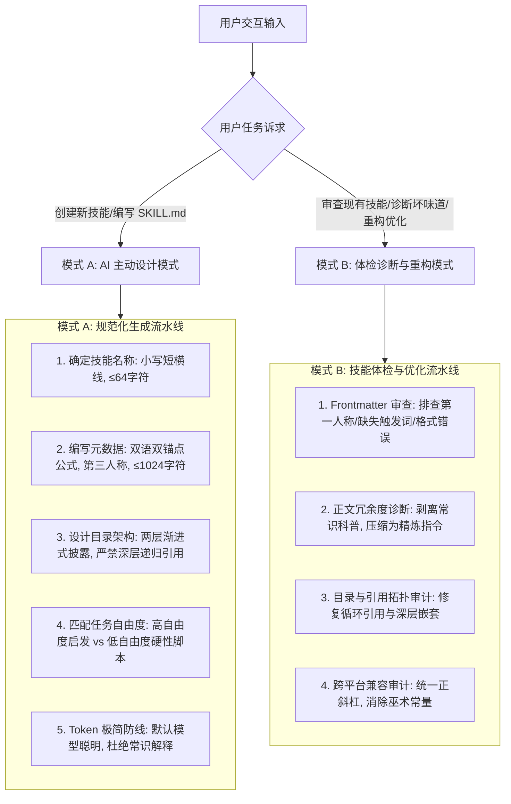

# Agent Skill 架构与规范化编写指南

本技能提炼自 Anthropic 官方 Agent Skills 最佳实践规范与 Code-Craft 多语言工程沉淀，专为设计、编写、优化和审查 Agent 技能提供标准化工程支持。

---

## 1. 核心执行引擎

---

## 2. 模式 A：新建 Skill 主动设计清单

当用户要求创建新技能、定义新工作流或封装领域知识时，**无需用户提醒，必须在第一时间主动应用以下 5 条黄金法则**：

1. **命名与双语双锚点元数据（Metadata Formula）**：
   - `name`：严格小写字母、数字与中划线连接（如 `sql-craft`），长度 $\le 64$；
   - `description`：采用**双语双锚点**结构，前半段为英文能力定义与 `Use when...` 触发词，后半段为中文能力定义与 `当用户要求...时触发`，长度 $\le 1024$。详见 [references/metadata_and_triggering.md](./references/metadata_and_triggering.md)。
2. **两级架构与渐进式披露（Progressive Disclosure）**：
   - 技能必须采用分层结构：`SKILL.md` 为第一层入口，`references/` 与 `scripts/` 为第二层深度资料；
   - **单层引用深度铁律**：`SKILL.md` 引用 `references/foo.md` 即可，`foo.md` 内部严禁再嵌套引用二级子文件，杜绝 Agent 检索迷航。详见 [references/progressive_disclosure_and_layout.md](./references/progressive_disclosure_and_layout.md)。
3. **任务自由度精准分级（Degrees of Freedom）**：
   - **低自由度**：对于脆弱、高危、顺序敏感任务（构建部署、环境检查、原子写），提供确定性脚本，锁定参数；
   - **高自由度**：对于架构设计、代码审查、技术方案，提供启发式检查清单与思考维度，激发模型推理能力。详见 [references/degrees_of_freedom_and_guardrails.md](./references/degrees_of_freedom_and_guardrails.md)。
4. **Token 极简原则（Context Window Hygiene）**：
   - **默认假设模型已经掌握行业标准知识**，严禁在文档中花费 Token 解释通用常识（如“什么是 RESTful”、“什么是 B-Tree”）；
   - 只写入**当前工程的特有规范、踩坑护栏、脚本参数与硬性边界**。
5. **跨平台与路径规范（Zero Magic Constants）**：
   - 所有路径一律使用正斜杠（`/`），杜绝 Windows 反斜杠；
   - 所有数值配置（超时、列宽、对齐字节数）必须给出明确工程依据。

---

## 3. 模式 B：已有 Skill 规范体检与重构

当用户要求“审查这个 skill”、“优化这个 SKILL.md”、“为什么技能没有被触发”时，执行以下诊断流：

1. **触发失效与元数据体检**：
   - 检查 `description` 是否使用了第一人称（如 "I can help you..." $\to$ 违规，降低召回率）；
   - 检查是否缺少 `Use when...` 或 `当用户要求...时触发` 明确场景；
   - 检查不同技能间 `description` 是否存在关键词碰撞导致模型选择困难。
2. **正文 Token 膨胀诊断**：
   - 识别是否存在长篇大论的“背景介绍”和“概念科普”；
   - 输出优化前后的 Token 预估对比，将冗长段落重构成“代码块 + 极简要点”。
3. **引用拓扑健康度诊断**：
   - 扫描是否存在死链（Broken Links）、多级嵌套引用（File A $\to$ File B $\to$ File C）；
   - 整理扁平化单层引用矩阵。
4. **交付规范重构 Diff**：
   - 输出修改后的 Frontmatter 与标准化结构。

---

## 4. 核心参考手册

- [元数据规范与双语双锚点设计](./references/metadata_and_triggering.md)：命名约束、第三人称原则、双语触发词设计公式。
- [渐进式披露与两级目录架构](./references/progressive_disclosure_and_layout.md)：Token 优化、单层引用深度、目录布局模式。
- [自由度分级与脚本安全护栏](./references/degrees_of_freedom_and_guardrails.md)：高/中/低自由度决策树、确定性脚本模式。
- [技能质量评估与跨模型测试](./references/testing_and_eval_checklist.md)：三测试用例法、Haiku/Sonnet/Opus 兼容性校验。
- [官方最佳实践原著知识库](../../../resources/agent-skills/best-practices.md)：Anthropic 完整官方最佳实践归档。
