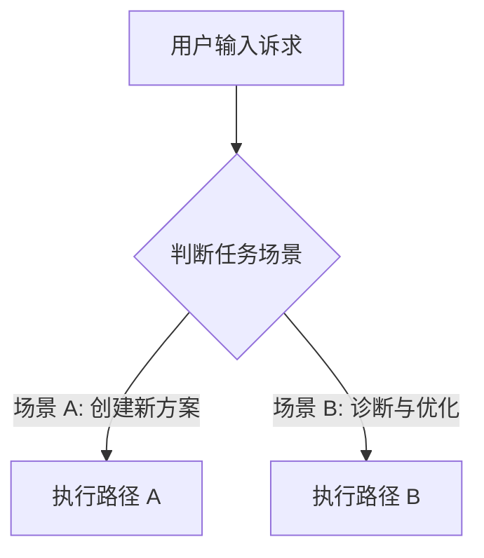

# [技能中文标题]

简要说明本技能解决的核心问题与理论依据。

---

## 1. 核心工作流与决策树



---

## 2. 核心执行指南

### 场景 1：[场景名称]
当用户要求 [具体场景描述] 时：
1. 步骤说明与命令：
   ```bash
   ./scripts/run.sh --flag
   ```
2. 注意事项与边界约束。

---

## 3. 核心参考手册

- [专题手册 A](./references/topic_a.md)：针对特定技术的详细规范。
- [专题手册 B](./references/topic_b.md)：针对疑难问题的排查清单。
