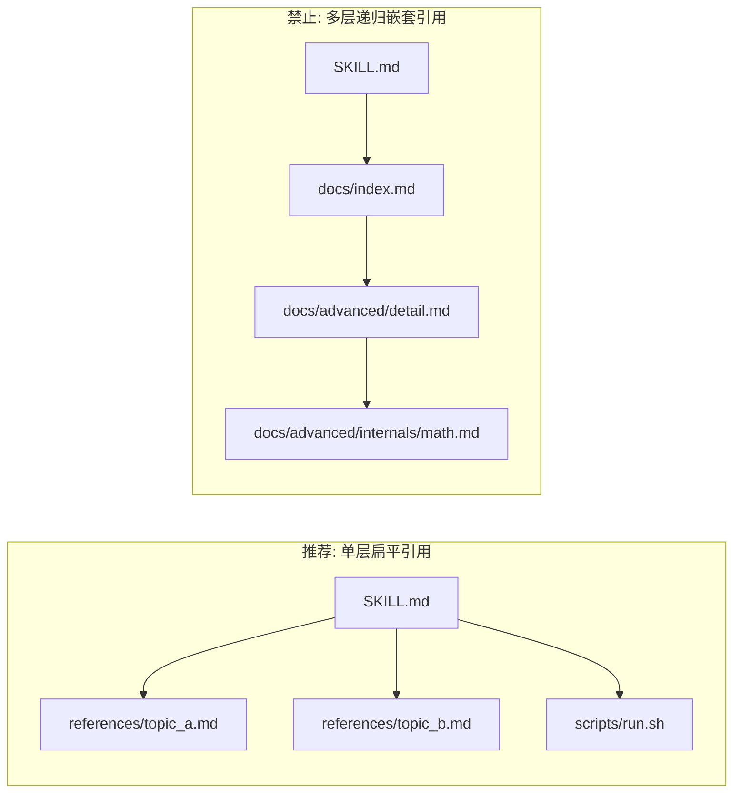

# 渐进式披露与两级目录架构

> 依据 Anthropic 官方规范中关于“上下文窗口公共资源保护”的核心理念。

---

## 1. 上下文窗口的经济学本质

在大型多智能体协作与长程任务中，上下文窗口（Context Window）是最昂贵的共享公共资源：
- 系统提示词（System Prompt）
- 对话上下文历史（Message History）
- 技能预加载元数据（Skills Metadata）
- 当前激活技能的内容（Active SKILL.md）
- 工具执行输入与输出（Tool Calls & Tool Results）

一旦一个过度庞大的技能被加载进上下文，后续**每一次交互的每个 Token 都会在每次请求中被持续计费**，并且可能挤压对话历史导致模型过早发生遗忘。

---

## 2. 渐进式披露两级架构模型

优秀的技能必须采用**两级渐进式披露（Progressive Disclosure）**拓扑：

```text
skill-name/
├── SKILL.md                 # [第一层] 快速决策总控：业务工作流、决策树、快速指引 (≤ 150 行)
├── references/              # [第二层] 领域深度手册：原理解析、参数矩阵、反模式归纳
│   ├── topic_a.md
│   └── topic_b.md
├── examples/                # [第二层] 可编译可运行的示例、黄金测试用例
│   └── demo.hpp
└── scripts/                 # [第二层] 确定性可执行脚本 (Python/Bash)
    └── run_check.sh
```

### 每一层的职责划分：
1. **第一层（`SKILL.md`）**：
   - 目标：让 Agent 在 10 秒内理解“我是谁、我怎么决策、核心工作流步骤是什么”。
   - 控制体积：控制在 80~150 行以内，通常仅包含 Mermaid 流程图、模式分支、核心命令与第二层的链接索引。
2. **第二层（`references/`, `scripts/`, `examples/`）**：
   - 目标：提供具体落地实现的深度知识。
   - 特点：Agent 只有在第一层指引且当前任务明确需要时，才会按需（On-demand）加载对应文件。

---

## 3. 单层引用深度铁律（Single-Layer Reference Constraint）



### 为什么严禁多层嵌套？
1. **工具调用爆炸**：模型读取 `SKILL.md` $\to$ 发现指向 `index.md` $\to$ 读取 `index.md` $\to$ 发现又指向 `detail.md`，导致多次往返工具调用，大幅增加耗时与网络延迟。
2. **检索迷航（Context Drift）**：深层跳转容易导致模型遗忘最初用户的任务目标，注意力发散。
3. **维护脆弱性**：层级越深，相对路径越容易失效断链。

**铁律**：`SKILL.md` 直接指向 `references/` 下的具体主题文件，所有参考文件必须直接解答具体问题，禁止在参考文件内继续套娃跳转。
