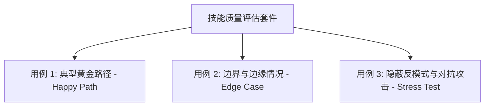

# 技能质量评估与跨模型测试清单

> 依据 Anthropic 官方规范中关于“使用计划使用的所有模型进行测试”与“三评估基准法”的指导。

---

## 1. 三用例评估法 (Three-Eval Benchmark)

任何新编写的技能在合并入生产环境前，必须至少设计并验证 3 个不同层次的评估测试用例：

1. **用例 1：典型黄金路径（Happy Path）**
   - 目标：验证在最常见的标准用户 Prompt 下，技能是否能被**准确触发**，并生成符合预期格式的结果。
   - 检验点：元数据匹配度、工作流步骤是否完整。
2. **用例 2：边界与边缘情况（Edge Case）**
   - 目标：输入缺少关键参数、极简输入或具有歧义的指令。
   - 检验点：技能是否能触发参数自检，或主动引导用户补充必要信息。
3. **用例 3：对抗与隐蔽反模式（Stress Test）**
   - 目标：提供包含复杂陷阱的代码或需求（如隐式类型转换、缓存伪共享、断电脆弱性）。
   - 检验点：技能是否会盲目妥协，还是能坚守底线规则并指出根本隐患。

---

## 2. 跨模型体检矩阵（Cross-Model Matrix）

不同能力等级的模型在运行同一个技能时，表现差异显著：

| 模型档次 | 典型代表 | 常见表现瓶颈 | 技能优化重点 |
| :--- | :--- | :--- | :--- |
| **轻量级 (Flash / Haiku)** | Claude Haiku, Gemini Flash | 易跳步、对隐含上下文理解不足、容易遗漏细节 | **增强具体指引**：明确步骤编号，提供可直接套用的模板和脚本 |
| **均衡级 (Sonnet / Pro)** | Claude Sonnet | 综合表现最佳，遵循指令能力极强 | **保持精炼平衡**：减少废话，保留清晰决策树与核心边界 |
| **高推理级 (Opus / Thinking)** | Claude Opus, o3 | 推理深度极大，但面对过度啰嗦的指令易产生注意力稀释 | **避免过度解释**：删除背景常识，仅保留硬性约束与契约 |

---

## 3. 合并上线前 Checklist

在将技能推送到版本仓库前，执行本核对表：

### Frontmatter 元数据
- [ ] `name` 长度 $\le 64$，纯小写字母与连字符，无空格与特殊符号。
- [ ] `description` 长度 $\le 1024$ 字符。
- [ ] `description` 为纯第三人称（无 "I can", "You should"）。
- [ ] 包含了清晰的英文能力概括与 `Use when...` 触发词。
- [ ] 包含了清晰的中文能力概括与 `当用户要求...时触发` 命令词。

### 结构与 Token 控制
- [ ] `SKILL.md` 行数控制在 80~150 行以内。
- [ ] 杜绝了通用概念科普与常识解释（省下 Token 留给对话历史）。
- [ ] 目录扁平化，所有参考手册直接平铺在 `references/` 下。
- [ ] 引用深度为一层（`SKILL.md` 指向手册，手册不互相套娃）。

### 脚本与跨平台兼容
- [ ] 所有文档、代码中的路径均采用正斜杠（`/`）。
- [ ] Shell 脚本均设置了 `set -euo pipefail`。
- [ ] 无任何未加解释的巫术常量（Magic Numbers）。
