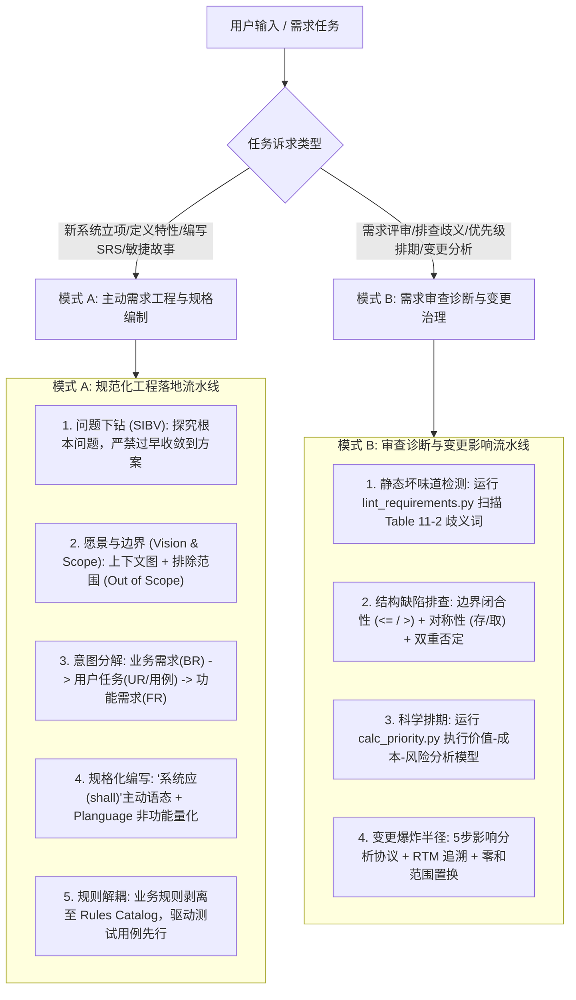

# 软件需求工程与业务分析指南 (Software Requirements Engineering)

本技能系统提炼自需求工程权威 Karl Wiegers 经典名著《Software Requirements》(第3版) 与《Software Requirements Essentials》(2023)，为软件需求全生命周期的获取、建模、编写、度量、评审与变更治理提供工业级工程标准。

---

## 1. 核心执行引擎 (Dual-Mode Engine)

---

## 2. 模式 A：主动需求工程与规格编制流程

当用户要求设计新功能、梳理业务流程、撰写 PRD/SRS 或分解敏捷需求时，**必须主动依循以下 5 个步骤推进**：

1. **确立 SIBV 业务问题陈述与愿景边界**：
   - 杜绝直接从“界面或功能”切入，严格按 `Situation -> Problem -> Implication -> Benefit -> Vision` 梳理商业痛点；
   - 制定愿景陈述公式（`For / Who / The / Is a / That / Unlike / Our product`），并明确划定**排除范围（Out of Scope）**；
   - 详见 [references/requirements_foundation_and_scope.md](./references/requirements_foundation_and_scope.md) 与模板 [examples/vision_and_scope_template.md](./examples/vision_and_scope_template.md)。
2. **建立三层级需求体系与用户代言机制**：
   - 区分业务需求（BR）、用户需求（UR）与功能需求（FR），建立 Product Champion（产品代言人）沟通渠道；
   - 指定唯一的赋权决策者与死锁打破人（Deadlock Breaker）。
3. **用户需求多模表达（用例 vs. 敏捷用户故事）**：
   - 复杂企业业务采用标准用例（主成功流、扩展流、异常流、前置/后置条件）；
   - 敏捷冲刺采用 INVEST 故事卡，编写严格的 Given-When-Then BDD 验收准则；
   - 详见 [references/elicitation_and_user_requirements.md](./references/elicitation_and_user_requirements.md) 与范例 [examples/use_case_and_user_story_spec.md](./examples/use_case_and_user_story_spec.md)。
4. **工业级功能规范与 Planguage 质量量化**：
   - 功能需求强制统一采用“**系统应 (shall)**”主谓宾主动句式，杜绝模棱两可的“应该 (should)”；
   - 非功能需求严禁使用“快速/稳定”空洞形容词，统一采用 **Planguage** 语法声明 `SCALE / METER / MUST / PLAN / FAIL`；
   - 详见 [references/specification_and_ambiguity_defense.md](./references/specification_and_ambiguity_defense.md) 与 [references/quality_attributes_and_planguage.md](./references/quality_attributes_and_planguage.md)。
5. **业务规则独立目录化与测试先行**：
   - 业务规则按“事实、约束、动作触发、推断、计算”五分类录入独立规则目录（Rules Catalog）；
   - 根据需求在编码前反导验收测试用例，驱动需求缺陷前置暴露。

---

## 3. 模式 B：需求审查诊断、优先级计算与变更控制

当用户要求“审查需求文档”、“排查需求歧义”、“确定功能优先级”或“评估需求变更影响”时，执行以下诊断流：

1. **歧义坏味道扫描与防御重构**：
   - 运行自动化工具扫描：`python3 .agents/skills/software-requirements/scripts/lint_requirements.py <doc.md>`；
   - 重点诊断排查 Table 11-2 经典坏味道（“用户友好”、“快速”、“和/或”、“等等”、“通常”、“合理”等）；
   - 纠正数值边界开闭区间（强制使用 `$\le$`、`$>$`）、消除双重否定、补齐对称性操作（保存必须配对加载）。
2. **分析型量化优先级排期**：
   - 拒绝“大嗓门优先”和“全量高优陷阱”，运行工具科学计算：
     `python3 .agents/skills/software-requirements/scripts/calc_priority.py --wb 2.0 --wp 1.0 --wc 1.0 --wr 0.5 <features.json/csv>`；
   - 基于 $Priority = \frac{Value\%}{Cost\% + Risk\%}$ 生成降序优先级排名；
   - 详见 [references/prioritization_and_validation.md](./references/prioritization_and_validation.md)。
3. **变更五步影响分析与 CCB 审批**：
   - 严格执行变更影响协议：评估商业对齐度 $\to$ 扫描 RTM 爆炸半径 $\to$ 评估测试回归代价 $\to$ 量化工期预算延后 $\to$ 提出等价范围置换方案；
   - 坚持“零和博弈防御”：死线固定时，新增功能必须以剔除同等工作量低优特性为前提；
   - 详见 [references/requirements_management_and_traceability.md](./references/requirements_management_and_traceability.md)。

---

## 4. 核心参考手册与工具索引

- [需求基础、业务需求与范围界定](./references/requirements_foundation_and_scope.md)：三层级模型、SIBV 问题陈述、产品愿景、决策规则与权利法案。
- [需求获取、用户需求与业务规则](./references/elicitation_and_user_requirements.md)：7大获取技术、用例模板、敏捷故事与 Gherkin、事件响应表、业务规则五分类。
- [规格说明书编写规范与歧义消除防御](./references/specification_and_ambiguity_defense.md)：ISO/IEC/IEEE 29148 标准结构、7大质量判据、25+ 歧义词典、边界与对称性防御。
- [非功能需求、质量属性与 Planguage 量化](./references/quality_attributes_and_planguage.md)：外部/内部质量属性体系、Planguage 语法、质量权衡冲突矩阵、约束推导。
- [需求优先级评定与质量验证](./references/prioritization_and_validation.md)：Wiegers 分析型计算模型、四象限重要度矩阵、同行正式审查、测试用例反导。
- [需求管理、可跟踪性与变更控制](./references/requirements_management_and_traceability.md)：需求基线状态机、RTM 端到端可跟踪性矩阵、五步影响分析、CCB 治理。
- [愿景与范围说明书模板](./examples/vision_and_scope_template.md)：工业级 Vision and Scope 完整模板。
- [软件需求规格说明书模板](./examples/srs_specification_template.md)：标准 SRS 完整规格模板。
- [用例与敏捷用户故事范例](./examples/use_case_and_user_story_spec.md)：经典用例与敏捷 BDD 对照范例。
- [分析型优先级计算器](./scripts/calc_priority.py)：自动化价值-代价-风险排期脚本。
- [需求歧义坏味道检测工具](./scripts/lint_requirements.py)：自动化需求歧义扫描工具。
