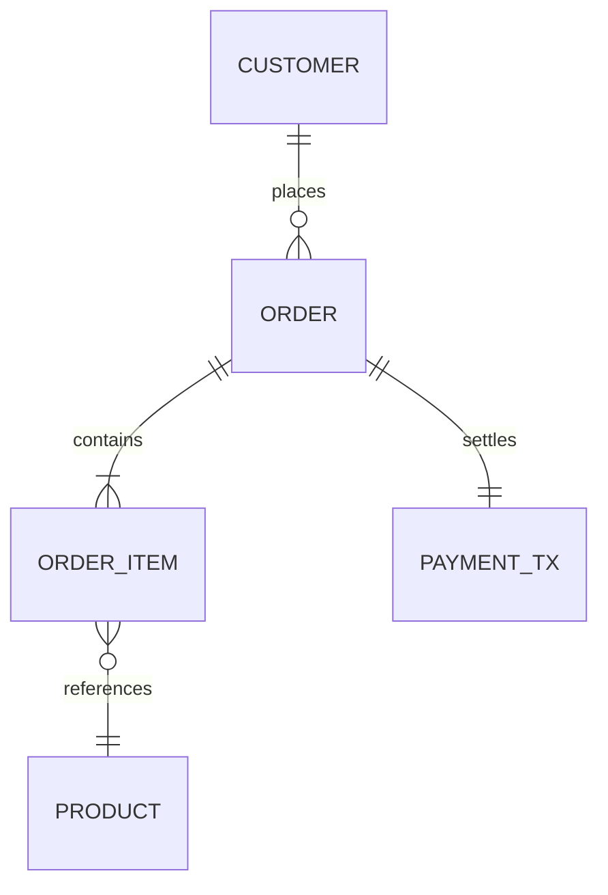

# 软件需求规格说明书模板 (Software Requirements Specification - SRS)

> **模板说明**：本模板遵循 ISO/IEC/IEEE 29148 与 Karl Wiegers《Software Requirements》(第3版) 工业级规范设计，作为系统设计、编码实现与测试验收的唯一受控基线文档。

---

# 1. 引言 (Introduction)

## 1.1 目的 (Purpose)
[明确说明本文档的覆盖范围、目标软件产品及其针对的具体发布版本（如 Release 2.0.0 基线）。]

## 1.2 文档约定与语法规范 (Document Conventions)
- **情态动词约定**：本文档严格遵循工程标准，所有具有强制约束力的系统行为一律使用“**系统应 (shall)**”；用户拥有的合法可选权利使用“**用户可 (may)**”；严格杜绝含糊不清的“应该 (should)”。
- **编号规则**：
  - 功能需求：`FR-[模块]-[三位序号]`（如 `FR-PAY-001`）；
  - 质量属性：`NFR-[类别]-[三位序号]`（如 `NFR-PERF-001`）；
  - 外部接口：`INT-[类别]-[三位序号]`（如 `INT-API-001`）。

## 1.3 预定读者与阅读指南 (Intended Audience)
[说明业务分析师、系统架构师、前端/后端开发人员、测试工程师、运维团队各自应重点关注的章节。]

## 1.4 项目范围索引 (Product Scope)
[简述本系统核心使命，并链接指向已签署生效的 [《愿景与范围规格说明书》](./vision_and_scope_template.md)。]

---

# 2. 总体描述 (Overall Description)

## 2.1 产品视角 (Product Perspective)
[阐明系统是独立软件还是更大企业级系统的组成子系统。在此绘制系统在生态圈中的拓扑集成图。]

## 2.2 用户类别与特征 (User Classes and Characteristics)
| 用户类别标识 | 用户群体描述 | 技术熟练度 | 访问频次与核心关注点 | 利益分类 (受宠/次要/反对) |
| :--- | :--- | :--- | :--- | :--- |
| **UC-ADMIN** | 平台系统管理员 | 高 (熟悉 Linux / SQL) | 低频，高度关注系统安全与审计日志 | 次要类 |
| **UC-CASHIER**| 线下门店收银员 | 中低 (仅掌握收银操作) | 高频 (每分钟多次交互)，关注响应速度 | 受宠用户类 (Favored) |

## 2.3 运行环境与技术栈约束 (Operating Environment & Constraints)
- **硬件与操作系统**：Ubuntu Server 22.04 LTS (x86_64, aarch64)；
- **开发与运行时**：C++20 标准编译环境 (GCC 11+ / Clang 14+) 或 Java 17 LTS；
- **存储基础设施**：PostgreSQL 14+（启用 WAL 物理流复制），Redis 7.0+（哨兵集群）；
- **浏览器兼容性**：Chrome 95+，Edge 95+，Firefox 100+。

## 2.4 假设与外部依赖 (Assumptions and Dependencies)
- **DEP-01**: 假定短信验证码服务商提供不低于 99.9% 的可用性，且单条发送时延 $\le 3$ 秒。

---

# 3. 系统特性与功能需求 (System Features & Functional Requirements)

## 3.1 特性 1: 订单在线实时结算 (Feature: Real-time Order Settlement)

### 3.1.1 描述与优先级 (Description and Priority)
- **特性描述**：为收银员与线上买家提供原子化资金扣减与订单状态流转服务。
- **业务优先级**：高优 (Priority Score: 1.15，属于 Release 1.0 阻断性上线特性)。

### 3.1.2 激励/响应序列 (Stimulus/Response Sequences)
1. 客户端提交包含支付凭据的结算请求包。
2. 系统校验签名、订单时效性与库存锁定状态。
3. 系统与第三方支付通道完成扣款事务。
4. 系统更新数据库状态并广播结算完成事件。

### 3.1.3 功能需求明细 (Functional Requirements)
- **FR-PAY-001**: 当用户点击“立即支付”时，**系统应**在 500ms 内校验当前订单状态是否为“待支付”；若订单已超时取消，**系统应**拒绝支付并提示“订单已超时失效”。
- **FR-PAY-002**: 若订单金额满足系统满减规则（引用 `BR-MKT-015`），**系统应**自动重新计算应付金额，并在界面展示优惠明细。
- **FR-PAY-003**: 当支付网关返回扣款成功回执时，**系统应**在单个数据库事务内完成以下三项操作：
  1. 将订单状态变更为“已支付”；
  2. 生成不可篡改的资金清算流水记录；
  3. 将库存锁定状态变更为“已扣减”。
- **FR-PAY-004**: 若与支付网关的通信在 5 秒内发生超时无响应，**系统应**启动幂等重试查询；若连续 3 次重试失败，**系统应**将订单置为“支付挂起中”，并向运维监控告警。

---

# 4. 数据需求 (Data Requirements)

## 4.1 逻辑数据模型 (Logical Data Model)


## 4.2 数据字典与验证约束 (Data Dictionary)
| 实体与字段名 | 数据类型 | 允许空值 (Null) | 取值范围与边界约束 | 业务描述 |
| :--- | :--- | :---: | :--- | :--- |
| `orders.id` | BIGINT | N | 全局雪花算法生成的 64 位正整数 | 订单全局唯一主键 |
| `orders.amount`| NUMERIC(12,2)| N | $\ge 0.01$ 且 $\le 10,000,000.00$ | 订单最终实付金额（单位: 元） |
| `orders.status`| VARCHAR(20) | N | 枚举值: `PENDING`, `PAID`, `CANCELLED` | 订单生命周期状态 |

---

# 5. 外部接口需求 (External Interface Requirements)

## 5.1 用户界面契约 (User Interfaces)
- **UI-01**: 系统界面布局必须遵循《企业统一设计规范 v3.0》，支持 1920x1080 与 1366x768 两种主流分辨率自适应。
- **UI-02**: 所有包含危险操作的按钮（如“作废订单”、“全额退款”）必须采用警示红色背景，并在点击后弹出二次模态确认框。

## 5.2 软件与通信接口 (Software & Communication Interfaces)
- **INT-API-001**: 客户端与服务端通信必须采用 RESTful API 规范，请求与响应体一律采用 UTF-8 编码的 JSON 格式。
- **INT-SEC-001**: 所有跨互联网传输的 HTTP 通信必须强制重定向至 HTTPS，TLS 协议版本必须 $\ge 1.3$，且支持 Perfect Forward Secrecy (PFS)。

---

# 6. 非功能需求与质量属性 (Nonfunctional Requirements)

## 6.1 性能需求 (Performance Requirements - Planguage)
```markdown
TAG: PERF.ORDER.CHECKOUT_LATENCY
AMBITION: 确保高并发大促场景下结算接口低延迟，杜绝用户排队焦虑。
SCALE: 客户端发起请求到收到结算成功响应的流逝时间 (ms)。
METER: 模拟 2,000 并发虚拟用户持续压测 30 分钟，统计服务端 P99 响应时间。
MUST: <= 800 ms。
PLAN: <= 300 ms。
FAIL: > 800 ms 在连续 1 分钟内的采样中出现。
```

## 6.2 安全性与合规需求 (Security Requirements)
- **NFR-SEC-001**: 所有在数据库中落盘的客户身份证号、银行卡号与密码等敏感数据，必须采用 AES-256-GCM 算法进行字段级强加密存储。
- **NFR-SEC-002**: 系统应记录所有管理操作的独立审计日志（Audit Log），审计日志必须保留至少 3 年，且任何角色（包括超级管理员）均不得删除或篡改历史日志。

## 6.3 可用性需求 (Availability Requirements)
```markdown
TAG: AVAIL.SYSTEM.UPTIME
SCALE: 单个自然年内核心交易系统的服务可用率百分比。
METER: 基于三方独立监控探针每 10 秒探测 `/healthz` 端点计算可用时长。
MUST: >= 99.9%（全年非计划停机累计 <= 8.76 小时）。
PLAN: >= 99.95%。
```
