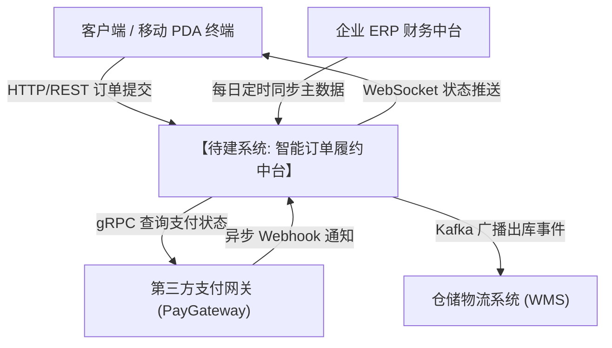

# 项目愿景与范围规格说明书模板 (Vision and Scope Document)

> **模板说明**：本模板遵循 Karl Wiegers《Software Requirements》(第3版) 经典标准制定，是项目启动期对齐商业目标与划分系统边界的核心契约文件。

---

# 1. 业务需求 (Business Requirements)

## 1.1 背景现状 (Background)
[简要描述业务当前运作的上下文环境、既有业务流程或支撑系统，阐明推动本次软件研发的驱动因素。]

## 1.2 SIBV 业务问题陈述 (Problem Statement)
- **背景现状 (Situation)**: [描述业务当前运行的实际场景。]
- **痛点问题 (Problem)**: [清晰定义阻碍业务发展或造成损耗的核心痛点。]
- **负面影响 (Implication)**: [若不解决该问题，面临的经济损失、竞争劣势或合规惩罚。]
- **预期收益 (Benefit)**: [成功解决该问题后，业务在营收、降本、合规或风控维度的量化收益。]
- **愿景目标 (Vision)**: [期望达成的理想未来状态概括。]

## 1.3 业务目标与量化指标 (Business Objectives & Success Metrics)
| 编号 | 业务目标陈述 (Business Objective) | 衡量指标与单位 (Success Metric) | 基线值 (Past) | 目标值 (Target) | 达标期限 (Deadline) |
| :--- | :--- | :--- | :--- | :--- | :--- |
| **BO-1** | 降低国际跨境订单的人工复核成本 | 单笔订单复核平均工时 | 18 分钟 | $\le 3$ 分钟 | 上线后 3 个月内 |
| **BO-2** | 提升大促高峰期的订单处理并发能力 | 核心结算接口并发吞吐量 | 200 TPS | $\ge 2,500$ TPS | 2026 年 Q4 大促前 |
| **BO-3** | 满足欧盟新规个人隐私数据审计合规 | 合规审计通过率与违规扣分 | 75% / 扣8分 | 100% / 0 扣分 | 正式上线首日 |

## 1.4 业务风险 (Business Risks)
- **BR-1**: [潜在市场或竞争对手变动风险，以及团队的缓解策略。]
- **BR-2**: [新政法规调整风险，以及法律事务团队的合规介入方案。]

---

# 2. 解决方案愿景 (Scope and Vision)

## 2.1 愿景陈述公式 (Vision Statement)
- **针对 (For)**: [明确核心目标客户或用户群体]
- **他们面临 (Who)**: [当前的核心痛点或业务诉求]
- **本系统 (The)**: [系统/产品官方全称]
- **是一个 (Is a)**: [产品架构形态，如高并发微服务电商中台 / 跨平台客户端]
- **它能够 (That)**: [核心业务能力与杀手级特性]
- **不同于 (Unlike)**: [主要竞争对手产品 / 遗留旧系统 / 既有手工 Excel 流程]
- **我们的产品 (Our product)**: [决定性的差异化核心竞争优势]

## 2.2 主要特性树 (Major Features Tree)
采用 3 级特性分解结构定义系统能力树：
- **Feature 1: 订单全生命周期智能处理**
  - Subfeature 1.1: 多渠道订单自动归集与数据清洗
  - Subfeature 1.2: 跨境税费与汇率实时自动试算
  - Subfeature 1.3: 异常订单风控拦截与工单自动派发
- **Feature 2: 智能库存与仓储调度**
  - Subfeature 2.1: 跨区域前置仓自动寻优分流
  - Subfeature 2.2: 临期商品自动降价促销策略

## 2.3 假设与依赖 (Assumptions and Dependencies)
- **AS-1**: [团队假定的外部条件，如用户具备基础网络操作技能。]
- **DE-1**: [对外部三方系统的强依赖，如第三方支付网关在特定日期前完成接口升级。]

---

# 3. 范围与限制 (Scope and Limitations)

## 3.1 初始版本发布范围 (Scope of Initial Release)
[明确列出 Release 1.0 必须包含的特性集合与支持的核心用户类别。]

## 3.2 后续版本递进规划 (Scope of Subsequent Releases)
- **Release 2.0**: [规划引入的次高优特性。]
- **Release 3.0**: [规划引入的高级自动化与智能算法特性。]

## 3.3 明确排除的范围 (Limitations and Exclusions / Out of Scope)
> **极其重要**：明确界定“不做什么”以坚决防御项目范围蔓延（Scope Creep）：
- **EX-1**: 本系统**不提供**离线单机操作模式，所有终端必须在稳定局域网/互联网环境下运行。
- **EX-2**: 本系统**不包含**硬件发票打印机的驱动开发，仅输出行业标准 PDF/A 电子发票流。
- **EX-3**: 历史迁移数据仅导入 2024 年 1 月 1 日之后的有效订单，更早数据以只读归档库方式保留。

---

# 4. 业务上下文与系统拓扑 (Business Context)

## 4.1 利益相关者画像与产品代言人 (Stakeholders & Champions)
| 利益相关者类别 | 核心诉求与关切点 | 利益倾向 (受宠/次要/反对) | 指定产品代言人 (Product Champion) |
| :--- | :--- | :--- | :--- |
| **一线仓库操作员** | 扫码出库快捷流畅，PDA 反应迅速 | 受宠用户类 (Favored) | 张某某 (华东一仓资深班长) |
| **财务审计主管** | 每笔资金进出流水账目平准，报表可溯源 | 受宠用户类 (Favored) | 李某某 (财务风控总监) |
| **外部恶意爬虫/黑产** | 盗取库存价格数据或恶意刷单 | 不受宠类 (Disfavored) | 系统内置风控与限流引擎防御 |

## 4.2 系统上下文图 (Context Diagram)

## 4.3 赋权决策者与死锁打破机制 (Decision Makers & Deadlock Breaker)
- **日常业务需求确认人**: 产品经理与各模块 Product Champion；
- **技术可行性与架构决策人**: 首席架构师；
- **唯一死锁仲裁人 (Deadlock Breaker)**: 项目总赞助人（VP of Operations）。当业务与研发就范围、排期发生不可调和争议超过 48 小时时，由仲裁人行使一票决定权。
