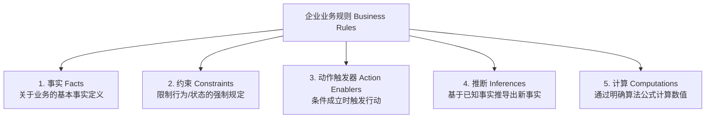

# 需求获取、用户需求与业务规则 (Elicitation, User Requirements & Business Rules)

本指南系统提炼自 Karl Wiegers 经典著作《Software Requirements》(第3版) 与《Software Requirements Essentials》(2023)，指导如何深度挖掘用户真实意图、规范用例与敏捷故事编写，以及解耦业务规则。

---

## 1. 经典需求获取技术矩阵 (7 Elicitation Techniques)

单一获取手段极易产生盲区，应根据受众与场景组合应用：

| 技术手段 | 适用场景 | 核心优势 | 潜在陷阱与规避策略 |
| :--- | :--- | :--- | :--- |
| **访谈 (Interviews)** | 深度挖掘特定角色诉求、高层干系人访谈 | 针对性强，可追问深层动机 | 耗时较长；受访者易将“想要”误报为“需要”；避免诱导性提问 |
| **引导式工作坊 (Facilitated Workshops / JAD)** | 跨职能团队对齐、化解跨部门利益冲突 | 实时解决分歧，高效达成共识 | 极易被“大嗓门”或职级最高者主导；必须由中立 BA 严格控场 |
| **焦点小组 (Focus Groups)** | 商业大众消费品、收集潜在用户直观偏好 | 快速获得多样化定性反馈 | 群体极化与从众效应；得出的需求需通过实际行为数据二次校验 |
| **实地观察 (Observation)** | 优化复杂手工工作流、发现隐性操作习惯 | 揭示用户“实际怎么做”而非“自认为怎么做” | 霍桑效应（被观察者行为失真）；结合被动静默观察与主动追问 |
| **问卷调查 (Questionnaires)** | 拥有庞大异地用户群、需要定量统计验证 | 成本低、覆盖广、支持统计分析 | 回收率与有效率低；问题设计易产生歧义；只用于验证而非发现未知 |
| **文档分析 (Document Analysis)** | 系统重构、合规审计、遗留系统迁移 | 挖掘业务规则、合规法条、表单标准 | 文档陈旧落后于实际运作；必须与一线操作人员交叉核对有效性 |
| **接口分析 (Interface Analysis)** | 系统间集成、物联网设备通信、微服务协作 | 早期暴露跨系统边界不一致与数据瓶颈 | 忽视了错误处理协议；必须逐项定义异常超时与幂等机制 |

---

## 2. 结构化用例设计规范 (Use Cases)

用例聚焦于**用户意图（User Goal）**而非系统界面，是复杂企业级系统分析的黄金工具：

### 2.1 标准用例模板 (Wiegers / Cockburn Standard)
```markdown
### 用例标识: UC-[模块编号]-[序号] [用例名称 (动宾短语)]
- **主要参与者 (Primary Actor)**: 触发该用例的具体角色。
- **简要说明 (Description)**: 概述该用例为参与者带来的业务价值。
- **触发事件 (Trigger Event)**: 启动用例的外部事件或系统定时信号。
- **前置条件 (Preconditions)**: 用例开始前系统必须满足的状态（系统必须无条件信任）。
- **后置条件 (Postconditions)**: 用例成功执行后系统保证达成的业务状态。

#### 基本事件流 (Normal Flow / Happy Path)
1. 参与者 [执行输入或触发操作]。
2. 系统 [校验数据、更新业务状态、呈现反馈]。
3. 参与者 [选择后续步骤]...
4. 系统 [完成最终事务并通知参与者]。

#### 扩展流与分支流 (Alternative Flows)
- 2a. 若 [某种可选合法条件成立]:
    1. 系统执行分支处理。
    2. 返回基本事件流第 3 步。

#### 异常流 (Exception Flows)
- 2b. 若 [校验失败 / 网络超时 / 权限不足]:
    1. 系统记录审计日志并向参与者展示明确错误原因。
    2. 事务回滚，终止用例，系统维持前置条件状态。
```

---

## 3. 敏捷用户故事与验收标准 (User Stories & Acceptance Criteria)

### 3.1 用户故事 3C 维度
1. **卡片 (Card)**：`As a <角色>, I want <功能能力>, So that <商业价值>`；
2. **对话 (Conversation)**：PO、BA 与开发团队在冲刺规划时针对细节的深入交流；
3. **确认 (Confirmation)**：承载于验收准则（Acceptance Criteria）中的可测试性判据。

### 3.2 敏捷故事 INVEST 黄金法则
- **I (Independent)**：故事间尽可能相互解耦，支持自由排期；
- **N (Negotiable)**：细节可在对话中协商，非僵化合同；
- **V (Valuable)**：对最终用户或业务产生明确可度量的价值（杜绝“纯技术故事”）；
- **E (Estimable)**：团队具备足够理解能够评估故事点大小；
- **S (Small)**：颗粒度足够小，通常能在 1/4 到 1/2 个迭代周期内交付；
- **T (Testable)**：具备清晰、客观、自动化的测试验证准则。

### 3.3 Gherkin 验收准则标准 (Given-When-Then)
```gherkin
Scenario: 余额充足时的在线支付成功流程
  Given 用户已登录且购物车内商品总价为 150 元
    And 用户账户可用余额为 200 元
  When 用户点击“确认支付”按钮
  Then 系统扣除用户可用余额 150 元
    And 系统将订单状态变更为“已支付”
    And 系统向商户发送出库通知事件

Scenario: 余额不足时的在线支付防御流程
  Given 用户已登录且购物车内商品总价为 150 元
    And 用户账户可用余额为 80 元
  When 用户点击“确认支付”按钮
  Then 系统不扣除任何账户金额
    And 系统提示“余额不足，请充值或选择其他支付方式”
    And 订单维持“待支付”状态且库存锁定 15 分钟
```

---

## 4. 事件-响应表 (Event-Response Tables)

对于实时系统、事件驱动架构与复杂状态转换系统，事件-响应表是最具防御性的分析工具：

| 事件 (Event) | 触发/输入 (Trigger/Input) | 来源 (Source) | 预期系统响应 (System Response) | 目标/接收方 (Destination) | 前置约束条件 (Preconditions) |
| :--- | :--- | :--- | :--- | :--- | :--- |
| **E-01 心跳超时** | 超过 30s 未收到客户端 Ping 包 | 客户端连接网关 | 关闭 TCP 链路，释放 Session 缓存，广播下线事件 | 连接管理器 / 监控平台 | 链路当前处于 Active 状态 |
| **E-02 价格异常** | 调价幅度超出基准价 30% | 定价管理员输入 | 阻止提交，标红警告提示，向风控主管派发审批工单 | 页面提示 / 审批流引擎 | 处于白盘交易营业时间 |

---

## 5. 业务规则五分类法 (Business Rules Taxonomy)

> **核心原则**：业务规则独立于软件而存在。系统只是业务规则的**执行载体（Enforcer）**。严禁将业务规则直接硬编码混入 SRS 的功能叙述中，必须建立独立的业务规则目录（Business Rules Catalog）。



### 业务规则五类别及规范化表达
1. **事实 (Facts)**：描述业务中客观存在的事实与概念关系。
   - *例*：“每个化学试剂容器必须具有全企业唯一的 12 位条形码。”
2. **约束 (Constraints)**：限定业务参与者或系统可以采取的行为与状态。
   - *例*：“非化学安全培训合格人员不得申领剧毒化学品。”
3. **动作触发器 (Action Enablers)**：特定条件满足时，强制触发下游业务活动。
   - *例*：“当某种化学品库存量低于再订货点时，系统必须自动向采购部生成补货申请单。”
4. **推断 (Inferences)**：基于多个客观事实，通过逻辑判断派生出新的事实或评级。
   - *例*：“若客户在过去 12 个月内消费满 ¥50,000 且违约次数为 0，则该客户评级自动提升为‘钻石会员’。”
5. **计算 (Computations)**：运用可验证的数学公式或查找算法计算输出结果。
   - *例*：“员工加班津贴 = 基础小时工资 × 1.5 × (周累计工作时长 - 40)。”

### 业务规则目录 (Rules Catalog) 标准项
- **规则编号 (Rule ID)**：全局唯一命名（如 `BR-FIN-001`）；
- **规则正文 (Rule Statement)**：原子化陈述业务规则；
- **规则类别 (Category)**：事实 / 约束 / 动作触发 / 推断 / 计算；
- **来源出处 (Source)**：企业制度编号、税法条款或行业标准；
- **关联功能需求 (Enforcing Requirements)**：引用实现该规则的 SRS 功能编号。
