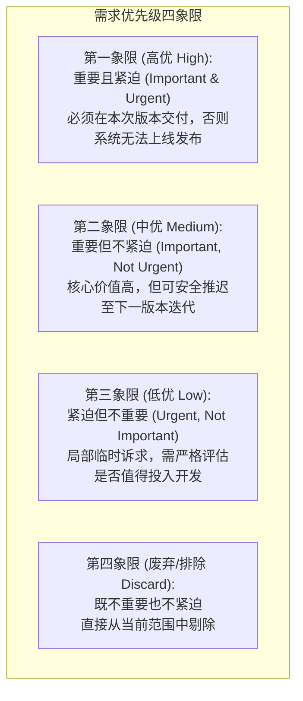
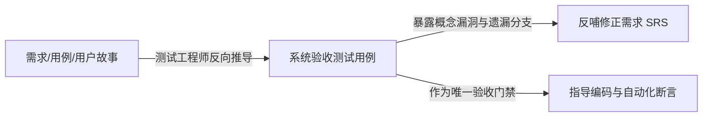

# 需求优先级评定与质量验证 (Prioritization & Requirements Validation)

本指南系统提炼自 Karl Wiegers 经典著作《Software Requirements》(第3版) 第 16、17 章，系统解析业界权威的“价值-成本-风险”分析型优先级计算模型、重要度/紧急度矩阵，以及严密的需求同行评审（Peer Review & Inspection）与测试用例反导机制。

---

## 1. 优先级评定体系与反模式防御

### 1.1 常见优先级反模式
- **大嗓门优先 (Decibel Prioritization)**：谁在会议室嗓门大、叫得最凶，就给谁的特性排最高优先级；
- **强权恐吓优先 (Threat Prioritization)**：谁的职级高、掌握政治资源，就无条件插队其偏好特性；
- **全量高优陷阱 (All-Are-Critical Syndrome)**：业务方宣称“所有需求都是 P0 紧急高优，一个都不能少”，导致排期彻底失控；
- **MoSCoW 缺陷**：MoSCoW (Must, Should, Could, Won't) 缺乏时间盒与成本/风险约束，最终往往导致 80% 的需求都被各方贴上“Must”标签而失去筛选效用。

### 1.2 实用两维度四象限分级 (Importance vs. Urgency)
对于快速粗粒度划分，建议采用重要性与紧迫性矩阵：

---

## 2. Karl Wiegers 分析型量化优先级模型 (Analytical Prioritization Model)

对于关键特性的科学排期，Karl Wiegers 提出了已被业界广泛验证的**价值-代价-风险量化模型**。该模型通过将业务价值与开发成本、技术风险进行标准化归一计算，得出无偏的优先级排序分。

### 2.1 四大核心评估维度 (打分区间: 1 ~ 9)
1. **相对收益 (Relative Benefit, 1~9)**：如果实现该特性，能给业务或用户带来的经济收益或竞争优势（1: 毫无价值；9: 带来颠覆性商业收益）。由 **业务代表 / Product Champion** 独立评定。
2. **相对损失 (Relative Penalty, 1~9)**：如果**不实现**该特性，业务或用户遭受的损失或负面后果（1: 没人会在意；9: 严重违法违规或导致客户大量流失）。由 **业务代表 / Product Champion** 独立评定。
3. **相对成本 (Relative Cost, 1~9)**：实现该特性所需的工程复杂度、工作量与工时投入（1: 顺手即改；9: 架构重构级难度）。由 **开发代表 / 架构师** 独立评定。
4. **相对风险 (Relative Risk, 1~9)**：实现该特性时面临的技术不确定性、第三方依赖或缺陷隐患（1: 闭眼写；9: 缺乏技术沉淀、高度不可控）。由 **开发代表 / 架构师** 独立评定。

### 2.2 数学计算公式与标准化流程

$$Total\ Value = (Benefit \times W_{benefit}) + (Penalty \times W_{penalty})$$

$$Value\% = \frac{Total\ Value_i}{\sum Total\ Value} \times 100\%$$

$$Cost\% = \frac{Cost_i \times W_{cost}}{\sum (Cost \times W_{cost})} \times 100\%, \quad Risk\% = \frac{Risk_i \times W_{risk}}{\sum (Risk \times W_{risk})} \times 100\%$$

$$\textbf{Priority Score} = \frac{Value\%}{Cost\% + Risk\%}$$

> **推荐权重设置**：$W_{benefit} = 2$（更看重正向商业收益），$W_{penalty} = 1$，$W_{cost} = 1$，$W_{risk} = 0.5$。最终按 Priority Score 降序排列，得分越高越优先实现。

### 2.3 典型矩阵计算示例
| 特性标识与描述 | 收益 (1-9) | 损失 (1-9) | 总价值 (权2/1) | 价值% | 成本 (1-9) | 成本% | 风险 (1-9) | 风险% | **最终得分 (Priority)** | 排名 |
| :--- | :---: | :---: | :---: | :---: | :---: | :---: | :---: | :---: | :---: | :---: |
| **F-01: 核心化学品库存出入库** | 9 | 9 | 27 | 23.3% | 3 | 12.0% | 2 | 8.7% | **1.13** | **1** |
| **F-02: 供应商电子画册模糊搜索** | 8 | 4 | 20 | 17.2% | 4 | 16.0% | 2 | 8.7% | **0.70** | **2** |
| **F-03: 危险品资质过期合规警告** | 5 | 8 | 18 | 15.5% | 3 | 12.0% | 3 | 13.0% | **0.62** | **3** |
| **F-04: 3D 分子结构导入与渲染** | 7 | 2 | 16 | 13.8% | 8 | 32.0% | 8 | 34.8% | **0.21** | **4** |

---

## 3. 需求同行评审与严格审查 (Peer Reviews & Inspection)

> **铁律**：修复需求缺陷的成本随开发生命周期呈指数级增长。在编码前通过正式评审消除一个需求缺陷的成本，仅是在生产上线后排查修复成本的 **1/100 到 1/200**。

### 3.1 正式审查角色分工 (Fagan-Style Formal Inspection)
1. **主持人 (Moderator)**：把控审查流程、控制时间与节奏、调解争议、保证客观中立；
2. **作者 (Author)**：需求文档编写者，负责在答疑环节澄清背景，但**不得担任主持人**；
3. **朗读者 (Reader)**：逐段转述需求正文，引导全员以一致节奏审阅；
4. **记录员 (Recorder)**：实时记录所发现的缺陷条目与责任人，不遗漏任何细节；
5. **审查员 (Inspectors)**：业务代表、架构师、测试人员、运维人员等跨职能角色。

### 3.2 需求同行审查缺陷清单 (Inspection Defect Checklist)
在评审过程中，每位审查员必须对照以下清单逐项勾选：

- [ ] **遗漏与未解项 (Omission & TBD)**：是否存在尚未确认的占位符？所有异常分支和失败路径是否均有应对逻辑？
- [ ] **歧义与多义性 (Ambiguity)**：是否存在 Table 11-2 中的歧义词（如“快速”、“用户友好”、“等等”）？
- [ ] **可测试性 (Verifiability)**：测试人员能否不依赖额外推测，直接写出断言用例？
- [ ] **技术可行性 (Feasibility)**：是否存在当前技术栈无法支持或严重超出硬件开销的要求？
- [ ] **数据与边界一致性 (Consistency)**：字段命名与数据字典是否完全一致？数值区间的开闭区间是否明确？
- [ ] **业务规则匹配度 (Business Rule Compliance)**：是否完全遵从了《业务规则目录》中的企业制度与法规？

---

## 4. 需求反导测试用例机制 (Acceptance Test Derivation)

将需求验证前置的最有效手段是**在编写代码之前先根据需求编写验收测试用例（ATDD）**：

### 反导测试用例四步法
1. **正常路径 (Happy Path) 用例编写**：根据用例的主成功流编写断言；
2. **边界极值 (Boundary Values) 用例编写**：针对数值、字符长度与时间截点的上下界构造输入；
3. **异常与降级 (Error & Degraded) 用例编写**：构造网络断开、超时、权限失效、死锁等异常场景；
4. **隐性假设逆向推导**：如果在编写测试用例时测试人员发现“不知道此处该期望什么结果”，说明**该处需求存在缺陷或遗漏**，必须立即要求 BA 补全 SRS。
