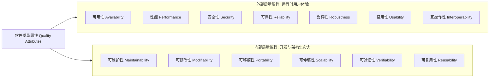
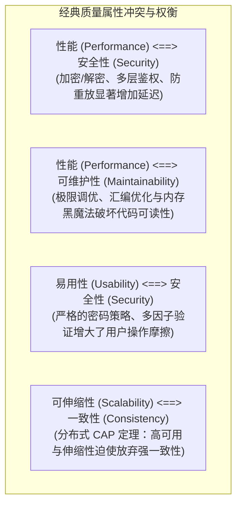

# 非功能需求、质量属性与 Planguage 量化工程 (Quality Attributes & Planguage)

本指南系统提炼自 Karl Wiegers《Software Requirements》(第3版) 第 14 章与 Tom Gilb 的竞争工程思想，提供软件质量属性分类标准、Planguage 结构化量化模板、属性权衡矩阵，以及约束推导规范。

---

## 1. 软件质量属性全景分类体系

非功能需求（NFR）直接决定了系统的用户体验与架构生命力，严禁将其降格为“附加说明”。质量属性按观察视角严格划分为**外部属性（运行时对用户可见）**与**内部属性（维护期对开发者可见）**：



### 核心质量属性定义与量化视角
| 属性名称 | 核心定义 (Wiegers 准则) | 常见度量指标与单位 |
| :--- | :--- | :--- |
| **可用性 (Availability)** | 系统处于正常工作状态并能执行既定功能的时间百分比 | SLA 百分比（如 99.9%）、MTBF（平均无故障时间）、MTTR（平均恢复时间） |
| **性能 (Performance)** | 系统在给定负载下响应外部激励的时间特性与资源开销 | 响应耗时（P95/P99 延迟 ms）、并发吞吐量（TPS/QPS）、CPU/内存峰值占用率 |
| **安全性 (Security)** | 防御未经授权访问、数据泄露、篡改以及抗恶意拒绝服务的能力 | 身份验证机制、加密算法强度（如 AES-256）、渗透测试漏洞等级、审计留痕度 |
| **可靠性 (Reliability)** | 系统在规定时间与操作环境下无故障维持运行的能力 | 故障发生概率、事务成功率（如 99.999%）、断电时数据零丢失保证 |
| **鲁棒性 (Robustness)** | 当系统面临非法输入、硬件失效或环境异常时的容错与恢复能力 | 优雅降级时间、未捕获异常抛出率（必须为 0）、本地脱机容灾支撑时长 |
| **易用性 (Usability)** | 目标用户掌握系统操作并高效完成任务的难易程度 | 培训时长（小时）、典型任务完成耗时（秒）、错误操作发生率、SUS 满意度得分 |
| **可修改性 (Modifiability)** | 引入新功能、修复缺陷或适应业务变更时所需付出的改动成本 | 模块变更影响扩散度、圈复杂度、回归测试覆盖耗时 |
| **可伸缩性 (Scalability)** | 系统通过水平或垂直扩展硬件资源以承载增长业务量的能力 | 节点扩容线性度（增加 2 倍机器承载 $\ge 1.8$ 倍流量）、数据量上限支撑 |
| **可验证性 (Verifiability)** | 测试人员验证系统功能与质量达标所需的难易程度与自动化水平 | 代码分支覆盖率、端到端自动化测试执行耗时、环境状态重置便捷度 |

---

## 2. Planguage 精准量化表达规范

> **原则**：任何无法客观度量的质量目标（如“系统必须快速且安全”）都是毫无工程价值的废话。Tom Gilb 与 Karl Wiegers 提出的 **Planguage** 是消灭含糊质量诉求的终极武器。

### 2.1 Planguage 核心关键字
- `TAG`: 质量需求的全局唯一命名标签（如 `PERF.REPORT.LATENCY`）；
- `AMBITION`: 该需求期望达成的业务目标或战略目的简述；
- `SCALE`: 具体的物理度量单位（如秒、毫秒、并发数、百分比）；
- `METER`: 测量方法与测试环境执行规范（如何实施测试）；
- `MUST`: **绝对底线**，低于该阈值系统验收不通过，视为缺陷；
- `PLAN`: **交付目标**，当前计划版本所必须达到的设计基准；
- `WISH`: **理想期望**，无需额外大幅增加成本时的最佳上限；
- `PAST`: **现状基线**，现有老系统或手工操作的实际历史数值；
- `FAIL`: **失败判据**，触发告警或认定版本不合格的负向阈值。

### 2.2 生产级 Planguage 示例

#### 示例 1: 报表导出性能需求
```markdown
TAG: PERF.EXPORT.ACCOUNTING_REPORT
AMBITION: 确保财务人员在月末结算高峰期能迅速拉取财务大表，杜绝页面卡死。
SCALE: 用户点击“导出”到浏览器开始下载完整加密 CSV 文件的流逝时间（秒）。
METER: 在千兆局域网内，基准客户端环境（i7 CPU, 16GB RAM），针对 100 万行测试账单数据执行 50 次并发压测取 P95 统计值。
PAST: 120 秒（老版 Oracle 存储过程导出）。
MUST: 15 秒（不得超过 15 秒，否则财务系统被视为超时阻断）。
PLAN: 5 秒（本次微服务重构的设计基准）。
WISH: 2 秒。
FAIL: > 15 秒在任何超过 5% 的并发测试样本中出现。
```

#### 示例 2: 核心业务系统可用性需求
```markdown
TAG: AVAIL.CORE.PAYMENT_GATEWAY
AMBITION: 保障电商大促期间核心支付链路高度可用，最大程度减少丢单。
SCALE: 自然季度内支付网关能够正常处理交易的持续在线时间百分比。
METER: 生产环境 Prometheus 监控探针每 5 秒发送心跳健康检查，统计季度非计划停机时间。
PAST: 99.5%（老架构每季度平均非计划停机约 11 小时）。
MUST: 99.95%（季度非计划停机时间严格累计不得超过 65 分钟）。
PLAN: 99.99%（双活架构目标：季度非计划停机累计 ≤ 13 分钟）。
WISH: 99.999%（高可用理想目标）。
FAIL: 单次计划外服务中断时间超过 5 分钟，或季度累计可用率 < 99.95%。
```

---

## 3. 质量属性权衡矩阵 (Quality Attribute Trade-offs)

各质量属性之间存在天然的物理制约，架构设计本质上是取舍与妥协（Trade-offs）：



### 属性交互影响矩阵 (Wiegers Matrix)
| 增强该属性 $\downarrow$ | 对【性能】的影响 | 对【安全性】的影响 | 对【可维护性】的影响 | 对【可移植性】的影响 | 对【可测试性】的影响 |
| :--- | :---: | :---: | :---: | :---: | :---: |
| **增强性能** | — | **— (中性)** | **- (负向)** | **- (负向)** | **- (负向)** |
| **增强安全性** | **- (负向)** | — | **- (负向)** | **— (中性)** | **- (负向)** |
| **增强可维护性** | **- (负向)** | **— (中性)** | — | **+ (正向)** | **+ (正向)** |
| **增强可移植性** | **- (负向)** | **— (中性)** | **+ (正向)** | — | **+ (正向)** |
| **增强易用性** | **- (负向)** | **- (负向)** | **— (中性)** | **— (中性)** | **— (中性)** |

---

## 4. 将质量属性转化为落地技术规范

质量属性本身不是代码，必须通过以下映射落地到具体的交付件中：

| 质量属性 | 转化落地的技术物料形式 | 落地示例 |
| :--- | :--- | :--- |
| **可用性、伸缩性** | **系统架构设计决策 (Architecture)** | 引入多可用区部署、无状态服务实例、Kubernetes HPA 自动水平扩容策略 |
| **安全性、互操作性** | **显式功能需求 (Functional Req)** | 增加功能：“当用户连续输错密码 5 次时，系统应锁定账户 15 分钟并发送邮件告警” |
| **互操作性、集成性** | **设计约束 (Design Constraint)** | 强制限定：“所有跨服务通信必须遵循 gRPC 协议，并采用 Protocol Buffers v3 格式” |
| **可维护性、可测试性** | **工程设计规范 (Design Guideline)** | 设定代码门禁：“单个函数圈复杂度不得超过 15，单元测试分支覆盖率必须 $\ge 80\%$” |
| **可移植性** | **实现约束 (Implementation Constraint)**| 限制语言底层：“后端代码严禁调用平台特有系统 API，必须基于 POSIX / C++ 标准库编写” |

---

## 5. 设计与实现约束分类模型 (Constraints Taxonomy)

约束限制了开发团队的方案选择空间。识别约束时必须反复追问背后的真实原因（5 Whys），防止把“假想方案”误当成“强制约束”：

1. **技术栈与平台约束 (Technology Constraints)**：如“必须运行在 CentOS 7 / aarch64 架构上”、“必须兼容 Chrome 90+ 浏览器”；
2. **遗留系统接口约束 (Interface Constraints)**：如“必须通过已有的 SAP RFC 接口同步物料主数据”；
3. **法律法规与标准约束 (Regulatory Constraints)**：如“患者个人隐私数据必须符合 HIPAA 规范，离线存储必须全盘加密”；
4. **硬件与物理约束 (Hardware/Physical Constraints)**：如“嵌入式固件 ROM 镜像大小不得超过 16MB，RAM 运行内存不得超过 64MB”；
5. **商业与采购约束 (Commercial Constraints)**：如“仅允许引入采用 MIT 或 Apache-2.0 许可的开源组件，严禁引入 GPL 代码”。
