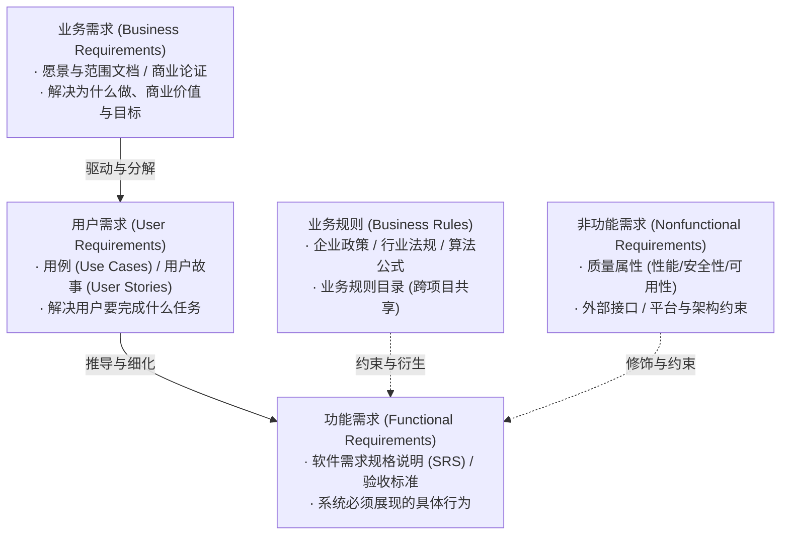

# 需求基础、业务需求与范围界定 (Foundation, Business Requirements & Scope)

本指南系统提炼自 Karl Wiegers 经典著作《Software Requirements》(第3版) 与《Software Requirements Essentials》(2023)，规范从业务问题到项目范围的定义标准。

---

## 1. 软件需求的三个层级与分类模型

软件需求并非铁板一块，混淆不同层级是导致项目返工的最主要诱因。标准需求体系严格划分为以下三个层级与三类支撑要素：



### 核心术语定义标准
| 需求类别 | 核心定义 (Wiegers 标准) | 载体文档 | 典型示例 |
| :--- | :--- | :--- | :--- |
| **业务需求 (Business Req)** | 组织构建产品或客户采购产品的高层业务目标与商业价值 | 愿景与范围文档 (Vision & Scope) | “在系统上线 6 个月内将海外订单处理成本降低 25%” |
| **用户需求 (User Req)** | 特定类别的用户为了达成目标所必须能通过系统执行的任务 | 用例 (Use Cases) / 史诗故事 (Epics) | “买家能够根据订单号与日期筛选近三年的历史发票” |
| **功能需求 (Functional Req)** | 系统在特定条件下必须展现的可观察行为与功能特性 | 软件需求规格说明 (SRS) | “当用户点击‘导出发票’时，系统应在 3 秒内生成加密 PDF” |
| **非功能需求 (NFR)** | 系统必须具备的属性、质量特征（性能/安全）或外部约束 | SRS 第 3/4 章或 Planguage 表 | “系统年可用性应达到 99.95%，平均故障恢复时间 ≤ 15 分钟” |
| **业务规则 (Business Rules)** | 定义或约束业务操作的政策、法规、计算准则（非软件专有） | 业务规则目录 (Rules Catalog) | “单笔退款金额超过 ¥5,000 时必须经财务总监审批” |
| **设计约束 (Constraint)** | 强加给开发团队的架构、技术栈、语言或平台选型限制 | SRS 约束章节 | “数据库必须采用 PostgreSQL 14+，且不得引入商业闭源驱动” |

---

## 2. 探究根本问题：SIBV 问题陈述模型

> **铁律**：严禁在未充分理解业务问题之前过早收敛到解决方案（*Practice #1: Understand the problem before converging on a solution*）。客户提出的往往是一个“解决方案假想”，BA 必须追问背后的业务痛点。

### SIBV 问题陈述模板
每个项目或重大特性必须首先输出标准 SIBV 陈述：

```markdown
### 问题陈述 (Problem Statement)
- **背景现状 (Situation)**: 描述业务当前运作的上下文环境与既有流程。
- **痛点问题 (Problem)**: 清晰界定阻碍业务达成目标的核心痛点或错失的商业机会。
- **负面影响 (Implication)**: 若该问题不被解决，企业面临的成本损失、风险升级或违规代价。
- **预期收益 (Benefit)**: 解决该问题后，业务可量化的经济回报、效率提升或战略收益。
- **愿景目标 (Vision)**: 成功实施解决方案后的理想未来状态概括。
```

---

## 3. 产品愿景与范围界定 (Vision & Scope)

### 3.1 经典愿景陈述公式 (Moore / Wiegers Template)
```markdown
- **针对 (For)**: [目标客户 / 目标用户类别]
- **他们面临 (Who)**: [痛点陈述 / 业务机会 / 核心诉求]
- **本产品 (The)**: [产品名称 / 模块名称]
- **是一个 (Is a)**: [产品分类 / 架构形态]
- **它能够 (That)**: [核心能力 / 关键业务收益]
- **不同于 (Unlike)**: [主要竞争对手 / 现有手工流程 / 旧有系统]
- **我们的产品 (Our product)**: [核心差异化优势 / 杀手级特性]
```

### 3.2 范围界定的三大核心模型
界定系统范围不仅要说明“做什么”，更要明确说明“**不做什么**”（Limitations & Exclusions）：

1. **上下文图 (Context Diagram)**：
   - 处于系统最顶层，将待建系统视为一个单一的黑盒处理节点；
   - 标注所有外部实体（用户角色、第三方系统、硬件设备）；
   - 标注跨越系统边界的所有输入流与输出流。
2. **生态系统图 (Ecosystem Map)**：
   - 展示待建系统在企业整体 IT 架构与上下游系统中的拓扑位置；
   - 明确各系统之间的数据交互方向、主从关系与集成协议。
3. **特性树 (Feature Tree)**：
   - 采用 3 级树状层次模型分解产品范围：`Level 1 (核心特性) -> Level 2 (子特性) -> Level 3 (功能能力)`；
   - 用于快速进行 Release 规划与范围切割（划定版本边界）。

---

## 4. 利益相关者分类与决策权机制

### 4.1 用户类别划分 (User Classes)
避免抽象的“用户”概念，将直接和间接使用者按职能分类：
- **受宠用户类 (Favored User Classes)**：产品的核心受众，需求具有最高权重，产品价值直接向其倾斜；
- **不受宠用户类 (Disfavored User Classes)**：出于安全或审计原因，系统需对其行为进行严格限制的用户（如黑产攻击者、越权操作员）；
- **被忽略用户类 (Ignored User Classes)**：其需求不纳入当前产品构建考量范围的间接关联方。

### 4.2 核心用户代表机制 (Product Champion Model)
- 每类关键用户群体必须选派或指定一名 **Product Champion（产品代言人）**；
- 职能：收集整理该用户类的日常需求、解答开发团队细节疑惑、参加评审并代表该群体签署验收。

### 4.3 赋权决策者与决策规则 (Decision Rules)
需求冲突是项目延期的最大根源之一。项目启动时必须明确决策机制：
- **四种决策方式**：
  1. *共识决 (Consensus)*：全员讨论达成一致（耗时最长，适合核心架构）；
  2. *咨询决 (Consultative)*：决策者广泛征求意见后独立拍板（最推荐）；
  3. *授权决 (Delegation)*：全权委托特定领域的 SME 决策；
  4. *独裁决 (Command)*：高层领导直接指派。
- **死锁打破规则 (Deadlock Breaker)**：必须白纸黑字指定唯一的决策仲裁人（如 Project Sponsor 或 Product Owner），当各方争议超过指定时限（如 24 小时）未果时，仲裁人拥有一票决定权。

---

## 5. 客户权利法案与责任法案 (Bill of Rights & Responsibilities)

健康的客户-开发伙伴关系基于平等的契约精神：

### 客户权利法案 (Bill of Rights)
1. 获得分析人员用通俗易懂的业务语言进行沟通，避免被晦涩技术黑话搪塞；
2. 获得分析人员对业务领域与业务流程的深度理解；
3. 要求需求以结构化、易理解的形式呈现（文本、用例、原型）；
4. 获得关于需求可行性、成本与技术风险的客观反馈；
5. 获得对已提出需求的透明变更评估与调整权力；
6. 最终交付的产品必须忠实满足商定的业务目标与验收准则。

### 客户责任法案 (Bill of Responsibilities)
1. 积极向分析人员阐明业务目标与用户实际需要完成的任务；
2. 派遣合格、有决策权的代表（Product Champion）投入足够时间参与需求工作；
3. 协助分析人员明确需求的相对优先级，不搞“所有需求都是最高优先级”；
4. 及时对需求文档、模型和原型进行深度评审并提供建设性反馈；
5. 遵守商定的需求变更控制流程，不走非正式私下渠道提需求；
6. 尊重开发团队给出的成本估算与技术可行性结论，共同承担范围取舍决策。
