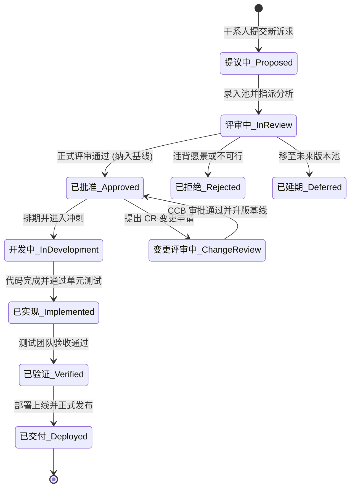
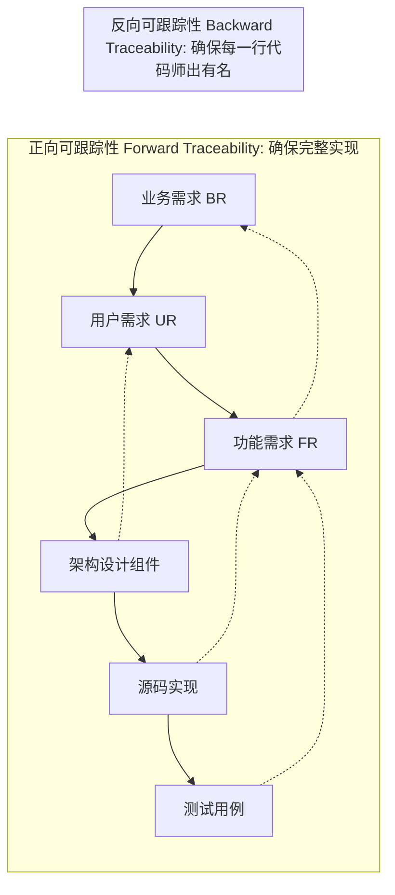
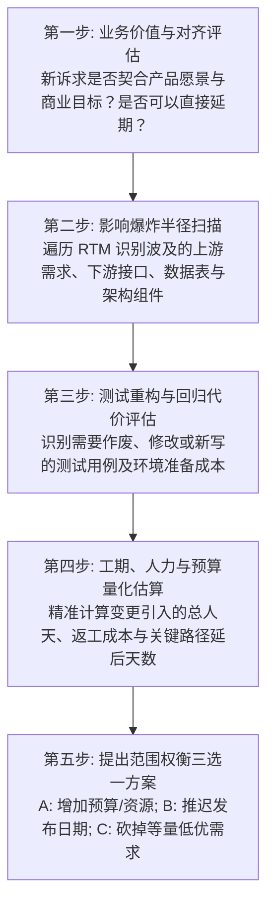

# 需求管理、可跟踪性与变更控制 (Requirements Management, Traceability & Change Control)

本指南系统提炼自 Karl Wiegers 经典著作《Software Requirements》(第3版) 第 27、28、29 章，提供基线管理、端到端可跟踪性矩阵（RTM）、五步变更影响分析协议，以及变更控制委员会（CCB）的工业级治理规范。

---

## 1. 需求基线与生命周期状态机 (Baselines & Status Tracking)

需求基线（Baseline）是经过正式评审并获得干系人一致签署认可的一组特定版本的需求集合。它是后续设计、编码、测试和范围变更控制的唯一合法依据。



### 关键属性维护清单
每条需求在管理工具中必须维护以下核心元数据属性：
- **需求唯一标识 (Requirement ID)**：永久不变的编号（如 `FR-ORDER-042`）；
- **版本号 (Version Number)**：每次实质改动自动递增（如 `v1.0` $\to$ `v1.1`）；
- **当前状态 (Status)**：上述状态机枚举值；
- **提出人与创建日期 (Author & Date)**；
- **业务优先级 (Priority)**：基于分析型模型得出的优先级；
- **所属基线版本 (Release / Baseline ID)**：如 `Release 2.4.0`；
- **设计负责人、代码文件与验证用例索引 (Traceability Links)**。

---

## 2. 需求可跟踪性矩阵 (Requirements Traceability Matrix - RTM)

> **铁律**：未经需求追溯的代码是“不可控的自作主张（Gold Plating）”；未经代码实现的基线需求是“失信的违约”；未经测试覆盖的需求是“潜在的生产事故”。



### 2.1 工业级 RTM 矩阵表格规范
| 业务需求 ID | 用户需求/用例 ID | 功能需求 ID | 系统设计组件 / API 契约 | 源代码文件与符号索引 | 测试用例编号 | 验收状态 |
| :--- | :--- | :--- | :--- | :--- | :--- | :--- |
| **BR-01 降低退款成本** | **UC-ORDER-03 批量退款** | **FR-03.1** 校验退款权限 | `AuthService::VerifyRefundPerm` | `src/auth/service.cpp:85` | `TC-SEC-104` | 已通过 (Pass) |
| **BR-01 降低退款成本** | **UC-ORDER-03 批量退款** | **FR-03.2** 冲正资金流水 | `PaymentGateway::Reverse` | `src/pay/gateway.cpp:210` | `TC-PAY-056` | 已通过 (Pass) |

### 2.2 RTM 质量诊断与坏味道治理
- **孤儿需求 (Orphan Requirements)**：功能需求无法向前追溯到任何业务需求或用例。治理：确认是否为研发过度设计的私货，坚决剔除或补齐业务论证。
- **孤儿代码 (Orphan Code)**：源码或 API 无法追溯到任何基线功能需求。治理：安全审查并彻底清理死代码。
- **盲区需求 (Untested Requirements)**：功能需求未被任何自动化测试用例覆盖。治理：阻断上线，强制补充测试断言。

---

## 3. 需求变更五步影响分析协议 (Change Impact Analysis Protocol)

变更不可避免，但失控的变更会毁灭项目。面对任何需求变更申请（CR），必须在 CCB 审批前严格执行五步影响分析：



### 变更影响评估表模板 (Impact Analysis Checklist)
```markdown
### 变更申请编号: CR-[序号] [变更特性简述]
- **提出人与日期**: [姓名 / 部门 / 日期]
- **业务价值与紧迫性评估**: [若不接受此变更，业务将遭受的具体损失]

#### 1. 影响范围核查 (Blast Radius)
- [ ] 受影响的需求项: [FR-XXX, FR-YYY]
- [ ] 受影响的业务规则: [BR-ZZZ]
- [ ] 受影响的数据库表/字段: [orders.status, payment_logs]
- [ ] 受影响的外部 API 契约: [POST /api/v2/orders/refund]
- [ ] 受影响的测试用例: [TC-01, TC-02, TC-15]

#### 2. 代价与工期估算
- **需求与设计修改工作量**: [X] 人天
- **代码重构与实现工作量**: [Y] 人天
- **测试用例编写与回归验证**: [Z] 人天
- **关键路径与总交付延后**: [N] 天

#### 3. 范围等价置换建议 (Trade-off Recommendation)
- 为确保既定发布日期不延误，建议从当前迭代中剥离以下低优先级特性：
  - 移出特性 1: [FR-AAA，优先级评分 0.32]
  - 移出特性 2: [FR-BBB，优先级评分 0.41]
```

---

## 4. 变更控制委员会 (CCB) 运作与决策治理

### 4.1 CCB 成员构成法则
CCB 必须由代表各方利益的核心干系人组成，人数建议保持在 3~5 人奇数以避免僵局：
1. **项目发起人 / 赞助人 (Project Sponsor)**：最终商业与资金决策权所有者；
2. **产品经理 / 业务代表 (Product Champion / PO)**：代表用户与业务价值评判；
3. **技术架构负责人 (Lead Architect / Dev Lead)**：评估技术代价、可行性与架构坏味道；
4. **测试质量负责人 (QA Lead)**：评估可测试性与质量回归风险；
5. **项目经理 / 交付主管 (PM)**：把控整体工期节奏与资源约束。

### 4.2 变更审批决策准则
CCB 在审批变更时必须严格遵循以下原则：
- **拒绝口头变更**：任何未录入管理系统、未进行五步影响分析的变更，一律不予上会讨论；
- **零和博弈防御**：若项目发布截止时间固定且人员预算无法增加，**任何新增特性的批准必须以砍掉或延期同等工作量的既有特性为前提**；
- **透明公示与基线升版**：一旦 CCB 签署通过，立即将旧版本需求归档并发布新版本基线通知全员。
