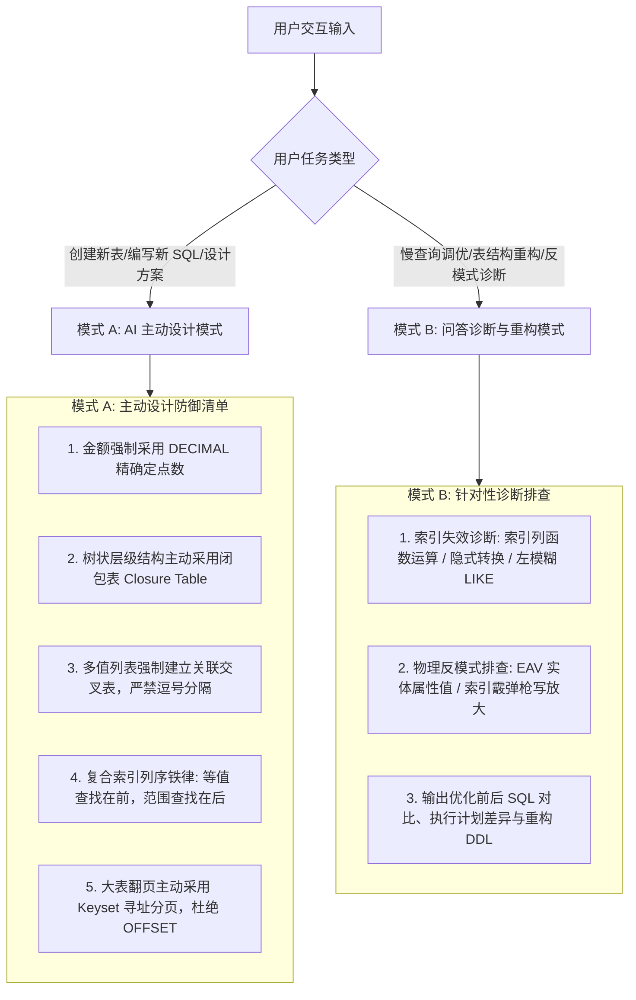

# 关系数据建模与高性能 SQL 技能指南

本技能提炼自关系数据库领域两大经典权威专著：
- 《SQL Performance Explained》- Markus Winand（从 B-Tree 物理底层解剖索引与执行计划）
- 《SQL 反模式》（SQL Antipatterns）- Bill Karwin（25 个经典数据库设计与查询反模式及标准解法）

---

## 1. 核心执行引擎

---

## 2. 模式 A：AI 主动设计模式

当用户要求创建数据表结构、编写核心查询或规划存储方案时，**无需用户提醒，必须在第一时间主动应用以下 5 条铁律**：

1. **金额与数值精确性（No Float for Currency）**：
   - 涉及金额、利息、账务的字段，严禁使用 `FLOAT` 或 `DOUBLE`；强制使用 `DECIMAL(18, 4)` 或更高精度定点数，防范舍入误差，详见 [references/physical_types_and_integrity.md](./references/physical_types_and_integrity.md)。
2. **拒绝乱穿马路（Jaywalking Antipattern）**：
   - 严禁在单个字段内以逗号/分号分隔存储多个 ID 或标签（如 `tags: "1,2,3"`）；
   - 主动创建标准的关联交叉表（Intersection / Join Table），保持关系模型第一范式（1NF）与外键约束完整性，详见 [references/schema_design_and_antipatterns.md](./references/schema_design_and_antipatterns.md)。
3. **层级结构建模选型（Closure Table over Naive Trees）**：
   - 涉及深层部门、商品类目等树状结构时，主动引入**闭包表（Closure Table）**，将祖先-后代路径解耦为专有路径表，避免无限递归查询，详见 [references/schema_design_and_antipatterns.md](./references/schema_design_and_antipatterns.md)。
4. **复合索引列顺序铁律（Equality First, Range Second）**：
   - 为复杂 `WHERE` 条件设计复合索引时，严格遵循：**精确等值列（`=`）排在最前，范围列（`BETWEEN, >, <`）排在最后**；
   - 优先设计能够满足 Index-Only Scan 的覆盖索引，详见 [references/btree_indexing_and_execution.md](./references/btree_indexing_and_execution.md)。
5. **深分页采用 Keyset 寻址（Seek Method over OFFSET）**：
   - 对千万级大表进行分页展示或数据抽取时，主动采用基于主键或游标的 Keyset 分页（`WHERE id > :last_id ORDER BY id ASC LIMIT :size`），杜绝 `LIMIT 1000000, 20` 导致的巨额内存与磁盘扫描，详见 [references/query_optimization_and_keyset.md](./references/query_optimization_and_keyset.md)。

---

## 3. 模式 B：问答诊断与代码优化模式

当用户询问“为什么这个 SQL 这么慢”、“帮我看下这个表怎么建索引”、“如何优化分页”时，执行以下诊断流：

1. **索引失效与执行计划诊断**：
   - 检查 `WHERE` 条件中索引列是否存在函数调用（如 `DATE(created_at) = ?`）；
   - 检查字符串与数字之间是否存在隐式类型转换（Implicit Casting）；
   - 检查是否命中 `LIKE '%abc'` 左模糊全表扫描；
   - 输出索引重构建议或虚拟列（Generated Column）方案，详见 [references/query_optimization_and_keyset.md](./references/query_optimization_and_keyset.md)。
2. **反模式识别与重构指导**：
   - 诊断是否存在 **EAV（实体-属性-值）** 导致的巨型自连接与类型失控，建议转为半结构化 JSONB 配合虚拟列索引；
   - 诊断是否存在 **索引霰弹枪（Index Shotgun）**：每个字段都建单列索引导致的写入性能暴跌与写放大，提炼高信噪比复合索引；
   - 诊断是否存在 **NULL 三值逻辑陷阱**（如 `NOT IN (NULL)` 导致整表结果为空）。
3. **交付对比清单**：
   - 提供重构前后的 DDL / SQL 对比；
   - 解释 B-Tree 物理寻址路径的变化与理论扫描行数下降倍数。

---

## 4. 核心参考手册
- B-Tree 物理索引与列顺序设计：[`references/btree_indexing_and_execution.md`](./references/btree_indexing_and_execution.md)
- 查询优化、索引失效与 Keyset 分页：[`references/query_optimization_and_keyset.md`](./references/query_optimization_and_keyset.md)
- 逻辑设计反模式治理（闭包表/交叉表/EAV）：[`references/schema_design_and_antipatterns.md`](./references/schema_design_and_antipatterns.md)
- 物理类型与数据完整性（DECIMAL/外键/索引霰弹枪）：[`references/physical_types_and_integrity.md`](./references/physical_types_and_integrity.md)
- 经典著作论据速查：[`references/classic_literature_notes.md`](./references/classic_literature_notes.md)
