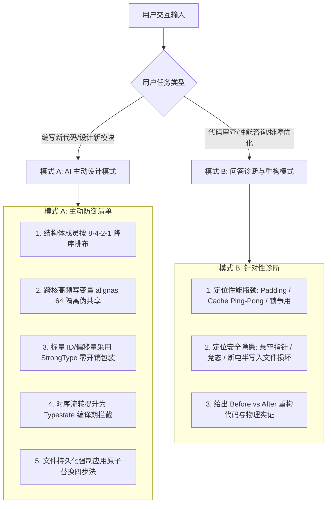

# 系统级物理数据与状态设计指南

本技能提炼自系统工程四大经典著作与奠基论文：
- 《C++ Concurrency in Action (2nd Ed)》- Anthony Williams
- 《Systems Performance (2nd Ed)》- Brendan Gregg
- 《Operating Systems: Three Easy Pieces (OSTEP)》- Remzi & Andrea Arpaci-Dusseau
- OSDI 2014 顶会论文《All File Systems Are Not Created Equal: On the Complexity of Crafting Crash-Consistent Applications》- Thanumalayan Sankaranarayana Pillai 等

---

## 1. 核心执行引擎

---

## 2. 模式 A：AI 主动设计模式

当用户要求设计新数据结构、新类或持久化逻辑时，**无需用户提醒，必须在第一时间主动应用以下 5 条物理设计准则**：

1. **结构体降序对齐（Memory Packing）**：
   - 结构体成员严格按照 **8 字节 $\to$ 4 字节 $\to$ 2 字节 $\to$ 1 字节** 降序排列；
   - 杜绝编译器因对齐插入隐式 Padding 空洞，详见 [references/memory_layout_and_cache.md](./references/memory_layout_and_cache.md)。
2. **多核伪共享防御（False Sharing Defense）**：
   - 凡是被不同 CPU 核心高频读写的独立变量（如并发计数器、工作线程状态），强制标注 `alignas(64)` 或使用硬件隔离宏，详见 [references/memory_layout_and_cache.md](./references/memory_layout_and_cache.md)。
3. **关键标量强类型化（Strong Typing）**：
   - 杜绝裸 `int` / `uint64_t` 表达核心 ID（`UserId`、`ConnectionId`）与单位物理量（`ByteOffset`、`Milliseconds`）；
   - 主动引入零开销强类型包装模板，详见 [references/zero_cost_strong_typing.md](./references/zero_cost_strong_typing.md) 与 [examples/strong_type.hpp](./examples/strong_type.hpp)。
4. **状态机编译期拦截（Typestate Pattern）**：
   - 涉及多阶段生命周期的资源（如网络连接、事务句柄），主动将阶段建模为独立类型参数，杜绝运行时的 `if (state != ...) return err;`，详见 [references/zero_cost_strong_typing.md](./references/zero_cost_strong_typing.md)。
5. **本地文件落盘崩溃安全（Crash-Safe Atomic Write）**：
   - 凡涉及文件持久化保存，严禁使用原地覆写（in-place overwrite）；
   - 主动使用 **`Write-Temp -> fdatasync -> Atomic Rename -> Dir fsync`** 四步法，详见 [references/crash_consistency_and_wal.md](./references/crash_consistency_and_wal.md) 与 [examples/crash_safe_writer.hpp](./examples/crash_safe_writer.hpp)。

---

## 3. 模式 B：问答诊断与代码优化模式

当用户询问“如何优化这段数据结构”、“为什么多线程变慢了”、“怎么防止断电数据损坏”时，执行以下诊断流：

1. **结构体布局诊断**：
   - 计算用户结构体的内存对齐空洞大小；
   - 输出重排前后的 `sizeof(T)` 对比与每个 64 字节 Cache Line 容纳对象数的提升比例。
2. **并发与缓存争用诊断**：
   - 检查是否存在 Cache Line Bouncing 与伪共享；
   - 检查是否存在 `shared_ptr` 频繁拷贝引发的原子总线风暴；
   - 提供基于 `acquire-release` 内存序或无锁环形队列的重构建议，详见 [references/concurrency_and_ownership.md](./references/concurrency_and_ownership.md)。
3. **持久化崩溃脆弱性诊断**：
   - 对照 OSDI 2014 论文提出的 60 种应用脆弱性模型，检查用户代码是否缺失 `fdatasync` 或父目录 `fsync`；
   - 提供符合 POSIX 原子性的重构 Diff。

---

## 4. 核心参考手册
- 内存与缓存微架构：[`references/memory_layout_and_cache.md`](./references/memory_layout_and_cache.md)
- 零成本强类型与状态机：[`references/zero_cost_strong_typing.md`](./references/zero_cost_strong_typing.md)
- 并发流转与单向所有权：[`references/concurrency_and_ownership.md`](./references/concurrency_and_ownership.md)
- 崩溃一致性与落盘规范：[`references/crash_consistency_and_wal.md`](./references/crash_consistency_and_wal.md)
- 原著理论考据速查：[`references/literature_and_paper_notes.md`](./references/literature_and_paper_notes.md)
