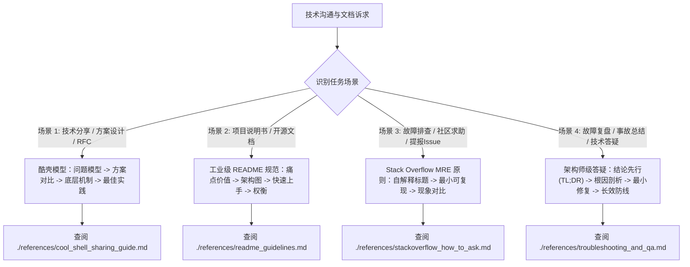

# 技术表达、文档编写与排障答疑指南

本技能提炼自陈皓（左耳朵耗子）经典著作《如何做一个有质量的技术分享》与全球开发者社区 Stack Overflow 官方《How to Ask》黄金准则。

旨在规范 AI Agent 在**“技术输出（文档/分享/README/答疑）”**与**“技术输入（排障/提问/故障复盘）”**中的表达与交付质量，拒绝填鸭式罗列与模糊沟通。

---

## 1. 核心工作流与场景决策树

---

## 2. 四大场景操作规范速查

### 场景 1：技术方案设计与分享
* **核心心法**：**“Why 比 What 重要，How 比 What 深入”**。
* **执行步骤**：
  1. **建立问题模型**：从受众痛点切入，框定思考范围；
  2. **方案横向对比**：列举 2~3 种候选技术路线，对比优缺点（无对比无说服力）；
  3. **机制与关键实现**：讲透核心数据结构、算法或源码骨架；
  4. **最佳实践与边界**：指出 Pros/Cons、适用场景与避坑经验。
- 详见：[酷壳高质量技术分享指南](./references/cool_shell_sharing_guide.md)

### 场景 2：工业级项目 README 编写
* **执行步骤**：
  1. **一句话价值主张 (Value Proposition)**：直击解决什么核心痛点；
  2. **架构图解**：以 Mermaid 或清晰文本结构呈现模块关系；
  3. **快速上手 (Quick Start)**：贴出可直接复制跑通的最小代码，杜绝缺少依赖的不完整示例；
  4. **设计考量与权衡 (Design Trade-offs)**：说明为什么选型 A 而非 B。
- 详见：[高品质 README 编写规范与模板](./references/readme_guidelines.md)

### 场景 3：排障求助与 Bug 提报
* **核心原则**：**MRE（Minimal, Reproducible Example 最小可复现示例）**。
* **执行步骤**：
  1. **自解释标题**：一句话概括核心现象 + 关键 API/环境；
  2. **背景先于代码**：先讲业务情景与预期，再贴代码；
  3. **最小可运行代码**：剔除 90% 不相干的业务逻辑，提供包含输入输出的独立运行 Demo；
  4. **双向对比**：严格区分 **“预期行为 (Expected)”** 与 **“实际行为 (Actual/Error Logs)”**；
  5. **杜绝图片**：代码、日志、配置严禁截图，统一使用文本代码块。
- 详见：[Stack Overflow 黄金提问与排障规范](./references/stackoverflow_how_to_ask.md)

### 场景 4：故障复盘与技术答疑
* **执行步骤**：
  1. **结论先行 (TL;DR)**：直接给出核心答案，不要让读者猜谜；
  2. **根因推导 (Root Cause Analysis)**：基于底层机制、系统状态数据解释为什么出错；
  3. **最小精准改动**：定位最根本原因，提供最小影响面的修复方案；
  4. **长效防线**：编写单元测试/集成测试或静态检查规则，防止问题卷土重来。
- 详见：[架构师级答疑与故障复盘(RCA)规范](./references/troubleshooting_and_qa.md)
