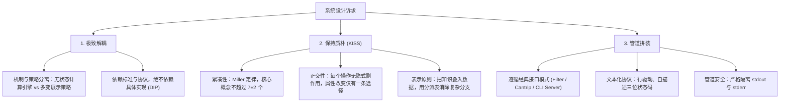

# Unix 哲学与系统架构设计指南

本技能沉淀自埃里克·雷蒙德（Eric S. Raymond）经典著作《UNIX编程艺术》（The Art of UNIX Programming）及现代解耦架构最佳实践（酷壳/陈皓关于应对多变需求的工程心法）。

---

## 1. 核心架构哲学：解耦、KISS、拼装

---

## 2. 架构设计与执行工作流

### 阶段一：模块紧凑性与正交性核查
1. **心智容量校验（紧凑性）**：
   - 检查对外暴露的 API 或接口概念是否超过 **$7 \pm 2$** 个；若超过，提炼高频工作的“核心子集”。
2. **副作用排查（正交性）**：
   - 数据处理接口严禁强绑定物理文件路径，必须抽象为数据流（`Reader` / `InputStream` / `fd`）。
   - 检查每个接口调用是否只改变一件事。

### 阶段二：接口模式与通信选型
根据系统交互特征，对照 [Unix 经典接口设计模式](./references/interface_patterns.md) 选取模式：
- **数据流变换** $\to$ **过滤器模式 (Filter)**：`stdin` 接收数据，`stdout` 吐出结果，便于管道串联。
- **原子运维指令** $\to$ **Cantrip 模式**：无输入输出，仅返回状态码 `0` 或非 `0`，利于自动化脚本集成。
- **多端业务系统** $\to$ **引擎与接口分离模式 (Engine-Interface)**：核心引擎无状态化，策略与界面轻量外挂。
- **微服务与守护进程** $\to$ **CLI 服务器模式 (CLI Server)**：文本行驱动协议，便于命令行调试。

### 阶段三：配置与输入输出合规
1. **配置覆盖模型**：严格遵循 [配置分层与命令行规范](./references/cli_and_config_standards.md) 中的 5 级优先级：
   `硬编码默认值` $\to$ `/etc/` $\to$ `~/.config/` $\to$ `环境变量` $\to$ `命令行参数`。
2. **I/O 流安全红线**：
   - `stdout` 只承载有效业务 Payload；
   - `stderr` 承载日志、进度提示与调试诊断；
   - 保持**缄默原则**（成功时不输出无谓的人类对话）。

---

## 3. 核心参考资料库

- [17 条 Unix 哲学深度解析与量化指标](./references/unix_principles.md)：机制与策略分离、表示原则、补救原则（Fail-Fast）、缄默原则。
- [命令行设计与配置分层规范](./references/cli_and_config_standards.md)：`-a` 到 `-z` 常用选项语义表、`--` 终止解析规则、5级配置覆盖模型。
- [文本化与应用协议设计规范](./references/protocol_and_textuality.md)：4 种通用文本元格式选型、行驱动协议、3位状态码定义。
- [酷壳核心实践：以 Unix 思想应对需求变化](./references/cool_shell_insights.md)：陈皓老师关于解耦、KISS、IoC 接口拼装的具体方法。
