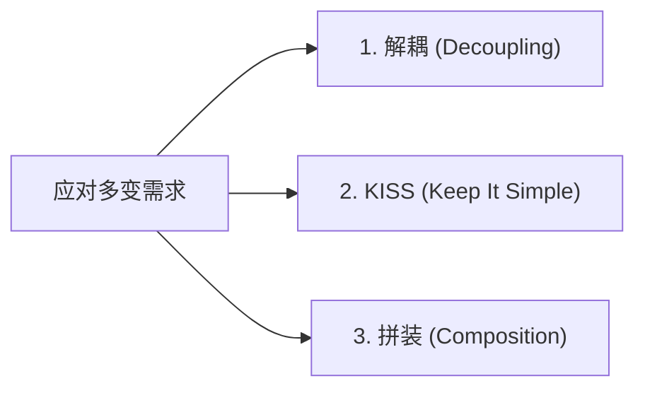

# 酷壳核心：用 Unix 思想应对多变需求 (CoolShell Insights)

> 整理自陈皓（左耳朵耗子）经典博文《用Unix的设计思想来应对多变的需求》（https://coolshell.org/articles/7236.html）。

---

## 一、 软件设计的唯一终极命题：解耦

> “无论是 Unix 设计，还是面向对象设计，还是别的什么如 SOA、ECB、消息、事件、MVC、网络七层模型、数据库设计等等，他们都在干三件事——**解耦，解耦，还是解耦！** 所谓解耦，就是让软件的模块和模块间尽量少地依赖起来。” —— 陈皓

### 现实世界的解耦启发：
1. **灯具与灯泡**：制造灯具的工厂完全不关心制造灯泡的工厂，但两者通过螺口接口（E27/E14 国际标准）完美协同。
2. **浏览器与网站**：上网的人不关心网站服务端是用 Java、Go 还是 Python，网站开发者也不用管用户用什么操作系统和终端，因为两者依赖的是唯一的通用标准协议——**HTTP 协议**。

**核心结论**：面向对象的本质与 Unix 的本质完全一致——**依赖于接口/标准，而不是依赖于具体实现**。

---

## 二、 Unix 应对需求变更的三大法宝

面对业务需求的频繁变动，技术上减轻痛苦的核心三板斧：

### 1. 解耦（Decouple to Standard）
- **不要直接耦合实现**：模块之间不要直接互相持有具体实例，而是统一耦合到一个抽象标准（协议、接口定义或事件规范）。
- **Unix 的典范：一切皆文件**：
  - 操作系统把所有的硬件设备全部抽象成 `/dev/` 下的文件；
  - 上层软件只需要 `fd`, `read()`, `write()` 这三个简单的原子操作就可以操纵任何硬件，硬件变更对软件完全透明。

### 2. KISS（Keep It Simple, Stupid）
- **纯粹与极致**：每个模块的代码行数不需要非得限制在几行，但**必须简单到只做一件事，并把这件事做到极致**。
- 模块越纯粹、职责越单一，当外部环境变化时，它的稳定性就越高，被牵连修改的概率就越低。

### 3. 拼装（Assembly & Pipeline）
- **像零件一样随意替换**：
  - 在 Unix 下，命令间全部解耦到只依赖 `stdin` 和 `stdout`，用户可以用管道符 `|` 任意拼装工具完成新需求；
  - 不喜欢 `bash` 可以直接换成 `zsh`，不喜欢 `awk` 可以换成 `gawk`。
- **软件开发落地**：
  - 将大系统拆解为独立的微服务、插件或纯函数，依赖统一的消息格式串联；
  - 当业务需求改变时，**不要去大改已有代码的内部逻辑，而是调整拼装组合的拓扑关系，或者插拔一个新的小零件**。

---

## 三、 绿色隔离：不污染全局环境

Unix 哲学的另一大精髓在于环境隔离与绿色部署：
1. **进程/程序独立空间**：一个程序的临时文件与运行数据不能污染系统或其他程序；删除或替换该程序绝不影响其他模块正常运转。
2. **多版本共存能力**：通过配置环境目录或容器隔离，允许不同版本的依赖在系统中同时独立运行，杜绝全局单体环境冲突。
