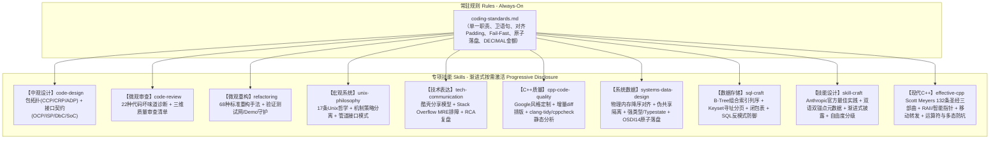

# 🏛️ Code-Craft: AI Agent 软件工程与高阶架构技能库
*(Software Engineering & Architecture Skills for Autonomous AI Agents)*

> **一句话价值主张**：将计算机科学经典名著（《重构》《UNIX编程艺术》、系统底层工程与 SQL 经典哲学）系统化重构成 AI Agent 可直接判定、执行与按需激活的**“八维工程技能（Skills）与常驻底线准则（Rules）”**。

[English Documentation](./README_EN.md) | 简体中文

---

## 1. 为什么需要这个项目？(Why & Problem Model)

现代大语言模型（LLM）具备极强的语法生成能力，但在面对真实复杂的工业级软件工程时，往往暴露以下**三大痛点**：

1. **“玩具代码”与坏味道漫延**：LLM 倾向于生成长篇扁平代码，充斥着深层嵌套 `if-else`、长函数、基本类型偏执与重复逻辑，缺乏对代码异味（Code Smells）的敏锐嗅觉；
2. **过度设计与脆弱继承**：在架构设计时，LLM 容易患上“夸夸其谈未来性（Speculative Generality）”的毛病，滥用深层继承体系，违反 YAGNI 与迪米特法则；
3. **提示词工程的碎片化与遗忘**：每次对话重复粘贴海量 Prompt 不仅消耗昂贵的上下文 Token，而且容易导致模型注意力涣散，无法形成稳定、可继承的团队工程规范。

### 本项目的解法
借助 **Google Antigravity / 现代 Agent 规范**，我们实现了从“长篇人类书籍”到“机器执行手册（Runbook）”的提炼，建立**分层渐进式披露机制（Progressive Disclosure）**，让 Agent 在写代码的第一时间，自带资深架构师的工程直觉。

---

## 2. 核心架构拓扑 (Architecture Topology)

本项目采用**“一横十纵”**的立体质量防护网：



---

## 3. 技能与规则全景一览 (Skills & Rules Matrix)

### 1. 全局常驻底线规则 (`.agents/rules/`)
* **[`coding-standards.md`](./.agents/rules/coding-standards.md)**：
  * **函数设计红线**：长度控制在 20~30 行内，单一抽象层级 (SLAP)，入参 $\le 3$ 个，**卫语句优先 (Guard Clauses)**；
  * **系统物理底线**：结构体 8-4-2-1 降序对齐消灭 Padding；跨核变量强制 `alignas(64)` 隔离伪共享；
  * **崩溃一致性**：文件落盘强制四步法（`write tmp -> fdatasync -> rename -> dir fsync`），杜绝断电损坏；
  * **关系数据规范**：金额强制 `DECIMAL(18, 4)`，严禁逗号分隔多值，复合索引等值在前范围在后；
  * **C++ 语言专项**：Google 风格基线、指针右对齐、120 字符列宽；老项目强制童子军增量检查；三方库三重隔离；
  * **I/O 分离铁律**：`stdout` 是机器消费流，严禁打印非业务提示；所有日志、诊断信息统一输出至 `stderr`；成功时保持绝对沉默；
  * **实证安全准则**：严禁凭空推论，遇歧义编写最小测试/Demo 验证；**补救原则 (Fail-Fast)** 严禁吞噬异常；代码改动必须经用户确认后方可提交。

### 2. 十大专项技能 (`.agents/skills/`)

| 技能目录 (Skill) | 专注层级 | 理论基石 | 核心能力与包含资产 |
| :--- | :---: | :--- | :--- |
| **[`code-design`](./.agents/skills/code-design/)** | **中观**<br/>包与模块 | Uncle Bob 组件原则<br/>SOLID 原则<br/>Bertrand Meyer (DbC) | - **组件划分**：CCP 共同封闭、CRP 共同重用、ADP 无环依赖及 2 种解环手术刀<br/>- **接口契约**：OCP 开闭原则、ISP 瘦接口隔离、DbC（前置/后置条件/不变式）<br/>- **演进哲学**：YAGNI 反过度设计、组合优于继承、CoC 惯例优于配置 |
| **[`code-review`](./.agents/skills/code-review/)** | **微观**<br/>代码体检 | Martin Fowler《重构》第3章 | - **22 种坏味道诊断手册**（发散式变化、霰弹式修改、依恋情结等详细特征与解法）<br/>- **快速核查清单**（按包拓扑、OO 契约、函数逻辑三层逐项比对） |
| **[`refactoring`](./.agents/skills/refactoring/)** | **微观**<br/>安全实施 | Martin Fowler《重构》第6~11章 | - **重构铁律**：自测试网守护、两顶帽子法则、微步前进（Baby Steps）<br/>- **68 种经典重构手法全集**（重新组织函数、搬移特性、组织数据、简化条件等）<br/>- **坏味道到手法速查映射表** |
| **[`unix-philosophy`](./.agents/skills/unix-philosophy/)** | **宏观**<br/>系统架构 | Eric S. Raymond《UNIX编程艺术》<br/>酷壳《应对多变的需求》 | - **17 条 Unix 哲学深度解析**（紧凑性 Miller 定律、正交性、表示原则数据驱动）<br/>- **10 大经典接口模式**（Filter 过滤器、Cantrip、引擎与接口分离、CLI Server 等）<br/>- **命令行与配置规范**（`-a`~`-z` 选项字典、5级配置覆盖模型、`--` 解析终结符） |
| **[`tech-communication`](./.agents/skills/tech-communication/)** | **交互**<br/>表达文档 | 酷壳《如何做有质量的技术分享》<br/>Stack Overflow《How to Ask》 | - **酷壳技术分享模型**：问题模型 $\to$ 方案对比 $\to$ 源码机制 $\to$ 最佳实践<br/>- **Stack Overflow 提问规范**：MRE 最小可复现示例、预期 vs 实际现象、零代码截图<br/>- **工业级 README 模板**：痛点主张、架构拓扑、开箱即用、技术选型权衡<br/>- **架构师级答疑与复盘**：结论先行(TL;DR)、5-Whys 根因分析(RCA)、长效防线 |
| **[`cpp-code-quality`](./.agents/skills/cpp-code-quality/)** | **工程**<br/>C++工具链 | Google C++ Style<br/>LLVM Clang-Tidy<br/>童子军增量法则 | - **自动化工具链检测**：环境自检脚本 `env_check.sh` 探测工具链，缺失时提供发行版安装指令<br/>- **一键配置初始化**：自动生成定制版 `.clang-format`（右对齐/120列）、`.clang-tidy`（高信噪比规则）与 `.clang-format-ignore`<br/>- **双模智能调度**：支持增量行级检查（`clang-format-diff` 适配老项目）与全量扫描，彻底屏蔽 `third_party/` |
| **[`systems-data-design`](./.agents/skills/systems-data-design/)** | **系统**<br/>内存与落盘 | Williams《并发实战》<br/>Gregg《系统性能》<br/>OSTEP 操作系统<br/>OSDI '14 顶会论文 | - **双模驱动**：包含 AI 主动设计防线与问答诊断优化双引擎<br/>- **物理内存对齐**：成员按 8-4-2-1 降序排布挤出 Padding，跨核变量 `alignas(64)` 隔离伪共享<br/>- **零开销强类型**：`StrongType` 消除参数混淆，`Typestate` 编译期掐死时序调用 Bug<br/>- **崩溃安全原子落盘**：OSDI 14 标准四步法（`write tmp -> fdatasync -> rename -> dir fsync`） |
| **[`sql-craft`](./.agents/skills/sql-craft/)** | **存储**<br/>关系与索引 | Markus Winand 索引<br/>Bill Karwin《SQL反模式》 | - **双模驱动**：包含表结构设计主动防御与慢查询重构双引擎<br/>- **B-Tree 列序铁律**：复合索引严格遵守“等值在前、范围在后”，覆盖索引消除回表 I/O<br/>- **大表 Seek 分页**：Keyset Pagination 消除 `LIMIT OFFSET` 带来的百万行全表扫描雪崩<br/>- **反模式治理**：闭包表（Closure Table）终结树递归、交叉表干掉逗号乱穿马路、金额强制 DECIMAL |
| **[`skill-craft`](./.agents/skills/skill-craft/)** | **元工程**<br/>Agent技能 | Anthropic 官方规范<br/>Claude Best Practices | - **双模驱动**：包含新技能规范化主动设计与现有技能体检优化双引擎<br/>- **双语双锚点**：第三人称英文定义 + Use when + 中文场景 + 命令词精准召回<br/>- **渐进式披露**：两级目录结构（`SKILL.md` + `references/`），强制单层引用深度，严禁套娃递归<br/>- **自由度控制**：高自由度启发式核对清单 vs 低自由度硬性脚本（正斜杠、零巫术常量） |
| **[`effective-cpp`](./.agents/skills/effective-cpp/)** | **现代C++**<br/>语言与设计 | Scott Meyers 圣经三部曲<br/>《Effective C++》(55条)<br/>《More Effective C++》(35条)<br/>《Effective Modern C++》(42条) | - **双模驱动**：包含现代 C++ 主动设计契约与老旧代码升版诊断重构双引擎<br/>- **RAII 与智能指针**：`unique_ptr` 默认所有权、`make` 系列无缝构建、构造函数智能指针防泄漏、Pimpl 析构编译隔离<br/>- **运算符与多态防坑**：绝不多态化处理数组、严禁重载短路操作符 `&&`/`||`、复合赋值 `op=` 实现 `op`、异常强制按引用捕获<br/>- **右值移动与转发**：`std::move` 强转右值、`std::forward` 保留引用、引用折叠、避免通用引用贪婪重载<br/>- **继承与接口硬契约**：多态基类虚析构、`override` 显式重写、三五零法则、`noexcept` 容器移动解锁、`clone()` 虚拟构造器 |

---

## 4. 快速上手与使用示例 (Quick Start)

本项目**零外部环境依赖**，只需在支持 Agent 自定义扩展的 IDE 或 CLI 环境中挂载本仓库，技能将随对话上下文**自动触发**。

### 场景 1：代码审查（诊断坏味道）
```text
💬 用户："帮我审查一下这段支付回调处理函数的代码质量"
🤖 Agent 动作：
1. 自动激活 [code-review] 技能；
2. 检索 22 种坏味道清单，指出：包含 Divergent Change（发散式变化）与 Switch Statements（条件分支惊悚）；
3. 给出严重级别（Major/Minor）并建议套用 Replace Conditional with Polymorphism (9.6) 重构。
```

### 场景 2：安全重构（步步验证）
```text
💬 用户："重构这段复杂的嵌套 if-else 折扣计算代码"
🤖 Agent 动作：
1. 自动激活 [refactoring] 技能；
2. 声明“重构前必须构筑测试网”：先编写一段独立运行的验证 Demo 锁定现有输入输出行为；
3. 以微步（Baby Steps）方式引入卫语句（Guard Clauses）和策略分派表，每改一步验证一次。
```

### 场景 3：架构与包划分
```text
💬 用户："我要设计一个多租户权限校验模块，如何划分目录结构和接口？"
🤖 Agent 动作：
1. 自动激活 [code-design] 技能；
2. 遵循 CCP 聚合强相关类，遵循 CRP 剔除无关依赖，确保包依赖拓扑为有向无环图 (ADP)；
3. 基于 DbC 显式定义租户上下文的前置断言与后置校验契约。
```

### 场景 4：高水准技术分享与文档
```text
💬 用户："下周要在团队内分享‘为什么需要关注点分离’，帮我拟一份大纲"
🤖 Agent 动作：
1. 自动激活 [tech-communication] 技能；
2. 严格按酷壳模型输出：痛点切入（一个改动引发十个包连锁崩溃） $\to$ 方案横向对比（AOP vs 中间件 vs 事件驱动） $\to$ 核心机制剖析 $\to$ 团队落地最佳实践。
```

### 场景 5：C++ 静态检查与增量排版 (老项目适配)
```text
💬 用户："这是个老项目，只对本次修改的代码执行静态检查与格式化"
🤖 Agent 动作：
1. 自动激活 [cpp-code-quality] 技能；
2. 运行环境自检：确保 clang-format/clang-tidy 已就绪；
3. 检查并确认项目根目录具备定制版 .clang-format 与 .clang-tidy；
4. 执行增量审查模式：仅提取 git diff 变更行调用 clang-format-diff，屏蔽 third_party/，零破坏老代码。
```

### 场景 6：系统级数据排布与原子落盘 (主动防御与诊断)
```text
💬 用户："设计一个多线程监控模块的本地状态存储，或者帮我看看这段写配置文件的代码为什么断电会坏"
🤖 Agent 动作：
1. 自动激活 [systems-data-design] 技能；
2. 结构体主动降序重排：成员按 8->4->2->1 字节排序消除 Padding，跨核计数器加 alignas(64) 绝杀伪共享；
3. 持久化强制注入 OSDI 14 顶会四步法：写临时文件 -> fdatasync -> rename -> 父目录 fsync，杜绝断电半写入文件损坏。
```

### 场景 7：数据库表结构与高性能查询优化 (SQL 建模)
```text
💬 用户："千万级订单表分页越来越慢，而且商品标签用逗号存的，怎么优化？"
🤖 Agent 动作：
1. 自动激活 [sql-craft] 技能；
2. 阻断“乱穿马路”反模式：将逗号标签重构为标准关联交叉表，保留外键约束与索引点查能力；
3. 解决深分页雪崩：将 LIMIT 1000000, 20 重构为基于主键 Seek 的 Keyset Pagination，耗时从 5 秒降至 2 毫秒。
```

### 场景 8：编写新技能或规范体检 (Skill 元工程)
```text
💬 用户："帮我编写一个针对 Kubernetes 部署排障的新技能"
🤖 Agent 动作：
1. 自动激活 [skill-craft] 技能；
2. 遵循 Anthropic 官方规范，生成标准小写 `k8s-troubleshoot` 目录与两级渐进式披露架构；
3. 输出严格的“双语双锚点”Frontmatter（第三人称动词、英文 Use when 与中文触发词）；
4. 提供低自由度的诊断脚本护栏与单层深度的参考手册，彻底杜绝常识解释以节省 Token。
```

### 场景 9：现代 C++ 规范设计与遗留代码升级 (effective-cpp)
```text
💬 用户："帮我看下这段基于 C++98 写的旧代码，怎么用现代 C++ 优雅重构，并且避免内存泄漏"
🤖 Agent 动作：
1. 自动激活 [effective-cpp] 技能；
2. 识别老旧反模式：将裸 new/delete 重构为 std::unique_ptr，将 NULL 升级为 nullptr，将私有非拷贝基类升级为 = delete；
3. 规范化 Pimpl 惯用法：前置声明并在 .cpp 中显式 default 析构函数，防止 incomplete type 编译报错；
4. 移动语义防线：严禁在按值返回局部对象时多余 std::move 破坏编译器 RVO 优化；为移动构造标注 noexcept 解锁容器高效扩容。
```

---

## 5. 项目目录全景 (Directory Layout)

```text
code-craft/
├── .agents/                               # AI Agent 规则与技能核心资产
│   ├── rules/
│   │   └── coding-standards.md            # 全局常驻编码规范与设计底线 (含系统数据与SQL底线)
│   └── skills/
│       ├── code-design/                   # 架构建模、包划分与接口契约技能
│       ├── code-review/                   # 代码审查与坏味道体检技能
│       ├── refactoring/                   # 代码安全重构技能
│       ├── unix-philosophy/               # Unix哲学与系统设计技能
│       ├── tech-communication/            # 技术表达、文档编写与排障答疑技能
│       ├── cpp-code-quality/              # C++代码质量、增量格式化与静态检查技能
│       ├── systems-data-design/           # 物理内存对齐、强类型/Typestate、OSDI14崩溃安全落盘技能
│       ├── sql-craft/                     # 关系建模、B-Tree复合索引列序、Keyset分页与反模式防御
│       ├── skill-craft/                   # Agent技能设计、双语双锚点元数据、渐进式披露与质量体检技能
│       └── effective-cpp/                 # Scott Meyers 132条现代C++圣经三部曲、RAII、移动转发与类设计技能
│           ├── SKILL.md                   # 双模引擎与调度中心
│           ├── references/                # 资源管理/现代语法/移动完美转发/类继承/并发/运算符异常/132条款全景
│           └── examples/                  # [现代实战] modern_pimpl_idiom / safe_thread_guard / cloneable_virtual_copy
│
├── resources/                             # 原始参考资料库（持续扩展中）
│   ├── refactoring/                       # 《重构》原版 EPUB 资料
│   ├── unix-programming-art/              # 《UNIX编程艺术》原版 EPUB 与博文索引
│   ├── tech-communication/                # 酷壳分享心法与 Stack Overflow 提问指南
│   ├── system-data-design/                # OSTEP、并发实战、系统性能、OSDI14论文、SQL反模式、SQL性能
│   ├── agent-skills/                      # Anthropic 官方 Agent Skills 最佳实践指南与速查手册
│   └── effective-cpp/                     # Scott Meyers 经典三部曲原版资料 (EC++、More EC++、EMC++)
│
├── .clang-format                          # [一键生成] Google风格基线 + 右对齐指针 + 120列宽
├── .clang-format-ignore                   # 格式化自动排除 third_party/ 与构建目录
├── .clang-tidy                            # 高信噪比静态分析规则集 (HeaderFilterRegex隔离三方库)
├── .gitignore                             # Git 忽略配置
├── README.md                              # 项目中文说明
└── README_EN.md                           # 项目英文说明 (English Documentation)
```

---

## 6. 设计权衡与架构决策 (Design Trade-offs)

1. **为什么采用多技能（Multi-Skills）而非单体巨型 Skill？**
   * *权衡*：如果把所有知识塞进单个单体文件，不仅导致严重的上下文窗口膨胀（Context Bloating），还会稀释 LLM 的注意力。
   * *决策*：微观重构、中观设计、宏观系统、技术表达相互正交，独立成包，匹配意图时精准加载。
2. **为什么坚持采用纯 Markdown + YAML 元数据？**
   * *权衡*：无需编译环境，零外部第三方运行依赖。
   * *决策*：遵循 Unix 哲学的“文本化原则”与“透明性原则”，任何人类与 AI 均可零障碍检视、复用和迁移。

---

## 7. 如何贡献与扩展 (Extending the Knowledge Base)

欢迎将您团队沉淀的经典工程书籍或内部研发规约合入本项目：
1. **添加原始材料**：在 `resources/<topic>/` 下存放书籍、RFC 或技术博客；
2. **提取结构化技能**：
   - 在 `.agents/skills/<skill-name>/` 下创建 `SKILL.md`，定义准确的 YAML Frontmatter；
   - 将详细的理论、步骤与正反用例分流至 `references/`，实现渐进式披露；
3. **补充常驻红线**：若具有全语言通用性，合入 `.agents/rules/coding-standards.md`。

---

## 8. 致敬与思想源泉 (Acknowledgements)

本项目站在巨人的肩膀上，知识体系提炼自以下思想先驱：
* **Martin Fowler** ——《重构：改善既有代码的设计》(Refactoring: Improving the Design of Existing Code)
* **Eric S. Raymond** ——《UNIX编程艺术》(The Art of UNIX Programming)
* **Robert C. Martin (Uncle Bob)** ——《敏捷软件开发：原则、模式与实践》(Agile Software Development)
* **陈皓（左耳朵耗子 / CoolShell）** ——《用Unix的设计思想来应对多变的需求》、《一些软件设计的原则》、《如何做一个有质量的技术分享》
* **Stack Overflow 社区** ——《How do I ask a good question?》与 MRE (Minimal, Reproducible Example) 规范

---
*MIT License © 2026 lilucpp. Built with discipline, precision, and passion.*
