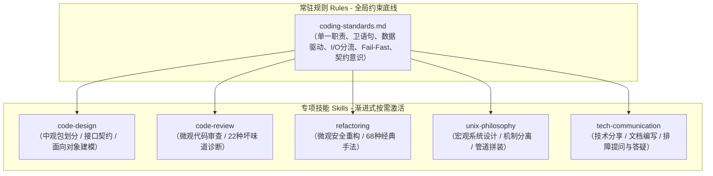

# AI Agent 软件设计与工程质量技能库 (Software Engineering & Design Skills for Agents)

[English Version](./README_EN.md) | 简体中文

本项目致力于将计算机科学经典著作与现代高阶软件工程思想，转化为 AI Agent（如 Google Antigravity、Claude Code、Cursor 等）可直接判定、执行和按需激活的**结构化规则（Rules）与技能包（Skills）**。

通过将人类阅读的“长篇理论”重构为面向机器的“执行手册、决策树、质量清单与正反模式”，让 AI 助手在日常编码、代码审查、模块设计、系统架构以及**技术表达与文档沟通**中，始终遵循最高标准的软件工程原则。

---

## 一、 核心知识资产图谱



---

## 二、 技能与规则全景导航

### 1. 全局常驻规则 (Always-On Rules)
* **[`.agents/rules/coding-standards.md`](./.agents/rules/coding-standards.md)**：
  * **函数设计底线**：单函数 20~30 行以内，单一抽象层级 (SLAP)，入参 $\le 3$ 个，**卫语句优先 (Guard Clauses)**。
  * **I/O 分流与缄默**：`stdout` 严禁输出人类交互杂讯，纯留给机器消费；所有日志与诊断统一走 `stderr`；成功时保持沉默。
  * **实证与安全**：遇歧义写最小测试/Demo 验证；**补救原则 (Fail-Fast)** 严禁吞噬异常；改动必须经确认后方可提交。

### 2. 五大专项技能包 (Specialized Skills)
每个技能包均遵循 Antigravity 规范，具备清晰的触发条件（YAML Frontmatter）与渐进式披露参考库：

| 技能名称 (Skill) | 触发场景 (Triggers) | 理论来源 | 核心包含内容 |
| :--- | :--- | :--- | :--- |
| **[`code-design`](./.agents/skills/code-design/)** | 架构设计、新模块定义、接口建模、包划分 | 经典架构、SOLID、酷壳高阶设计思想 | - **包与组件划分**：CCP 共同封闭、CRP 共同重用、ADP 无环依赖及解环方案<br/>- **接口与契约**：OCP 开闭原则、ISP 接口隔离、DbC 契约设计、SoC 关注点分离<br/>- **演进设计**：YAGNI 反过度设计、组合优于继承、CoC 惯例优于配置 |
| **[`code-review`](./.agents/skills/code-review/)** | 代码审查、质量体检、排查设计腐化 | 马丁·福勒《重构》第3章 | - **22 种代码坏味道诊断手册**（现象、危害、治疗手法）<br/>- **三维审查快速核查清单**（包依赖层、面向对象契约层、逻辑细节层） |
| **[`refactoring`](./.agents/skills/refactoring/)** | 代码重构、降低圈复杂度、模块解耦 | 马丁·福勒《重构》第6~11章 | - **重构铁律**：测试网/Demo 实证守护、两顶帽子法则、微步前进（Baby Steps）<br/>- **68 种标准重构手法全集**（含问题、解法、动机与代码对照）<br/>- **坏味道到手法速查映射表** |
| **[`unix-philosophy`](./.agents/skills/unix-philosophy/)** | 系统架构、CLI 工具、通信协议、配置系统 | 埃里克·雷蒙德《UNIX编程艺术》、酷壳博文 | - **17 条 Unix 哲学深度解析**（紧凑性 Miller 定律、正交性、表示原则）<br/>- **10 大经典接口设计模式**（Filter 过滤器、Cantrip、引擎与接口分离、CLI Server 等）<br/>- **命令行与配置规范**（`-a` 到 `-z` 标准选项语义表、5级配置覆盖模型）<br/>- **文本化与应用协议设计**（行驱动、3位状态码、4类元格式选型） |
| **[`tech-communication`](./.agents/skills/tech-communication/)** | 写README、技术方案/RFC、技术分享、Bug排查求助、事故复盘(RCA) | 酷壳《如何做一个有质量的技术分享》、Stack Overflow《How to Ask》 | - **酷壳技术分享模型**：问题模型 $\to$ 方案对比 $\to$ 底层机制 $\to$ 最佳实践<br/>- **Stack Overflow 提问规范**：MRE 最小可复现示例、自解释标题、预期 vs 实际现象、严禁截图<br/>- **工业级 README 模板**：痛点价值主张、架构拓扑、开箱即用快速上手、技术权衡<br/>- **架构师级答疑与复盘**：结论先行(TL;DR)、5-Whys 根因分析、最小精准修复、长效防线 |

---

## 三、 项目目录结构

```text
create_kills/
├── .agents/                               # AI Agent 规则与技能根目录
│   ├── rules/
│   │   └── coding-standards.md            # 全局编码规范与底线
│   └── skills/
│       ├── code-design/                   # 架构建模与包设计技能
│       ├── code-review/                   # 代码审查与坏味道体检技能
│       ├── refactoring/                   # 代码安全重构技能
│       ├── unix-philosophy/               # Unix哲学与系统设计技能
│       └── tech-communication/            # 技术表达、文档编写与排障答疑技能
│
├── resources/                             # 原始参考资料库（持续完善中）
│   ├── refactoring/                       # 《重构：改善既有代码的设计》原书
│   ├── unix-programming-art/              # 《UNIX编程艺术》原书与精选博文索引
│   └── tech-communication/                # 技术分享心法与 Stack Overflow 提问指南索引
│
├── .gitignore                             # Git 忽略配置
├── README.md                              # 项目中文说明
└── README_EN.md                           # 项目英文说明
```

---

## 四、 如何使用这套 Skills？

当您在支持 Agent Customization 的工作环境中（如 Antigravity），只需向助手发出自然语言指令，相应的技能将被**自动激活**：

* 💬 **请求审查**：“*帮我 Review 这段新写的订单结算代码*”
  $\to$ 自动加载 `code-review`，对照 22 种坏味道与 ISP/ADP 清单输出结构化体检报告。
* 💬 **请求重构**：“*重构这个嵌套了 4 层的复杂 if-else*”
  $\to$ 自动加载 `refactoring`，要求先建立验证 Demo/测试用例，按微步套用卫语句与多态手法。
* 💬 **请求设计**：“*我要设计一个多源数据同步模块，如何划分包和接口？*”
  $\to$ 自动加载 `code-design`，基于 CCP/CRP/ADP 划分模块包，定义 DbC 前后置契约。
* 💬 **请求开发工具**：“*帮我写一个批处理日志的 CLI 命令行工具*”
  $\to$ 自动加载 `unix-philosophy`，严格遵守过滤器模式、`-a`~`-z` 选项规范及 `stdout/stderr` 隔离。
* 💬 **编写项目文档**：“*帮我为这个项目写一份高质量的 README*”
  $\to$ 自动加载 `tech-communication`，生成包含痛点阐述、架构图解与开箱即用快速上手的标准文档。
* 💬 **事故复盘 / 答疑**：“*分析刚才线上死锁的根本原因，写一份复盘报告*”
  $\to$ 自动加载 `tech-communication`，按照 TL;DR 结论先行、5-Whys 根因分析与长效防线输出标准 RCA 报告。

---

## 五、 后续扩展指南

如果您希望向本项目追加新的经典书籍或自定义技能：
1. **追加原始资料**：放置于 `resources/<topic-name>/` 下。
2. **提取与结构化**：
   - 提取硬核判据与工作流，编写 `SKILL.md`（配置准确的 `description` 触发词）；
   - 将繁重的理论和代码手册分流至 `references/` 与 `examples/`，实现渐进式披露。
3. **沉淀常驻规则**：将具有普适性的红线规则提炼至 `.agents/rules/`。

---

## 六、 致敬与参考资料

本项目知识核心提炼并致敬以下大师著作与思想先驱：
* **Martin Fowler** ——《重构：改善既有代码的设计》(Refactoring: Improving the Design of Existing Code)
* **Eric S. Raymond** ——《UNIX编程艺术》(The Art of UNIX Programming)
* **Robert C. Martin (Uncle Bob)** ——《敏捷软件开发：原则、模式与实践》(Agile Software Development)
* **陈皓（左耳朵耗子 / CoolShell）** ——《用Unix的设计思想来应对多变的需求》、《一些软件设计的原则》、《如何做一个有质量的技术分享》
* **Stack Overflow Community** ——《How do I ask a good question?》& MRE (Minimal, Reproducible Example)
