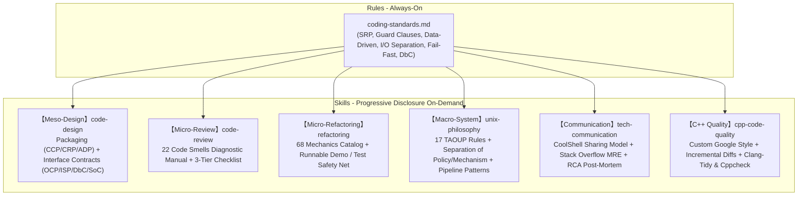

# 🏛️ AGY-Craft: Software Engineering & Architecture Skills for Autonomous AI Agents

> **One-Line Value Proposition**: Systematically distills computer science classics (*Refactoring*, *The Art of UNIX Programming*, and high-level architectural philosophy) into **five-dimensional executable skills and always-on baseline rules** tailored for AI coding agents.

English | [简体中文](./README.md)

---

## 1. Why AGY-Craft? (Problem Model & Vision)

Modern Large Language Models (LLMs) demonstrate remarkable syntax generation capabilities, but when confronted with real-world enterprise engineering, they often suffer from **three critical pain points**:

1. **"Toy Code" & Proliferating Code Smells**: LLMs inherently produce flat, sprawling blocks of code laden with nested `if-else` cascades, oversized functions, primitive obsession, and duplicate logic—lacking sensitivity to architectural rot;
2. **Over-Engineering & Fragile Inheritance**: When tasked with system design, LLMs frequently fall into "Speculative Generality", abusing deep inheritance hierarchies and violating YAGNI and the Law of Demeter;
3. **Fragmented & Ephemeral Prompts**: Pasting massive prompt instructions in every session bloats the context window, degrades model attention, and fails to establish an enduring, repeatable engineering discipline.

### The Solution
Leveraging the **Google Antigravity / Agent Customization Specification**, we transform bulky human literature into machine-executable runbooks with **Progressive Disclosure**, giving autonomous agents the instinctive discipline of senior software architects.

---

## 2. Architecture Topology

AGY-Craft establishes a comprehensive defense-in-depth engineering matrix:



---

## 3. Skills & Rules Matrix

### 1. Global Baseline Rules (`.agents/rules/`)
* **[`coding-standards.md`](./.agents/rules/coding-standards.md)**:
  * **Function Design**: Length constrained to 20–30 lines, Single Level of Abstraction Principle (SLAP), $\le 3$ arguments, **Guard Clauses first**;
  * **C++ Specifics**: Google C++ baseline, PointerAlignment: Right, ColumnLimit: 120; incremental Boy Scout rule for legacy repos; triple-lock third-party isolation;
  * **I/O Separation**: `stdout` is strictly reserved for machine-consumable data payloads; all logs, diagnostics, and telemetry go to `stderr`. Silence is golden on success;
  * **Empirical Safety**: Never speculate; construct runnable verification demos when resolving ambiguous edge cases. **Rule of Repair (Fail-Fast)**: never swallow exceptions silently. Git commits require explicit human confirmation.

### 2. Six Specialized Skills (`.agents/skills/`)

| Skill Directory | Focus Tier | Theoretical Source | Key Assets & Capabilities |
| :--- | :---: | :--- | :--- |
| **[`code-design`](./.agents/skills/code-design/)** | **Meso**<br/>Packages & Modules | Component Principles (Uncle Bob)<br/>SOLID Principles<br/>Bertrand Meyer (DbC) | - **Package Topology**: CCP (Common Closure), CRP (Common Reuse), ADP (Acyclic Dependencies) & 2 cycle-breaking surgical techniques<br/>- **Interface & Contract**: OCP (Open/Closed), ISP (Interface Segregation), DbC (Pre/Post-conditions & Invariants)<br/>- **Evolutionary Design**: YAGNI anti-over-engineering, Composition over Inheritance, CoC (Convention over Configuration) |
| **[`code-review`](./.agents/skills/code-review/)** | **Micro**<br/>Code Health | Martin Fowler's *Refactoring* (Ch. 3) | - **22 Code Smells Diagnostic Manual** (Divergent Change, Shotgun Surgery, Feature Envy symptoms and treatments)<br/>- **Rapid Inspection Checklist** (Package topology, OO contracts, function logic) |
| **[`refactoring`](./.agents/skills/refactoring/)** | **Micro**<br/>Safe Execution | Martin Fowler's *Refactoring* (Ch. 6–11) | - **Refactoring Iron Laws**: Safety-net demo first, Two Hats rule, Baby Steps<br/>- **68 Refactoring Mechanics Catalog** (Composing methods, moving features, organizing data, simplifying conditionals)<br/>- **Smell-to-Refactoring Quick Lookup Matrix** |
| **[`unix-philosophy`](./.agents/skills/unix-philosophy/)** | **Macro**<br/>System Architecture | Eric S. Raymond's *TAOUP*<br/>CoolShell *Handling Volatile Requirements* | - **17 Unix Rules In-Depth** (Compactness & Miller's Law $7 \pm 2$, Orthogonality, Data-Driven Representation)<br/>- **10 Classic Interface Patterns** (Filter, Cantrip, Engine-Interface Separation, CLI Server)<br/>- **CLI & Configuration Standards** (`-a` to `-z` option dictionary, 5-tier config precedence, `--` parsing terminator) |
| **[`tech-communication`](./.agents/skills/tech-communication/)** | **Interaction**<br/>Docs & Troubleshooting | CoolShell *Quality Technical Sharing*<br/>Stack Overflow *How to Ask* | - **CoolShell Tech Sharing Model**: Problem Model $\to$ Alternatives Comparison $\to$ Mechanism & Internals $\to$ Best Practices<br/>- **Stack Overflow Asking Standard**: MRE (Minimal, Reproducible Example), expected vs actual behavior, zero screenshot policy<br/>- **Industry-Grade README Guidelines**: Value proposition, visual architecture, quick start in 3 minutes, trade-offs<br/>- **Architect-Level RCA & QA**: TL;DR conclusion first, 5-Whys root cause deduction, minimal precise fix, long-term regression defense |
| **[`cpp-code-quality`](./.agents/skills/cpp-code-quality/)** | **Tooling**<br/>C++ Toolchain | Google C++ Style<br/>LLVM Clang-Tidy<br/>Boy Scout Incremental Rule | - **Automated Toolchain Detection**: Environment self-check script `env_check.sh` diagnoses tools with distro install hints<br/>- **One-Click Config Init**: Generates customized `.clang-format` (Right pointer, 120 cols), `.clang-tidy` (high signal-to-noise rules), and `.clang-format-ignore`<br/>- **Dual-Mode Dispatch**: Supports incremental diff checking (`clang-format-diff` for legacy repos) and full scan, safely ignoring `third_party/` |

---

## 4. Quick Start & Practical Scenarios

Zero external dependencies required. As long as your IDE/CLI supports agent customization (such as Google Antigravity), these skills **trigger automatically based on conversational context**.

### Scenario 1: Code Review (Detecting Code Smells)
```text
💬 User: "Review the code quality of this payment callback handler"
🤖 Agent Response:
1. Automatically activates [code-review] skill;
2. Scans against the 22 code smells catalog, identifying Divergent Change and Switch Statements;
3. Reports severity rating (Major/Minor) and recommends Replace Conditional with Polymorphism (9.6).
```

### Scenario 2: Safe Refactoring (Empirical Baby Steps)
```text
💬 User: "Refactor this deeply nested conditional discount calculation"
🤖 Agent Response:
1. Automatically activates [refactoring] skill;
2. Declares: "Safety net first—constructing an isolated runnable demo to lock baseline behavior";
3. Executes baby steps: introducing guard clauses and strategy dispatch tables, verifying after every atomic edit.
```

### Scenario 3: Architectural Package Design
```text
💬 User: "Design the package structure and contracts for a multi-tenant permission validation module"
🤖 Agent Response:
1. Automatically activates [code-design] skill;
2. Applies CCP to group highly-correlated classes, applies CRP to prune unneeded dependencies, ensuring an Acyclic Dependency Graph (ADP);
3. Explicitly defines precondition and postcondition contracts (DbC) on tenant context.
```

### Scenario 4: High-Quality Technical Sharing & Docs
```text
💬 User: "I need to give a tech talk on 'Why We Need Separation of Concerns' next week. Help me outline it."
🤖 Agent Response:
1. Automatically activates [tech-communication] skill;
2. Outputs according to the CoolShell cognitive model: Real-world pain point $\to$ Alternatives comparison (AOP vs Middleware vs Events) $\to$ Core mechanism & data flow $\to$ Team best practices.
```

### Scenario 5: C++ Static Analysis & Incremental Formatting
```text
💬 User: "This is a legacy codebase; only format and run static checks on my modified lines"
🤖 Agent Response:
1. Automatically activates [cpp-code-quality] skill;
2. Pre-flight check: verifies clang-format and clang-tidy availability;
3. Ensures .clang-format and .clang-tidy exist in project root;
4. Executes incremental inspection: invoking clang-format-diff on git diff lines, ignoring third_party/ with zero blast radius.
```

---

## 5. Directory Layout

```text
create_kills/
├── .agents/                               # AI Agent rules & skills core repository
│   ├── rules/
│   │   └── coding-standards.md            # Global baseline coding standards
│   └── skills/
│       ├── code-design/                   # Package architecture & interface contract skill
│       ├── code-review/                   # Code review & smells diagnosis skill
│       ├── refactoring/                   # Safe refactoring & mechanics skill
│       ├── unix-philosophy/               # Unix philosophy & system design skill
│       ├── tech-communication/            # Technical communication, docs & RCA skill
│       └── cpp-code-quality/              # C++ quality, incremental diff formatting & linting
│           ├── SKILL.md                   # Skill entry point & scenario routing
│           ├── scripts/                   # [Executable scripts] env_check / init_config / run_check
│           └── references/                # [On-demand] Google style, rulesets, incremental guides
│
├── resources/                             # Raw literature & reference repository
│   ├── refactoring/                       # Martin Fowler's "Refactoring" raw EPUB
│   ├── unix-programming-art/              # "The Art of UNIX Programming" raw EPUB & blog links
│   └── tech-communication/                # Technical sharing and Stack Overflow asking guides
│
├── .clang-format                          # [One-Click Config] Google Style + Right Pointer + 120 Cols
├── .clang-format-ignore                   # Ignore third_party/ and build artifacts
├── .clang-tidy                            # High signal-to-noise static analysis ruleset
├── .gitignore                             # Git ignore rules
├── README.md                              # Chinese Documentation
└── README_EN.md                           # English Documentation
```

---

## 6. Design Trade-offs

1. **Why Multiple Specialized Skills instead of a Monolithic Skill?**
   * *Trade-off*: Stuffing all knowledge into a single monolithic document creates severe context window bloat and dilutes model attention.
   * *Decision*: Micro-refactoring, meso-design, macro-systems, and technical communication are orthogonal concerns, packaged independently for precision targeting.
2. **Why Pure Markdown + YAML Frontmatter?**
   * *Trade-off*: Zero compilation, zero runtime environment friction.
   * *Decision*: Upholds the Unix philosophy of "Textuality" and "Transparency"—readable and introspectable by both humans and machines.

---

## 7. How to Extend the Knowledge Base

1. **Add Raw Literature**: Place raw ebooks, RFCs, or engineering articles under `resources/<topic>/`;
2. **Structure New Skills**:
   - Create `SKILL.md` under `.agents/skills/<skill-name>/` with accurate YAML frontmatter;
   - Offload extensive reference manuals into `references/` for progressive disclosure;
3. **Consolidate Universal Rules**: If a constraint applies universally across all languages, add it to `.agents/rules/coding-standards.md`.

---

## 8. Acknowledgements & Seminal Works

AGY-Craft stands upon the shoulders of giants:
* **Martin Fowler** — *Refactoring: Improving the Design of Existing Code*
* **Eric S. Raymond** — *The Art of UNIX Programming*
* **Robert C. Martin (Uncle Bob)** — *Agile Software Development: Principles, Patterns, and Practices*
* **Hao Chen (Left-Ear Mouse / CoolShell)** — *Using Unix Design Philosophy to Deal with Volatile Requirements*, *Some Principles of Software Design*, *How to Deliver a Quality Technical Presentation*
* **Stack Overflow Community** — *How do I ask a good question?* & *Minimal, Reproducible Example (MRE)*

---
*MIT License © 2026 lilucpp. Built with discipline, precision, and passion.*
