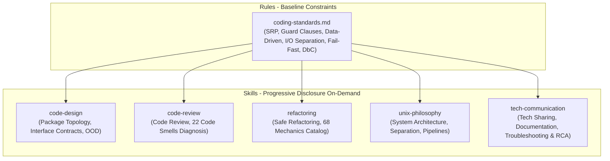

# Software Engineering & Architecture Skills for AI Agents

English | [简体中文](./README.md)

This project translates timeless computer science classics and modern high-level software engineering principles into **machine-executable rules and skills** designed for AI Agents (such as Google Antigravity, Claude Code, Cursor, etc.).

By distilling long-form human literature into structured operational runbooks, decision trees, diagnostic checklists, and anti-pattern catalogs, it equips AI coding agents with deep, disciplined engineering wisdom across daily coding, code review, modular design, system architecture, and **technical communication & documentation**.

---

## 1. Architectural Blueprint



---

## 2. Rules & Skills Catalog

### 1. Global Baseline Rules (Always-On)
* **[`.agents/rules/coding-standards.md`](./.agents/rules/coding-standards.md)**:
  * **Function Design**: Length within 20–30 lines, Single Level of Abstraction Principle (SLAP), $\le 3$ parameters, **Guard Clauses first**.
  * **I/O Separation & Silence**: `stdout` is strictly reserved for machine-consumable data payloads; all logging, warnings, and diagnostic telemetry must go to `stderr`. Silence is golden on success.
  * **Empirical Integrity & Safety**: Build runnable test verification demos when encountering ambiguous edge cases. **Rule of Repair (Fail-Fast)**: never swallow exceptions silently. Git commits require explicit human confirmation.

### 2. Specialized Skills (5 Pillars)
All skills follow the standard Antigravity specification with precise activation triggers (YAML frontmatter) and progressive disclosure reference libraries:

| Skill | Activation Scenarios | Theoretical Source | Key Content & References |
| :--- | :--- | :--- | :--- |
| **[`code-design`](./.agents/skills/code-design/)** | System architecture, package topology, interface modeling, modular design | Clean Architecture, SOLID, CoolShell Insights | - **Package & Component Topology**: CCP (Common Closure), CRP (Common Reuse), ADP (Acyclic Dependencies) & cycle-breaking mechanics.<br/>- **Interface & Contract**: OCP (Open/Closed), ISP (Interface Segregation), DbC (Design by Contract: Pre/Post-conditions & Invariants), SoC (Separation of Concerns).<br/>- **Evolutionary Design**: YAGNI, Composition over Inheritance, CoC (Convention over Configuration). |
| **[`code-review`](./.agents/skills/code-review/)** | Code review, quality inspection, detecting architectural decay | Martin Fowler's *Refactoring* (Ch. 3) | - **22 Code Smells Diagnostic Manual** (symptoms, root causes, recommended treatments).<br/>- **3-Tier Comprehensive Review Checklist** (package dependencies, OO contracts, logic details). |
| **[`refactoring`](./.agents/skills/refactoring/)** | Refactoring code, reducing cyclomatic complexity, decoupling | Martin Fowler's *Refactoring* (Ch. 6–11) | - **Refactoring Iron Laws**: Self-testing net / runnable demo safety first, Two Hats rule, Baby Steps.<br/>- **68 Standard Refactoring Mechanics Catalog** (problems, solutions, motivations, before/after code).<br/>- **Smell-to-Refactoring Quick Lookup Matrix**. |
| **[`unix-philosophy`](./.agents/skills/unix-philosophy/)** | System architecture, CLI utilities, IPC protocols, config systems | Eric S. Raymond's *TAOUP*, CoolShell Blog | - **17 Unix Rules In-Depth** (Compactness & Miller's Law $7 \pm 2$, Orthogonality, Representation Rule).<br/>- **10 Classic Interface Patterns** (Filter, Cantrip, Engine-Interface Separation, CLI Server).<br/>- **CLI & Configuration Standards** (`-a` to `-z` option conventions, `--` terminator, 5-tier config precedence).<br/>- **Textuality & Application Protocols** (Line-oriented framing, 3-digit status codes, metadata formats). |
| **[`tech-communication`](./.agents/skills/tech-communication/)** | Writing READMEs, RFCs/Design Docs, Tech Sharing, MRE Bug Reports, Incident RCA | CoolShell *Quality Technical Sharing*, Stack Overflow *How to Ask* | - **CoolShell Tech Sharing Model**: Problem Model $\to$ Alternatives Comparison $\to$ Mechanism & Internals $\to$ Best Practices.<br/>- **Stack Overflow Asking Standard**: MRE (Minimal, Reproducible Example), self-describing titles, expected vs actual behavior, zero screenshot policy.<br/>- **Industry-Grade README Guidelines**: Value proposition, visual architecture, quick start in 3 minutes, trade-offs.<br/>- **Architect-Level RCA & QA**: TL;DR conclusion first, 5-Whys root cause deduction, minimal precise fix, long-term regression defense. |

---

## 3. Directory Layout

```text
create_kills/
├── .agents/                               # Root directory for Agent rules and skills
│   ├── rules/
│   │   └── coding-standards.md            # Global baseline coding standards
│   └── skills/
│       ├── code-design/                   # Package architecture & interface contract skill
│       ├── code-review/                   # Code review & code smells inspection skill
│       ├── refactoring/                   # Safe refactoring & mechanics catalog skill
│       ├── unix-philosophy/               # Unix philosophy & system design skill
│       └── tech-communication/            # Technical communication, documentation & RCA skill
│
├── resources/                             # Raw literature & reference repository
│   ├── refactoring/                       # Martin Fowler's "Refactoring" raw EPUB
│   ├── unix-programming-art/              # "The Art of UNIX Programming" raw EPUB & blog links
│   └── tech-communication/                # Technical sharing and Stack Overflow asking guides
│
├── .gitignore                             # Git ignore rules
├── README.md                              # Chinese Documentation
└── README_EN.md                           # English Documentation
```

---

## 4. How to Use These Skills

In any Agent Customization environment supporting skills (such as Antigravity):

* 💬 **Review Request**: "*Review this newly written payment settlement logic*"
  $\to$ Automatically triggers `code-review`, scanning against the 22 code smells and ADP/ISP checklists.
* 💬 **Refactor Request**: "*Refactor this nested 4-layer conditional block*"
  $\to$ Automatically triggers `refactoring`, mandating a safety verification demo and applying guard clauses/polymorphism in baby steps.
* 💬 **Design Request**: "*How should I design the package structure and contracts for a multi-source data sync module?*"
  $\to$ Automatically triggers `code-design`, applying CCP/CRP/ADP for packaging and DbC for preconditions/postconditions.
* 💬 **Tool Development**: "*Help me build a CLI log processor*"
  $\to$ Automatically triggers `unix-philosophy`, adhering to the Filter pattern, standard `-a`~`-z` options, and strict `stdout/stderr` isolation.
* 💬 **Documentation**: "*Write an industry-grade README for this project*"
  $\to$ Automatically triggers `tech-communication`, crafting a standard document with value proposition, diagrams, and runnable quick start.
* 💬 **Incident Post-Mortem**: "*Analyze the deadlock accident that happened in production and write an RCA report*"
  $\to$ Automatically triggers `tech-communication`, executing 5-Whys root cause analysis, minimal fix, and long-term regression testing.

---

## 5. Adding New Books & Skills

To expand this knowledge base with more books or domain skills:
1. **Add Raw Materials**: Place source books or papers under `resources/<topic-name>/`.
2. **Distill & Structure**:
   - Extract actionable criteria and workflows into `SKILL.md` (defining concise trigger conditions in YAML frontmatter).
   - Offload extensive documentation into `references/` and `examples/` for progressive disclosure.
3. **Harmonize Global Rules**: Distill fundamental bottom-line rules into `.agents/rules/coding-standards.md`.

---

## 6. Acknowledgements & Literature

This repository honors the seminal works and engineering philosophy of:
* **Martin Fowler** — *Refactoring: Improving the Design of Existing Code*
* **Eric S. Raymond** — *The Art of UNIX Programming*
* **Robert C. Martin (Uncle Bob)** — *Agile Software Development: Principles, Patterns, and Practices*
* **Hao Chen (Left-Ear Mouse / CoolShell)** — *Using Unix Design Philosophy to Deal with Volatile Requirements*, *Some Principles of Software Design*, *How to Deliver a Quality Technical Presentation*
* **Stack Overflow Community** — *How do I ask a good question?* & *Minimal, Reproducible Example (MRE)*
