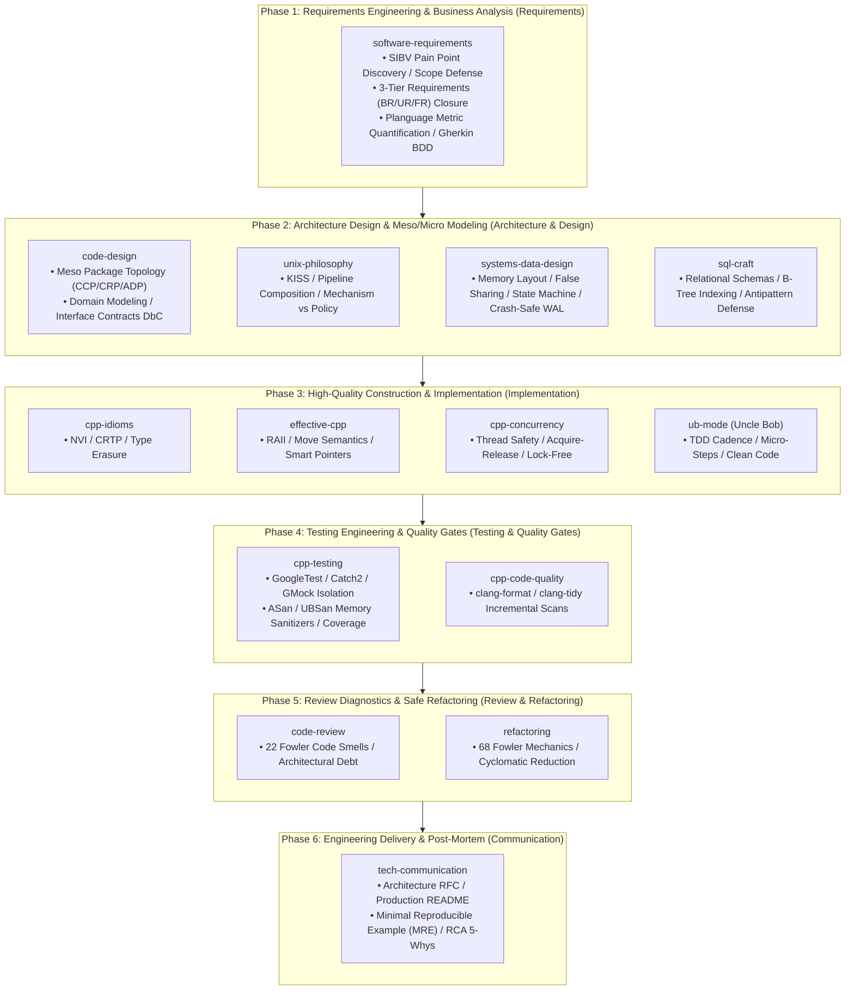

# 🏛️ Code-Craft: Software Engineering & Architecture Skills for Autonomous AI Agents

> **One-Line Value Proposition**: Systematically distills computer science classics (*Refactoring*, *The Art of UNIX Programming*, systems engineering, and SQL performance) into **eight-dimensional executable skills and always-on baseline rules** tailored for AI coding agents.

English | [简体中文](./README.md)

---

## 1. Why Code-Craft? (Problem Model & Vision)

Modern Large Language Models (LLMs) demonstrate remarkable syntax generation capabilities, but when confronted with real-world enterprise engineering, they often suffer from **three critical pain points**:

1. **"Toy Code" & Proliferating Code Smells**: LLMs inherently produce flat, sprawling blocks of code laden with nested `if-else` cascades, oversized functions, primitive obsession, and duplicate logic—lacking sensitivity to architectural rot;
2. **Over-Engineering & Fragile Inheritance**: When tasked with system design, LLMs frequently fall into "Speculative Generality", abusing deep inheritance hierarchies and violating YAGNI and the Law of Demeter;
3. **Fragmented & Ephemeral Prompts**: Pasting massive prompt instructions in every session bloats the context window, degrades model attention, and fails to establish an enduring, repeatable engineering discipline.

### The Solution
Leveraging the **Google Antigravity / Agent Customization Specification**, we transform bulky human literature into machine-executable runbooks with **Progressive Disclosure**, giving autonomous agents the instinctive discipline of senior software architects.

---

## 2. Architecture Topology

Code-Craft establishes a comprehensive "One Horizontal, Fifteen Verticals" defense-in-depth engineering matrix:

```mermaid
flowchart TD
    subgraph Global Baseline Rules [Rules - Always-On]
        R["coding-standards.md<br/>(SRP, Guard Clauses, 8-4-2-1 Alignment, Crash-Safe Write, DECIMAL Money)"]
    end

    subgraph Specialized Skills Matrix [Skills - Progressive Disclosure On-Demand]
        S1["【Meso-Design】code-design<br/>Packaging (CCP/CRP/ADP) + Interface Contracts (OCP/ISP/DbC/SoC)"]
        S2["【Micro-Review】code-review<br/>22 Code Smells Diagnostic Manual + 3-Tier Checklist"]
        S3["【Micro-Refactoring】refactoring<br/>68 Mechanics Catalog + Runnable Demo / Test Safety Net"]
        S4["【Macro-System】unix-philosophy<br/>17 TAOUP Rules + Separation of Policy/Mechanism + Pipeline Patterns"]
        S5["【Communication】tech-communication<br/>CoolShell Sharing Model + Stack Overflow MRE + RCA Post-Mortem"]
        S6["【C++ Quality】cpp-code-quality<br/>Custom Google Style + Incremental Diffs + Clang-Tidy & Cppcheck"]
        S7["【Systems Data】systems-data-design<br/>Memory Packing + False Sharing Defense + StrongType/Typestate + OSDI14 Atomic Write"]
        S8["【Data Storage】sql-craft<br/>B-Tree Index Column Order + Keyset Seek Pagination + Closure Table + Antipatterns Defense"]
        S9["【Skill Meta-Engineering】skill-craft<br/>Anthropic Best Practices + Bilingual Dual-Anchor + Progressive Disclosure + Degrees of Freedom"]
        S10["【Modern C++】effective-cpp<br/>Scott Meyers 132 Items Trilogy + RAII/Smart Pointers + Move/Forward + Operators & Polymorphism Traps"]
        S11["【C++ Idioms】cpp-idioms<br/>More C++ Idioms 75+ Patterns + NVI Template Method + CRTP Static Poly + Type Erasure Value Semantics + Attorney Proxy"]
        S12["【C++ Concurrency】cpp-concurrency<br/>Williams C++ Concurrency + Memory Model/Atomics + Fine-Grained Queue + Lock-Free CAS + Work Stealing"]
        S13["【C++ Testing】cpp-testing<br/>GoogleTest/Catch2 + GMock Dependency Injection + AAA Matrix + ASan/UBSan + Coverage Gates"]
        S14["【Requirements Engineering】software-requirements<br/>Wiegers Classic Requirements + 3 Levels + SIBV/Vision + Use Cases/INVEST + Planguage + Analytical Priority + RTM"]
    end

    R --> S1
    R --> S2
    R --> S3
    R --> S4
    R --> S5
    R --> S6
    R --> S7
    R --> S8
    R --> S9
    R --> S10
    R --> S11
    R --> S12
    R --> S13
    R --> S14
```



---

## 2.1 Modern Software Development Life Cycle (SDLC) Mapping Guide

To provide developers and AI Agents with crystal-clear guidance on **"which skill to activate at each engineering phase"**, the table below maps the 15 core skills across the 6 standard stages of the software development lifecycle:



| SDLC Phase | Recommended Skills | Core Engineering Challenges Addressed | Core Deliverables & Baselines |
| :--- | :--- | :--- | :--- |
| **Phase 1: Requirements Engineering**<br>*(Business Analysis)* | **`software-requirements`** | • Uncover root business pain points (SIBV), avoiding premature UI design<br>• Delineate In/Out-of-Scope boundaries to prevent scope creep<br>• Structure 3-tier requirements (BR/UR/FR) and Given-When-Then BDD stories<br>• Quantify quality attributes using Planguage; eliminate Table 11-2 ambiguities | • Vision and Scope Document<br>• Software Requirements Specification (SRS)<br>• Standalone Business Rules Catalog |
| **Phase 2: Architecture & Meso/Micro Modeling**<br>*(Architecture & Design)* | **`code-design`**<br>*(Meso/Micro Architecture)*<br><br>**`unix-philosophy`**<br>*(Macro Philosophy)*<br><br>**`systems-data-design`**<br>*(Memory & Crash Consistency)*<br><br>**`sql-craft`**<br>*(Relational Storage)* | • **Package Topology**: Enforce CCP/CRP cohesion and ensure ADP acyclic dependencies (DAG)<br>• **OO Contracts**: Interface Segregation (ISP), Open/Closed Strategy patterns (OCP), Design by Contract (DbC)<br>• **Unix Philosophy**: KISS principle, separation of mechanism and policy, textual pipeline protocols<br>• **Memory & Storage**: Cache line false-sharing padding, typestate transition defenses, crash-consistent WAL fsync, B-Tree physical index tuning | • Architectural Package Dependency DAG<br>• Domain Class Diagrams & Interface Contracts<br>• Physical Database DDL & Composite Indexes |
| **Phase 3: High-Quality Construction**<br>*(Implementation & Construction)* | **`effective-cpp`**<br>*(Modern C++ Standards)*<br><br>**`cpp-idioms`**<br>*(Advanced Design Patterns)*<br><br>**`cpp-concurrency`**<br>*(Multithreading & Concurrency)*<br><br>**`ub-mode`**<br>*(Clean Craftsmanship)* | • **Resource Safety**: Strict RAII lifecycle, smart pointer ownership, strong exception safety guarantees (Copy-and-Swap)<br>• **Advanced Idioms**: NVI template method base contract, CRTP zero-overhead static polymorphism, Type Erasure value wrappers<br>• **High Concurrency**: Acquire-Release memory orderings, fine-grained locked queues/hash tables, lock-free CAS/ABA defenses, TSan debugging<br>• **Clean Code**: Single Level of Abstraction Principle (SLAP), function length $\le 30$ lines, guard clauses first, rapid TDD cadence | • Robust Modern C++ Source Code<br>• High-Throughput Thread-Safe Data Structures<br>• Clean Implementations Honoring Design Contracts |
| **Phase 4: Testing & Quality Gates**<br>*(Testing & Quality Gates)* | **`cpp-testing`**<br>*(Testing Architecture)*<br><br>**`cpp-code-quality`**<br>*(Static Analysis Gates)* | • **Unit Testing**: Author AAA (Arrange-Act-Assert) cases covering 4-zone boundary matrices<br>• **Dependency Decoupling**: Inject pure virtual interfaces; mock external side effects with GoogleMock (`MOCK_METHOD`)<br>• **Memory Sanitizers**: Mandate ASan/UBSan on debug builds to catch wild pointers and heap corruption early<br>• **Static Quality Gates**: `clang-format-diff` incremental formatting; high-signal `clang-tidy` diagnostic sweeps | • Automated GoogleTest Test Suites<br>• Zero-Defect AddressSanitizer Run Reports<br>• Code Coverage Reports ($\ge 80\%$) |
| **Phase 5: Review & Safe Refactoring**<br>*(Review & Refactoring)* | **`code-review`**<br>*(Code Health & Smells)*<br><br>**`refactoring`**<br>*(Lossless Surgical Refactoring)* | • **Code Health Check**: Hunt down Martin Fowler's 22 code smells (Divergent Change, Shotgun Surgery, Feature Envy)<br>• **Architectural Debt**: Diagnose cyclic couplings, god classes, and hardcoded SOLID violations<br>• **Safe Refactoring**: Micro-step refactoring under test coverage using 68 classic mechanics to reduce cyclomatic complexity | • Structured Code Review Reports<br>• Behavior-Preserving Refactored Codebases<br>• Architectural Technical Debt Removal Logs |
| **Phase 6: Communication, Delivery & Post-Mortem**<br>*(Communication & Post-Mortem)* | **`tech-communication`** | • Author architectural RFC proposals and production-grade project READMEs<br>• Distill Minimal Reproducible Examples (MRE) when filing upstream bug reports<br>• Conduct blameless 5-Whys Root Cause Analyses (RCA) post-incident to build systemic defenses | • Architectural Design RFC Proposals<br>• Incident Post-Mortem RCA Reports<br>• High-Clarity Project Technical Documentation |

---

## 3. Skills & Rules Matrix

### 1. Global Baseline Rules (`.agents/rules/`)
* **[`coding-standards.md`](./.agents/rules/coding-standards.md)**:
  * **Function Design**: Length constrained to 20–30 lines, Single Level of Abstraction Principle (SLAP), $\le 3$ arguments, **Guard Clauses first**;
  * **Systems & Physical**: 8-4-2-1 descending alignment to eliminate padding; `alignas(64)` for multithreaded variables to prevent false sharing;
  * **Crash Consistency**: Mandatory 4-step atomic write (`write tmp -> fdatasync -> rename -> dir fsync`);
  * **Relational Storage**: Financial currency must use `DECIMAL(18, 4)`; B-Tree indexes: equality first, range second;
  * **C++ Specifics**: Google C++ baseline, PointerAlignment: Right, ColumnLimit: 120; incremental Boy Scout rule for legacy repos; triple-lock third-party isolation;
  * **I/O Separation**: `stdout` is strictly reserved for machine-consumable data payloads; all logs, diagnostics, and telemetry go to `stderr`. Silence is golden on success;
  * **Empirical Safety**: Never speculate; construct runnable verification demos when resolving ambiguous edge cases. **Rule of Repair (Fail-Fast)**: never swallow exceptions silently. Git commits require explicit human confirmation.

### 2. Fifteen Specialized Skills (`.agents/skills/`)

| Skill Directory | Focus Tier | Theoretical Source | Key Assets & Capabilities |
| :--- | :---: | :--- | :--- |
| **[`code-design`](./.agents/skills/code-design/)** | **Meso**<br/>Packages & Modules | Component Principles (Uncle Bob)<br/>SOLID Principles<br/>Bertrand Meyer (DbC) | - **Package Topology**: CCP (Common Closure), CRP (Common Reuse), ADP (Acyclic Dependencies) & 2 cycle-breaking surgical techniques<br/>- **Interface & Contract**: OCP (Open/Closed), ISP (Interface Segregation), DbC (Pre/Post-conditions & Invariants)<br/>- **Evolutionary Design**: YAGNI anti-over-engineering, Composition over Inheritance, CoC (Convention over Configuration) |
| **[`code-review`](./.agents/skills/code-review/)** | **Micro**<br/>Code Health | Martin Fowler's *Refactoring* (Ch. 3) | - **22 Code Smells Diagnostic Manual** (Divergent Change, Shotgun Surgery, Feature Envy symptoms and treatments)<br/>- **Rapid Inspection Checklist** (Package topology, OO contracts, function logic) |
| **[`refactoring`](./.agents/skills/refactoring/)** | **Micro**<br/>Safe Execution | Martin Fowler's *Refactoring* (Ch. 6–11) | - **Refactoring Iron Laws**: Safety-net demo first, Two Hats rule, Baby Steps<br/>- **68 Refactoring Mechanics Catalog** (Composing methods, moving features, organizing data, simplifying conditionals)<br/>- **Smell-to-Refactoring Quick Lookup Matrix** |
| **[`unix-philosophy`](./.agents/skills/unix-philosophy/)** | **Macro**<br/>System Architecture | Eric S. Raymond's *TAOUP*<br/>CoolShell *Handling Volatile Requirements* | - **17 Unix Rules In-Depth** (Compactness & Miller's Law $7 \pm 2$, Orthogonality, Data-Driven Representation)<br/>- **10 Classic Interface Patterns** (Filter, Cantrip, Engine-Interface Separation, CLI Server)<br/>- **CLI & Configuration Standards** (`-a` to `-z` option dictionary, 5-tier config precedence, `--` parsing terminator) |
| **[`tech-communication`](./.agents/skills/tech-communication/)** | **Interaction**<br/>Docs & Troubleshooting | CoolShell *Quality Technical Sharing*<br/>Stack Overflow *How to Ask* | - **CoolShell Tech Sharing Model**: Problem Model $\to$ Alternatives Comparison $\to$ Mechanism & Internals $\to$ Best Practices<br/>- **Stack Overflow Asking Standard**: MRE (Minimal, Reproducible Example), expected vs actual behavior, zero screenshot policy<br/>- **Industry-Grade README Guidelines**: Value proposition, visual architecture, quick start in 3 minutes, trade-offs<br/>- **Architect-Level RCA & QA**: TL;DR conclusion first, 5-Whys root cause deduction, minimal precise fix, long-term regression defense |
| **[`cpp-code-quality`](./.agents/skills/cpp-code-quality/)** | **Tooling**<br/>C++ Toolchain | Google C++ Style<br/>LLVM Clang-Tidy<br/>Boy Scout Incremental Rule | - **Automated Toolchain Detection**: Environment self-check script `env_check.sh` diagnoses tools with distro install hints<br/>- **One-Click Config Init**: Generates customized `.clang-format` (Right pointer, 120 cols), `.clang-tidy` (high signal-to-noise rules), and `.clang-format-ignore`<br/>- **Dual-Mode Dispatch**: Supports incremental diff checking (`clang-format-diff` for legacy repos) and full scan, safely ignoring `third_party/` |
| **[`systems-data-design`](./.agents/skills/systems-data-design/)** | **Systems**<br/>Memory & Crash-Safety | Williams *C++ Concurrency*<br/>Gregg *Systems Performance*<br/>OSTEP Operating Systems<br/>OSDI '14 Best Paper | - **Dual-Mode Engine**: Features proactive design defenses and advisory code optimization<br/>- **Physical Memory Alignment**: 8-4-2-1 descending packing to kill padding holes, `alignas(64)` for multi-core false sharing<br/>- **Zero-Cost Strong Types**: `StrongType` prevents ID/unit mixups, `Typestate` kills temporal sequence bugs at compile time<br/>- **Crash-Consistent Persistence**: OSDI 14 4-step atomic write (`write tmp -> fdatasync -> rename -> dir fsync`) |
| **[`sql-craft`](./.agents/skills/sql-craft/)** | **Storage**<br/>Relations & Indexing | Markus Winand Indexing<br/>Bill Karwin *SQL Antipatterns* | - **Dual-Mode Engine**: Features schema design defenses and slow query refactoring<br/>- **B-Tree Order Rule**: Composite indexes strictly follow "equality first, range second", covering indexes eliminate random I/O<br/>- **Keyset Seek Pagination**: Replaces `LIMIT OFFSET` to eliminate scanning millions of rows on deep pages<br/>- **Antipattern Defense**: Closure Table ends recursive trees, Intersection Table eliminates comma Jaywalking, DECIMAL enforces financial precision |
| **[`skill-craft`](./.agents/skills/skill-craft/)** | **Meta-Engineering**<br/>Agent Skills | Anthropic Official Standards<br/>Claude Best Practices | - **Dual-Mode Engine**: Proactive skill authoring and existing skill health audit/refactoring<br/>- **Bilingual Dual-Anchor**: 3rd-person English definition + Use when + Chinese domain + precise trigger keywords<br/>- **Progressive Disclosure**: Two-tier layout (`SKILL.md` + `references/`), single-layer reference depth to prevent context drift<br/>- **Degrees of Freedom**: Heuristic checklists for reasoning vs deterministic scripts for fragile tasks (forward slashes, no magic numbers) |
| **[`effective-cpp`](./.agents/skills/effective-cpp/)** | **Modern C++**<br/>Idioms & Design | Scott Meyers Bible Trilogy<br/>*Effective C++* (55 Items)<br/>*More Effective C++* (35 Items)<br/>*Effective Modern C++* (42 Items) | - **Dual-Mode Engine**: Proactive modern C++ design contracts and legacy C++98 modernization/refactoring<br/>- **RAII & Smart Pointers**: `unique_ptr` default ownership, `make` family allocations, constructor exception safety, Pimpl compilation isolation<br/>- **Operators & Polymorphism**: Never treat arrays polymorphically, never overload short-circuit `&&`/`||`, implement `op` via `op=`, catch exceptions by reference<br/>- **Move & Forwarding**: `std::move` rvalue casting, `std::forward` reference preservation, reference collapsing, universal reference overload avoidance<br/>- **Class Hierarchy & Safety**: Polymorphic virtual destructors, `override` specifier, Rule of 5/0, `noexcept` container move unlocks, `clone()` virtual constructor |
| **[`cpp-idioms`](./.agents/skills/cpp-idioms/)** | **Advanced C++**<br/>Patterns & Idioms | Wikibooks *More C++ Idioms*<br/>75+ Seminal Patterns & Idioms | - **Dual-Mode Engine**: Proactive C++ idiom selection and class architecture diagnostic refactoring<br/>- **Interface & Encapsulation**: NVI (Non-Virtual Interface) pattern enforces class contracts (public non-virtual + private virtual), Attorney-Client provides selective friendship without exposing private members<br/>- **Zero-Cost Static Polymorphism**: CRTP eliminates dynamic dispatch overhead and `vptr` size, C++20 `[[no_unique_address]]` maximizes Empty Base Optimization (EBO)<br/>- **Type Erasure & Value Semantics**: 3-tier architecture (external value wrapper + internal templated holder) gives non-intrusive runtime polymorphism without common base classes<br/>- **Exception Safety & Lifecycle**: Copy-and-Swap provides unified strong exception safety, Construct-On-First-Use eliminates Static Initialization Order Fiasco (SIOF) |
| **[`cpp-concurrency`](./.agents/skills/cpp-concurrency/)** | **Concurrency**<br/>Multithreading & Lock-Free | Anthony Williams Bible<br/>*C++ Concurrency in Action* (2nd Ed) | - **Dual-Mode Engine**: Proactive concurrent architecture and race/deadlock diagnostic hunting<br/>- **Thread Lifecycle**: C++20 `jthread` cooperative cancellation & RAII join guarantees eliminating `std::terminate` crashes<br/>- **Mutex & Deadlock Defense**: `scoped_lock` multi-locking, hierarchical mutex cycles defense, reader-writer `shared_mutex`, `call_once`<br/>- **C++ Memory Model**: 6 memory orderings, acquire-release happens-before chains, relaxed counters, synchronization fences<br/>- **Concurrent Data Structures & Pools**: Fine-grained head/tail dummy queue, bucketed hash map, lock-free CAS stack with ABA defense, Work-Stealing thread pool |
| **[`cpp-testing`](./.agents/skills/cpp-testing/)** | **Testing**<br/>Unit Test & Mocking | GoogleTest / Catch2<br/>GoogleMock / LLVM ASan | - **Dual-Mode Engine**: Proactive testing architecture and untestable legacy code decoupling<br/>- **Scaffolding & Sanitizers**: CMake `FetchContent` declarative dependencies, ASan/UBSan memory sanitization for testing builds<br/>- **Test Design & AAA**: Strict Arrange-Act-Assert pattern, 4-zone boundary matrix (empty/single/extremes/invalid), strong exception safety testing<br/>- **Mocking & Isolation**: Dependency injection interface extraction, modern GoogleMock `MOCK_METHOD` and `EXPECT_CALL` expectations<br/>- **Automated CI Pipeline**: Format $\to$ Clang-Tidy $\to$ ASan CTest execution $\to$ lcov/llvm-cov code coverage gate ($\ge 80\%$) |
| **[`software-requirements`](./.agents/skills/software-requirements/)** | **Requirements**<br/>Business & Specification | Karl Wiegers Seminal Books<br/>*Software Requirements* (3rd Ed)<br/>*Software Requirements Essentials* | - **Dual-Mode Engine**: Proactive requirements specification and smell audit/impact analysis<br/>- **3 Levels & Scope**: Business Requirements (BR) $\to$ User Requirements (UR/Use Cases/INVEST) $\to$ Functional Requirements (FR), SIBV problem statements & vision formula<br/>- **Specification & Ambiguity Defense**: ISO/IEC/IEEE 29148 structure, mandatory "The system shall" active syntax, Table 11-2 25+ ambiguity dictionary & rewrites, boundary/symmetry defense<br/>- **Planguage Quality Quantification**: External/Internal quality attribute taxonomy, SCALE/METER/MUST/PLAN/FAIL metrics, quality trade-offs matrix<br/>- **Analytical Prioritization & Governance**: Wiegers Value-Cost-Risk formula, Formal Peer Inspection checklists, Forward/Backward RTM traceability, 5-step change impact protocol |

### 3. Upstream Utility Skills (`.agents/skills/`)

Code-Craft also vendor-mirrors three general-purpose office and frontend utilities directly from the official Anthropic repository [**anthropics/skills**](https://github.com/anthropics/skills.git) (available as local utilities, excluded from `package_agensi.sh` distribution):

| Skill Directory | Focus Tier | Upstream Tool Source | Key Capabilities |
| :--- | :---: | :--- | :--- |
| **[`frontend-design`](./.agents/skills/frontend-design/)** | **Frontend UI**<br/>Web & UX | Anthropic Official Skills<br/>Tailwind / React / Web UI | Guides AI agents in creating distinctive, high-fidelity Web user interfaces with responsive layout and cohesive design systems. |
| **[`pdf`](./.agents/skills/pdf/)** | **Doc Tooling**<br/>PDF Processing | Anthropic Official Skills<br/>PyMuPDF / pdfplumber | Provides PDF form structure extraction, fillable field injection, bounding-box coordinate detection, and visual verification. |
| **[`docx`](./.agents/skills/docx/)** | **Doc Tooling**<br/>Word Processing | Anthropic Official Skills<br/>python-docx / Office XML | Supports Word document structural inspection, paragraph comments, track changes revision mode, and template merges. |

---

## 4. Quick Start & Practical Scenarios

Zero external dependencies required. As long as your IDE/CLI supports agent customization (such as Google Antigravity), these skills **trigger automatically based on conversational context**.

### Scenario 1: Code Review (Detecting Code Smells)
```text
💬 User: "Review the code quality of this payment callback handler"
🤖 Agent Response:
1. Automatically activates [code-review] skill;
2. Scans against the 22 code smells catalog, identifying Divergent Change and Switch Statements;
3. Reports severity rating (Major/Minor) and recommends Replace Conditional with Polymorphism (9.6).
```

### Scenario 2: Safe Refactoring (Empirical Baby Steps)
```text
💬 User: "Refactor this deeply nested conditional discount calculation"
🤖 Agent Response:
1. Automatically activates [refactoring] skill;
2. Declares: "Safety net first—constructing an isolated runnable demo to lock baseline behavior";
3. Executes baby steps: introducing guard clauses and strategy dispatch tables, verifying after every atomic edit.
```

### Scenario 3: Architectural Package Design
```text
💬 User: "Design the package structure and contracts for a multi-tenant permission validation module"
🤖 Agent Response:
1. Automatically activates [code-design] skill;
2. Applies CCP to group highly-correlated classes, applies CRP to prune unneeded dependencies, ensuring an Acyclic Dependency Graph (ADP);
3. Explicitly defines precondition and postcondition contracts (DbC) on tenant context.
```

### Scenario 4: High-Quality Technical Sharing & Docs
```text
💬 User: "I need to give a tech talk on 'Why We Need Separation of Concerns' next week. Help me outline it."
🤖 Agent Response:
1. Automatically activates [tech-communication] skill;
2. Outputs according to the CoolShell cognitive model: Real-world pain point $\to$ Alternatives comparison (AOP vs Middleware vs Events) $\to$ Core mechanism & data flow $\to$ Team best practices.
```

### Scenario 5: C++ Static Analysis & Incremental Formatting
```text
💬 User: "This is a legacy codebase; only format and run static checks on my modified lines"
🤖 Agent Response:
1. Automatically activates [cpp-code-quality] skill;
2. Pre-flight check: verifies clang-format and clang-tidy availability;
3. Ensures .clang-format and .clang-tidy exist in project root;
4. Executes incremental inspection: invoking clang-format-diff on git diff lines, ignoring third_party/ with zero blast radius.
```

### Scenario 6: Systems Memory Packing & Crash-Safe Persistence
```text
💬 User: "Design local storage for a multi-threaded metrics collector, or review why my config write corrupts on power cut"
🤖 Agent Response:
1. Automatically activates [systems-data-design] skill;
2. Memory packing: sorts members descending 8-4-2-1 bytes to kill padding holes; adds alignas(64) on multi-core counters to prevent false sharing;
3. Enforces OSDI 14 4-step atomic write: write tmp -> fdatasync -> rename -> parent dir fsync, eliminating torn write file corruption.
```

### Scenario 7: Database Schema Design & Query Optimization (SQL Craft)
```text
💬 User: "My 10-million row orders table pagination is taking 5 seconds, and tags are stored as comma strings. How to optimize?"
🤖 Agent Response:
1. Automatically activates [sql-craft] skill;
2. Eliminates Jaywalking: refactors comma-separated tags into a normalized intersection table with foreign key integrity and point-lookup indexes;
3. Resolves deep pagination cliff: refactors LIMIT 1000000, 20 into Keyset Pagination (Seek Method) using the primary key, reducing latency from 5s to 2ms.
```

### Scenario 8: Authoring New Skills & Quality Audit (skill-craft)
```text
💬 User: "Author a new agent skill for Kubernetes deployment troubleshooting"
🤖 Agent Response:
1. Automatically activates [skill-craft] skill;
2. Follows official Anthropic standards to scaffold standard `k8s-troubleshoot` directory and 2-tier progressive disclosure layout;
3. Crafts strict "Bilingual Dual-Anchor" Frontmatter (3rd-person verbs, English Use when, Chinese triggers);
4. Establishes low-degree-of-freedom diagnostic script guardrails and single-layer reference manuals, omitting common sense explanations to conserve context tokens.
```

### Scenario 9: Modern C++ Idiomatic Design & Legacy Modernization (effective-cpp)
```text
💬 User: "Review this legacy C++98 code, migrate it to modern C++, and eliminate resource leaks"
🤖 Agent Response:
1. Automatically activates [effective-cpp] skill;
2. Detects legacy antipatterns: refactors raw new/delete to std::unique_ptr, NULL to nullptr, private uncopyable classes to = delete;
3. Standardizes Pimpl Idiom: forward declares and explicitly defaults destructor in .cpp to prevent incomplete type compilation errors;
4. Move semantics defense: eliminates redundant std::move on local return objects to preserve RVO; marks move constructor noexcept to unlock STL reallocation speedups.
```

### Scenario 10: Advanced C++ Design Patterns & Idioms (cpp-idioms)
```text
💬 User: "Design a payment processor interface that ensures derived classes cannot skip audit logging, while keeping friendship scoped without leaking private data to tests"
🤖 Agent Response:
1. Automatically activates [cpp-idioms] skill;
2. Interface Architecture: Applies NVI (Non-Virtual Interface) idiom, exposing a public non-virtual `process()` method enforcing invariants/audit hooks while delegating implementation to `private virtual do_process()`;
3. Encapsulation Isolation: Applies Attorney-Client idiom, avoiding coarse-grained `friend class TestHarness;`, introducing `OrderAttorney` proxy to expose only specific internal status markers while keeping private credentials encapsulated;
4. Polymorphism & Value Semantics: If high-frequency execution requires zero vtable overhead, recommends CRTP static polymorphism; for heterogeneous collections, recommends Type Erasure for non-intrusive value semantics.
```

### Scenario 11: High-Performance Multithreading & Lock-Free Architecture (cpp-concurrency)
```text
💬 User: "Design a high-throughput multi-producer multi-consumer queue, avoiding global mutex bottlenecks and preventing pop() deadlock and memory leaks"
🤖 Agent Response:
1. Automatically activates [cpp-concurrency] skill;
2. Fine-Grained Locking: Introduces a Dummy Node to isolate head and tail pointers, splitting access into independent head_mutex and tail_mutex so pushes and pops run fully concurrently;
3. Exception Safety: Diagnoses the TOCTOU flaw in standard STL pop() interfaces, refactoring to std::shared_ptr pop return values to guarantee strong exception safety;
4. Memory Model & Sanitizer: Advises enabling TSAN (-fsanitize=thread) for continuous race detection, and provides Work-Stealing thread pool and Hazard Pointer lock-free refactoring for multi-core scaling.
```

### Scenario 12: Modern Unit Testing, Mocking & CI Quality Gates (cpp-testing)
```text
💬 User: "Write unit tests for this money transfer service, mocking the database and external SMS gateway while checking for memory leaks and exception safety"
🤖 Agent Response:
1. Automatically activates [cpp-testing] skill;
2. Dependency Injection & Isolation: Extracts `IAccountRepository` and `ISmsGateway` pure virtual interfaces, using modern GoogleMock `MOCK_METHOD` to eliminate concrete database and network coupling;
3. Strict AAA Pattern: Constructs Arrange-Act-Assert test cases covering normal transfers, insufficient funds boundary, and invalid zero amounts with `EXPECT_CALL` constraints;
4. Dual Sanitizers & Exception Safety: Configures ASan + UBSan compiler options, verifying that no database state mutations occur upon transfer failure (Strong Exception Safety Guarantee).
```

### Scenario 13: Business Problem Drilling, Ambiguity Defense & Analytical Prioritization (software-requirements)
```text
💬 User: "Help me turn messy stakeholder requests like 'the system must quickly and easily support exporting various report formats with a friendly UI' into a formal SRS, and prioritize the features"
🤖 Agent Response:
1. Automatically activates [software-requirements] skill;
2. Automated Smell Detection: Scans text to detect 4 classic Table 11-2 ambiguity smells ("quickly", "easily", "various", "friendly");
3. SIBV Problem Modeling: Probes root accounting bottlenecks, decomposes tasks into discrete functional requirements with mandatory "The system shall" active voice;
4. Planguage Quantification: Quantifies "quick export" via SCALE (elapsed seconds), METER (1M-row stress test), MUST (<=15s), PLAN (<=5s);
5. Analytical Prioritization: Rates Relative Benefit, Penalty, Cost, and Risk (1-9) to compute objective priority ranking via calc_priority.py.
```

---

## 5. Directory Layout

```text
code-craft/
├── .agents/                               # AI Agent rules & skills core repository
│   ├── rules/
│   │   └── coding-standards.md            # Global baseline coding standards (including systems data & SQL)
│   └── skills/
│       ├── code-design/                   # Package architecture & interface contract skill
│       ├── code-review/                   # Code review & smells diagnosis skill
│       ├── refactoring/                   # Safe refactoring & mechanics skill
│       ├── unix-philosophy/               # Unix philosophy & system design skill
│       ├── tech-communication/            # Technical communication, docs & RCA skill
│       ├── cpp-code-quality/              # C++ quality, incremental diff formatting & linting
│       ├── systems-data-design/           # Memory packing, strong types/typestate, OSDI14 crash-safe write
│       ├── sql-craft/                     # Relational modeling, B-Tree index ordering, Keyset pagination
│       ├── skill-craft/                   # Agent skill authoring, bilingual dual-anchor, progressive disclosure
│       ├── effective-cpp/                 # Scott Meyers 132 modern C++ trilogy, RAII, move semantics & class design
│       ├── cpp-idioms/                    # Wikibooks 75+ seminal C++ idioms, NVI, CRTP, Type Erasure, Attorney pattern
│       ├── cpp-concurrency/               # Anthony Williams C++ Concurrency, memory model, fine-grained queue, work stealing
│       ├── cpp-testing/                   # GoogleTest/Catch2/GMock/Sanitizers modern testing & CI quality pipeline
│       ├── software-requirements/         # Karl Wiegers software requirements, 3 levels, ambiguity defense, Planguage & prioritization
│       │   ├── SKILL.md                   # Dual-mode engine & dispatch center
│       │   ├── references/                # Foundation & scope / Elicitation & rules / Specification & ambiguity / Planguage / Prioritization & validation / RTM & change control
│       │   ├── examples/                  # Vision & scope template / SRS specification template / Use case & BDD examples
│       │   └── scripts/                   # Analytical priority calculator (calc_priority.py) / Requirements smell detector (lint_requirements.py)
│       ├── docx/                          # [Upstream: anthropics/skills] Word document comments, revision & template tooling
│       ├── frontend-design/               # [Upstream: anthropics/skills] Modern Web high-fidelity UI/UX design guide
│       └── pdf/                           # [Upstream: anthropics/skills] PDF form extraction, field filling & bbox coordinates
│
├── resources/                             # Raw literature & reference repository
│   ├── refactoring/                       # Martin Fowler's "Refactoring" raw EPUB
│   ├── unix-programming-art/              # "The Art of UNIX Programming" raw EPUB & blog links
│   ├── tech-communication/                # Technical sharing and Stack Overflow asking guides
│   ├── system-data-design/                # OSTEP, Concurrency, Systems Performance, OSDI14, SQL Antipatterns, SQL Performance
│   ├── agent-skills/                      # Anthropic Official Agent Skills Best Practices Guide & Cheat Sheet
│   ├── effective-cpp/                     # Scott Meyers "Effective C++", "More Effective C++", "Effective Modern C++"
│   ├── more-cpp-idioms/                   # "More C++ Idioms" (Wikibooks) raw literature & evolution mapping
│   ├── cpp-concurrency/                   # "C++ Concurrency in Action" (2nd Ed) raw literature
│   └── software-requirements/             # Karl Wiegers "Software Requirements" (3rd Ed) & "Software Requirements Essentials"
│
├── .clang-format                          # [One-Click Config] Google Style + Right Pointer + 120 Cols
├── .clang-format-ignore                   # Ignore third_party/ and build artifacts
├── .clang-tidy                            # High signal-to-noise static analysis ruleset
├── .gitignore                             # Git ignore rules
├── README.md                              # Chinese Documentation
└── README_EN.md                           # English Documentation
```

---

## 6. Design Trade-offs

1. **Why Multiple Specialized Skills instead of a Monolithic Skill?**
   * *Trade-off*: Stuffing all knowledge into a single monolithic document creates severe context window bloat and dilutes model attention.
   * *Decision*: Micro-refactoring, meso-design, macro-systems, and technical communication are orthogonal concerns, packaged independently for precision targeting.
2. **Why Pure Markdown + YAML Frontmatter?**
   * *Trade-off*: Zero compilation, zero runtime environment friction.
   * *Decision*: Upholds the Unix philosophy of "Textuality" and "Transparency"—readable and introspectable by both humans and machines.

---

## 7. How to Extend the Knowledge Base

1. **Add Raw Literature**: Place raw ebooks, RFCs, or engineering articles under `resources/<topic>/`;
2. **Structure New Skills**:
   - Create `SKILL.md` under `.agents/skills/<skill-name>/` with accurate YAML frontmatter;
   - Offload extensive reference manuals into `references/` for progressive disclosure;
3. **Consolidate Universal Rules**: If a constraint applies universally across all languages, add it to `.agents/rules/coding-standards.md`.

---

## 8. Acknowledgements & Seminal Works

AGY-Craft stands upon the shoulders of giants:
* **Martin Fowler** — *Refactoring: Improving the Design of Existing Code*
* **Eric S. Raymond** — *The Art of UNIX Programming*
* **Robert C. Martin (Uncle Bob)** — *Agile Software Development: Principles, Patterns, and Practices*
* **Karl Wiegers & Joy Beatty** — *Software Requirements* (3rd Edition) & *Software Requirements Essentials*
* **Anthropic Agent Skills Community** — Open-source repository [anthropics/skills](https://github.com/anthropics/skills.git) (providing frontend-design, pdf, docx utility skills)
* **Hao Chen (Left-Ear Mouse / CoolShell)** — *Using Unix Design Philosophy to Deal with Volatile Requirements*, *Some Principles of Software Design*, *How to Deliver a Quality Technical Presentation*
* **Stack Overflow Community** — *How do I ask a good question?* & *Minimal, Reproducible Example (MRE)*

---
*MIT License © 2026 lilucpp. Built with discipline, precision, and passion.*
