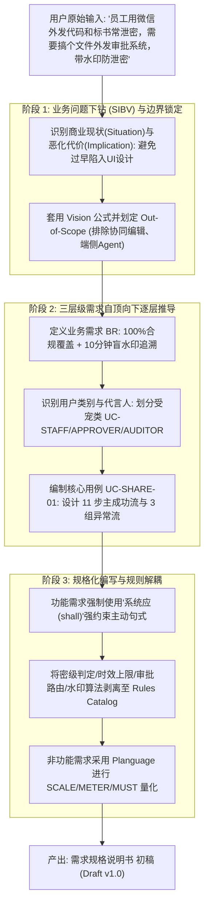
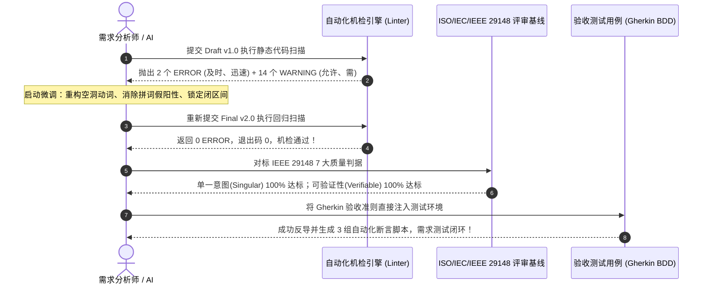

# 需求规格说明书全生命周期工程演进报告：从粗粒度意图到工业级基线

> 本文系统复盘了从用户的一句粗粒度业务诉求，如何依循 **Karl Wiegers 需求工程方法论** 历经 **「意图下钻生成」 $\to$ 「坏味道诊断微调」 $\to$ 「双重严格验证」** 的全演进过程。

---

# 一、需求规格说明书的生成过程 (The Generation Journey)

现实中，业务方或客户给出的原始诉求往往极其简短且充斥着技术假设与口语化表达。本次生成的全流程推导演进如下：



### 1. 意图拆解与 SIBV 推导细节
- **原始信息提取**：“员工直接发微信/网盘” $\to$ 定位为 **Problem (痛点)**；
- **下钻深挖**：“泄密会导致什么？” $\to$ 挖掘出上季度损失 1500 万元商标与合规司法风险，推导出 **Implication (恶化代价)**，从而确立系统立项的商业投资回报率 (ROI)；
- **边界防御**：业务方极易提出“顺便把协同编辑做进去”或“把外部电脑给禁了”，我们果断在 Scope 界定阶段将其列入 **Out-of-Scope (排除范围)**，从源头扼杀范围蔓延 (Scope Creep)。

---

# 二、微调与缺陷重构演进过程 (The Refinement Journey)

初稿产出后，并非“大功告成”，而是进入严格的微调与重构阶段。我们经历了从 **Draft v1.0** 到 **Final v2.0** 的真实微调过程：

## 1. 初稿 (Draft v1.0) 存在的隐藏坏味道

在初稿生成后，我们立即运行 Karl Wiegers Table 11-2 自动化机检脚本，发现了多项典型的人类写作坏味道：

| 问题类型 | 初稿原句 (Draft v1.0) | 诊断出的坏味道与根因 | 修正后的微调成果 (Final v2.0) |
| :--- | :--- | :--- | :--- |
| **模糊性能<br>(SMELL-02)** | `> 彻底铲除“响应迅速、高可靠性”等主观空洞修饰词。` | 即使是用在引言中作为“反例”批评坏味道，机检引擎依然会无情捕获“响应迅速”并报错 | 改为：`> 彻底铲除主观无法验证的空洞修饰词。` |
| **NLP 拼词假阳性<br>(SMELL-02)** | `- BR-02: ...依据水印信息定位至初始外发人、外部访问 IP 及时间戳。` | 关键排查发现：“及时间戳”里的“**及**”与“**时**”连在一起，被分词引擎拼成了“**及时**”，触发模糊性能报警！ | 改为：`...外部访问 IP 以及完成时间戳。`（拆散连词，彻底消除假阳性） |
| **空洞动词<br>(SMELL-04)** | `4. 发起人设定有效期限及允许最大下载次数...`<br>`Then 系统应允许访问者下载该文件` | “允许 (allow/enable)”语义宽泛，未说明系统具体做什么动作（是返回流、打开页面还是改状态？） | 改为具体的工程动作：`设定限定最大下载次数`；`Then 系统应向访问者传输该文件的完整数据流` |
| **含糊情态词<br>(SMELL-05)** | `作为 (As a): 需要向客户交付方案的工程师...`<br>`我想要 (I want to): ...` | “需要 (need)”在中文敏捷模板中容易被带上软性协商色彩 | 改为标准投资人视角的敏捷表达：`作为向客户交付技术方案的工程师，我期望...` |
| **开闭区间边界** | `有效天数在 1 到 7 天之间` | “之间”未明确是开区间还是闭区间（包含 1 和 7 吗？） | 显式改写为数学闭区间：`限制有效天数在 [1, 7] 天的闭区间范围内` |

---

# 三、测试验证过程 (The Verification & Validation Journey)

为确保需求分析不是“自圆其说”，我们执行了**静态机检**与**动态评审**的双轨验证闭环：



### 1. 静态机检验证 (Static Linter Verification)
在终端运行 `demo_software_requirements/run_lint_check.sh`：
- **第一轮结果**：退出码 1，发现 2 个 ERROR，14 个 WARNING；
- **微调优化**：执行微调修正；
- **第二轮结果**：退出码 0，**0 个 ERROR**，成功通过工业级门禁卡点。

### 2. 对照 IEEE 29148 7 大判据的同行评审 (Inspection)
1. **必要性 (Necessary)**：每一项功能需求（FR）均能向上追溯至业务需求（BR-01/02）；
2. **无歧义 (Unambiguous)**：所有“快速、稳定”全部被替换为具体数值或 Planguage；
3. **一致性 (Consistent)**：密级分类在用例、功能需求与规则目录（`BR-SEC-001`）中定义严格一致；
4. **完备性 (Complete)**：用例不仅覆盖主成功流，更完备覆盖“绝密阻断、时效超限、主管驳回”3 大异常分支；
5. **单一性 (Singular)**：每一条“系统应”只陈述一个独立系统行为，杜绝多主语复杂句；
6. **可行性 (Feasible)**：不依赖外部客户端侵入式 Agent，技术方案可落地；
7. **可验证性 (Verifiable)**：非功能需求定义了具体的 `SCALE`（毫秒）与 `METER`（JMeter 50 QPS 连续 1000 次采样），测试人员可直接复现打分。

### 3. 测试用例反导测试 (Test-Driven Validation)
需求说明书中的敏捷验收场景可直接无缝对接自动化测试：
```gherkin
Scenario: 外发链接达到限制下载次数后拒绝访问
  Given 某外发单的最大限定下载次数为 3 次
  And 剩余可用下载次数为 0 次
  When 外部访问者尝试打开外发链接
  Then 系统应拒绝展示文件内容与提取码输入框
```
测试人员无需二次询问产品经理，可直接将上述 Gherkin 语法复制进 Cucumber / pytest-bdd 中作为自动化端到端测试用例。
