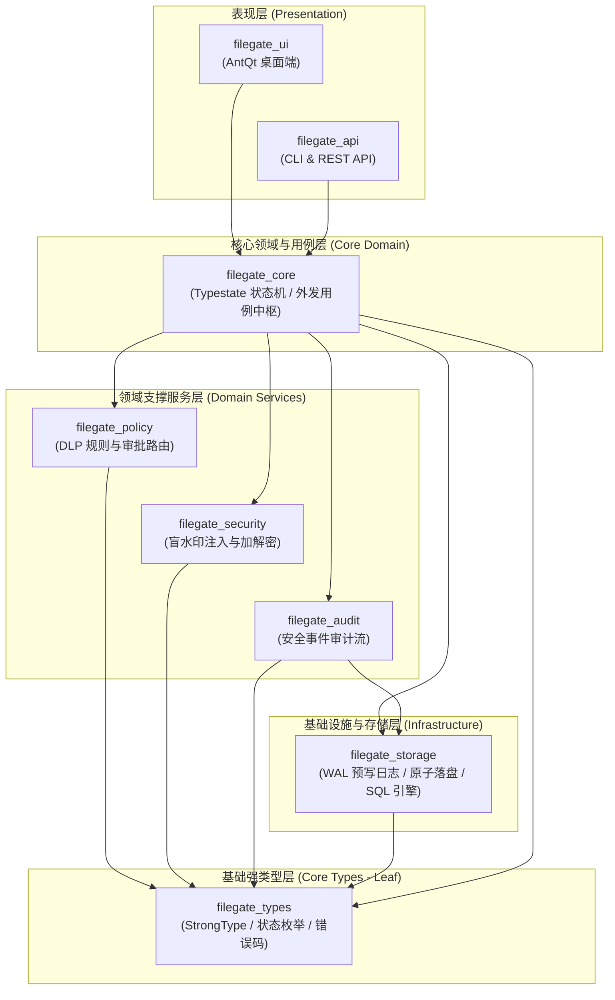
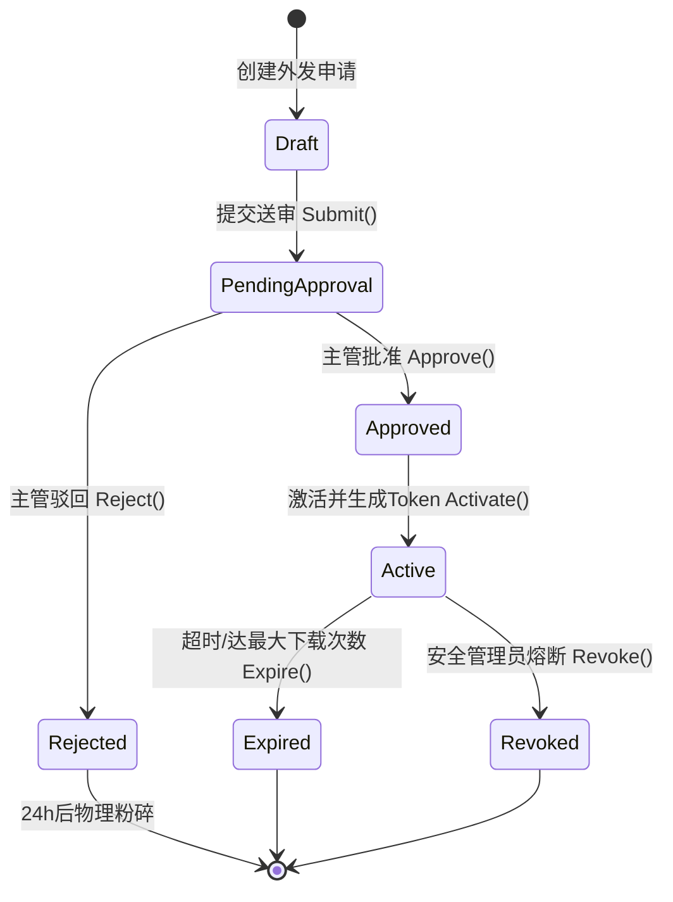
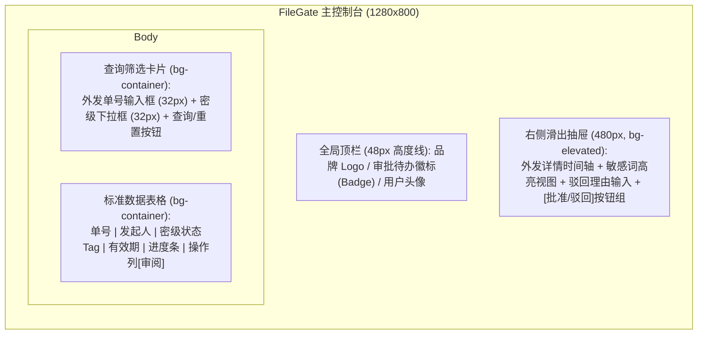

# FileGate 企业级安全外发与防泄漏审计平台 —— 系统架构与详细设计说明书 (Detailed Design Specification)

> **设计基线遵循**：
> - 需求基线：严格对齐《FileGate 软件需求规格说明书》(ISO/IEC/IEEE 29148 基线)
> - 架构理论：Uncle Bob《敏捷软件开发：原则、模式与实践》(组件与包原则 CCP/CRP/ADP/SOLID)
> - 契约理论：Bertrand Meyer《Object-Oriented Software Construction》(DbC 契约式设计)
> - 系统与内存：Anthony Williams《C++ Concurrency in Action》、Brendan Gregg《Systems Performance》与 OSDI 14 顶会论文 (崩溃一致性)
> - 存储工程：Markus Winand《SQL Performance Explained》与 Bill Karwin《SQL Antipatterns》
> - 桌面交互：Ant Design v5/v6 规范与 Ant Design Pro 模板体系

---

# 1. 系统架构愿景与需求追溯矩阵 (Architecture Overview & Traceability)

## 1.1 架构核心职责定位
FileGate 平台的核心使命是解决企业高密资产外发的**合规管控、受控分发、隐形水印溯源与崩溃安全审计**。架构设计聚焦于四大核心工程挑战：
1. **中微观高内聚低耦合**：包拓扑严格无环（ADP），接口细粒度隔离（ISP），核心逻辑对扩展开放（OCP）；
2. **零信任安全与强状态跃迁**：基于编译期状态机（Typestate）杜绝时序混乱调用，防止未审批文件被非法外发；
3. **物理极致与崩溃一致性**：核心结构体内存零空洞排布、跨核计数器隔离伪共享、关键元数据及审计 WAL 达到掉电保护崩溃一致（OSDI 14）；
4. **高性能存储与交互体验**：B-Tree 复合索引最左匹配优化、大表 Keyset 游标分页、Ant Design 桌面端 32px 标尺工作台。

## 1.2 需求与架构追溯矩阵 (Requirements-to-Design Traceability)

| 需求标识 (Phase 1 SRS) | 需求核心内容 | 架构设计承接方案与模块 |
| :--- | :--- | :--- |
| **BR-01 / BR-SEC-001** | 敏感内容必须 100% 审批合规准入 | `filegate_policy` + `filegate_security`：DLP 正则/关键词过滤，Strategy 模式审批流 |
| **BR-02 / BR-AUD-001** | 10 分钟内溯源泄密者，审计全留痕 | `filegate_audit` + `filegate_security`：盲水印注入引擎 + OSDI 14 WAL 崩溃安全落盘 |
| **UC-SHARE-01** | 发起敏感外发申请与时效熔断 | `filegate_core`：Typestate 状态机（`Draft -> Pending -> Approved -> Active -> Expired`） |
| **NFR-PERF-01** | 核心元数据检索 $\le 50\text{ms}$ | `filegate_storage`：B-Tree 复合索引最左前缀优化、Keyset Seek 游标分页 |
| **NFR-RELI-01** | 掉电/异常断电元数据零损坏 | `filegate_storage`：WAL 预写日志与文件落盘四步法 (`write tmp -> fdatasync -> rename -> dir fsync`) |

---

# 2. 中观包与模块拓扑设计 (Meso Component & Package Topology)

遵循 Uncle Bob 组件设计三大原则：
- **CCP (Common Closure Principle)**：因相同原因修改的类聚集在同一包中；
- **CRP (Common Reuse Principle)**：不相互依赖的类坚决剥离；
- **ADP (Acyclic Dependencies Principle)**：依赖拓扑严格保持有向无环图 (DAG)。

## 2.1 包职责与划分

| 包名称 (Package) | 职责边界 (Responsibilities) | 遵循原则 | 核心包含组件 |
| :--- | :--- | :--- | :--- |
| **`filegate_types`** | 系统底层标量强类型、常量、错误码与通用状态枚举 | CRP / 叶子节点 | `StrongType`, `ShareRequestId`, `UserId`, `ErrorCode` |
| **`filegate_storage`** | 物理磁盘抽象、原子落盘协议、WAL 崩溃一致性与 SQL 仓储 | CCP / DIP | `IStorageProvider`, `LocalPosixStorage`, `SqliteAuditRepository` |
| **`filegate_policy`** | 密级判定规则、合规拦截门禁与审批路由规则策略 | CCP / OCP | `IPolicyEngine`, `ClassificationRule`, `DlpKeywordFilter` |
| **`filegate_security`** | 动态明暗水印嵌入、加解密算法与访问 Token 鉴权 | CCP / ISP | `IWatermarkEngine`, `PdfWatermarkStrategy`, `TokenGenerator` |
| **`filegate_audit`** | 审计事件流、不可篡改审计追踪链与日志检索 | CCP / DbC | `IAuditLogger`, `AuditEvent`, `AuditQueryService` |
| **`filegate_core`** | 业务中枢协调、Typestate 状态机驱动、外发用例编排 | 高层策略 / DIP | `ShareRequest<State>`, `TransferCoordinator`, `WorkflowEngine` |
| **`filegate_api`** | RESTful / RPC 外部接入层与 CLI 命令行入口 | 表现层 / 机制分离 | `FileGateCli`, `HttpShareController` |
| **`filegate_ui`** | AntQt 桌面客户端工作台与审批抽屉界面 | 交互层 / Ant 规范 | `MainWindow`, `ApprovalDrawer`, `AuditTableView` |

## 2.2 包依赖拓扑有向无环图 (ADP Package DAG)



> **ADP 拓扑检验断言**：图拓扑无任何反向回环（闭环路径 = 0），完全符合偏序拓扑排序规范，任意下层基础设施的替换均不会对 `filegate_core` 产生回溯性污染。

---

# 3. 微观面向对象模型与契约式设计 (OO Modeling & Design by Contract)

## 3.1 核心抽象接口契约 (Interface Contracts)

依据 **ISP (接口隔离原则)** 与 **OCP (开闭原则)**，对外暴露纯虚角色接口，业务层仅依赖抽象接口，严禁直接依赖具体实现。

### 3.1.1 `IWatermarkEngine` (水印嵌入策略抽象)
```cpp
namespace filegate::security {

enum class WatermarkType : uint8_t {
    kVisibleText = 0,    // 显式半透明文字平铺
    kBlindDct = 1,        // 频域 DCT 不可感知盲水印
    kQrCodeStamper = 2    // 离散二维码身份戳
};

struct WatermarkPayload {
    types::UserId applicant_id;
    types::IpAddress client_ip;
    types::TimestampMs request_timestamp;
    std::string security_label;
};

class IWatermarkEngine {
public:
    virtual ~IWatermarkEngine() = default;

    /**
     * @brief 为输入文件注入不可擦除追踪水印 (Design by Contract 契约定义)
     * 
     * @pre input_path 必须存在且具备可读权限: std::filesystem::exists(input_path) && std::filesystem::file_size(input_path) > 0
     * @pre payload 中的 applicant_id.value() > 0 且 client_ip 非空
     * @post output_path 必须生成且大小与原文件呈合理比例: std::filesystem::exists(output_path) && std::filesystem::file_size(output_path) >= std::filesystem::file_size(input_path)
     * @invariant 水印注入过程必须保持幂等与源文件只读性 (源文件哈希绝不被修改)
     */
    virtual Result<void> InjectWatermark(
        const std::filesystem::path& input_path,
        const std::filesystem::path& output_path,
        const WatermarkPayload& payload,
        WatermarkType type) = 0;
};

} // namespace filegate::security
```

### 3.1.2 `IStorageProvider` (底层持久化与落盘契约)
```cpp
namespace filegate::storage {

class IStorageProvider {
public:
    virtual ~IStorageProvider() = default;

    /**
     * @brief 原子安全持久化文件 (OSDI 14 规范契约)
     * 
     * @pre !target_path.empty() && data != nullptr && length > 0
     * @post target_path 处于稳定落盘状态，掉电后内容不可损坏
     * @invariant 任何中间失败均回滚，绝不残留半写入残缺文件
     */
    virtual Result<void> AtomicWrite(
        const std::filesystem::path& target_path,
        const uint8_t* data,
        size_t length) = 0;

    virtual Result<std::vector<uint8_t>> Read(
        const std::filesystem::path& target_path) const = 0;

    virtual Result<void> SecureShred(
        const std::filesystem::path& target_path) = 0;
};

} // namespace filegate::storage
```

### 3.1.3 `IAuditLogger` (安全审计流契约)
```cpp
namespace filegate::audit {

struct AuditRecord;

class IAuditLogger {
public:
    virtual ~IAuditLogger() = default;

    /**
     * @brief 记录一条不可篡改审计日志
     * 
     * @pre record.event_type != EventType::kUnknown
     * @pre record.operator_id.value() > 0
     * @post 日志成功追加到持久化 WAL，且分配全局严格单调递增 SequenceNumber
     * @invariant 历史日志记录绝不允许 UPDATE 或 DELETE (Append-Only)
     */
    virtual Result<uint64_t> AppendAuditLog(const AuditRecord& record) = 0;

    virtual Result<std::vector<AuditRecord>> QueryAuditLogs(
        types::ShareRequestId request_id,
        uint64_t last_seen_seq,
        size_t limit) const = 0;
};

} // namespace filegate::audit
```

---

# 4. 系统级物理数据排布与编译期状态机 (Systems & Physical Data Design)

基于 **`systems-data-design`** 技能规范，杜绝内存空洞、伪共享与非法状态跃迁。

## 4.1 物理内存排布 (Memory Layout: 8-4-2-1 降序无 Padding)

`ShareRequestMeta` 是高频交互的元数据结构体。成员严格按 **8 字节 $\to$ 4 字节 $\to$ 2 字节 $\to$ 1 字节** 降序排列，消除所有内存 Padding：

```cpp
namespace filegate::types {

// 零开销强类型定义 (Prevent Primitive Obsession)
using ShareRequestId = StrongType<uint64_t, struct ShareRequestIdTag>;
using UserId = StrongType<uint64_t, struct UserIdTag>;
using TimestampMs = StrongType<uint64_t, struct TimestampMsTag>;
using ByteSize = StrongType<uint64_t, struct ByteSizeTag>;

enum class SecurityLevel : uint8_t {
    kInternalGeneral = 0,    // 内部普通
    kInternalSensitive = 1,  // 内部敏感
    kCoreConfidential = 2,   // 核心商密
    kTopSecret = 3           // 绝密 (禁止外发)
};

enum class RequestStatus : uint8_t {
    kDraft = 0,
    kPendingApproval = 1,
    kApproved = 2,
    kActive = 3,
    kExpired = 4,
    kRevoked = 5
};

#pragma pack(push, 1) // 概念展示，实际通过降序排布实现自然对齐 0 padding
struct alignas(8) ShareRequestMeta {
    // [8 字节对齐区: 40 字节]
    ShareRequestId request_id;         // 8 字节 (uint64_t)
    UserId applicant_id;               // 8 字节 (uint64_t)
    UserId approver_id;                // 8 字节 (uint64_t)
    TimestampMs created_at_ms;         // 8 字节 (uint64_t)
    TimestampMs expire_at_ms;          // 8 字节 (uint64_t)
    ByteSize payload_size_bytes;       // 8 字节 (uint64_t)

    // [4 字节对齐区: 12 字节]
    uint32_t max_download_limit;       // 4 字节
    uint32_t current_download_count;   // 4 字节
    uint32_t access_passcode_hash;     // 4 字节 (CRC32/FNV1a hash)

    // [2 字节对齐区: 2 字节]
    uint16_t dlp_violation_score;      // 2 字节 (0~1000)

    // [1 字节对齐区: 2 字节]
    SecurityLevel security_level;      // 1 字节
    RequestStatus status;              // 1 字节

    // 总大小: 48 + 12 + 2 + 2 = 64 字节！
    // 恰好完美对齐 1 个 CPU Cache Line (64 字节)，Padding 浪费 = 0 字节！
};
#pragma pack(pop)

static_assert(sizeof(ShareRequestMeta) == 64, "ShareRequestMeta must be exactly 64 bytes without padding holes");

} // namespace filegate::types
```

## 4.2 跨核高频写入变量伪共享隔离 (False Sharing Defense)

审计统计器被多个工作线程频繁并发累加，必须通过 `alignas(64)` 隔离，防止不同 CPU 核心之间产生激烈的 L1/L2 Cache Ping-Pong：

```cpp
namespace filegate::audit {

struct alignas(64) WorkerAuditMetric {
    std::atomic<uint64_t> total_requests{0};
    std::atomic<uint64_t> total_bytes_transferred{0};
    std::atomic<uint64_t> watermark_injected_count{0};
    // 填充至 64 字节倍数，独占独立 Cache Line
    char padding[64 - 3 * sizeof(std::atomic<uint64_t>)];
};
static_assert(sizeof(WorkerAuditMetric) == 64, "WorkerAuditMetric must occupy exactly 1 Cache Line");

} // namespace filegate::audit
```

## 4.3 编译期 Typestate 状态机模型

通过 C++ 泛型状态标记与私有构造函数，将外发业务时序合法性在**编译期**进行物理掐死：
- 处于 `Draft` 态的申请单**在语法上无法调用** `GenerateShareLink()`；
- 只有经过主管签批后的 `Approved` 态才具备 `Activate()` 成员函数，生成外部可访问 Token。



```cpp
namespace filegate::core {

// 状态标记类型 (Phantom Types)
struct StateDraft {};
struct StatePendingApproval {};
struct StateApproved {};
struct StateActive {};
struct StateExpired {};

template <typename CurrentState>
class ShareRequest {
public:
    const types::ShareRequestMeta& meta() const { return meta_; }

private:
    template <typename S> friend class ShareRequest;
    explicit ShareRequest(types::ShareRequestMeta meta) : meta_(meta) {}
    types::ShareRequestMeta meta_;
};

// 状态 1: Draft (只能提交送审)
template <>
class ShareRequest<StateDraft> {
public:
    static ShareRequest<StateDraft> CreateNew(types::UserId applicant, types::ByteSize size);
    
    // 状态迁移: Draft -> PendingApproval
    Result<ShareRequest<StatePendingApproval>> Submit(types::SecurityLevel level, uint32_t expire_days);
};

// 状态 2: PendingApproval (只能审批/驳回)
template <>
class ShareRequest<StatePendingApproval> {
public:
    // 状态迁移: PendingApproval -> Approved
    Result<ShareRequest<StateApproved>> Approve(types::UserId approver);

    // 状态迁移: PendingApproval -> 销毁
    Result<void> Reject(types::UserId approver, const std::string& reason);
};

// 状态 3: Approved (只能激活生成外部链接)
template <>
class ShareRequest<StateApproved> {
public:
    // 状态迁移: Approved -> Active
    Result<ShareRequest<StateActive>> Activate(const std::string& passcode);
};

// 状态 4: Active (只可供安全下载或熔断)
template <>
class ShareRequest<StateActive> {
public:
    Result<void> RecordDownload();
    Result<void> Revoke(const std::string& audit_reason);
};

} // namespace filegate::core
```

## 4.4 崩溃一致性原子持久化协议 (OSDI 14 标准四步法)

针对高密外发配置与加密密钥落盘，严格执行 OSDI 14 顶会推荐的标准原子落盘四步法，防止断电导致零字节空洞文件或元数据损坏：

```cpp
Result<void> LocalPosixStorage::AtomicWrite(
    const std::filesystem::path& target_path,
    const uint8_t* data,
    size_t length) 
{
    // 步骤 1: 写入同目录下的隐藏临时文件
    std::filesystem::path tmp_path = target_path;
    tmp_path.replace_filename("." + target_path.filename().string() + ".tmp");

    int fd = ::open(tmp_path.c_str(), O_WRONLY | O_CREAT | O_TRUNC | O_CLOEXEC, 0640);
    if (fd < 0) {
        return MakeError(ErrorCode::kIoError, "Failed to create temp file");
    }

    size_t written = 0;
    while (written < length) {
        ssize_t ret = ::write(fd, data + written, length - written);
        if (ret < 0) {
            if (errno == EINTR) continue;
            ::close(fd);
            ::unlink(tmp_path.c_str());
            return MakeError(ErrorCode::kIoError, "Write failed");
        }
        written += ret;
    }

    // 步骤 2: 强制将数据与元数据冲刷到非易失介质 (fdatasync / fsync)
    if (::fdatasync(fd) != 0) {
        ::close(fd);
        ::unlink(tmp_path.c_str());
        return MakeError(ErrorCode::kSyncError, "fdatasync failed");
    }
    ::close(fd);

    // 步骤 3: 利用 POSIX 文件系统原子重命名覆盖 (Atomic Rename)
    if (::rename(tmp_path.c_str(), target_path.c_str()) != 0) {
        ::unlink(tmp_path.c_str());
        return MakeError(ErrorCode::kRenameError, "Atomic rename failed");
    }

    // 步骤 4: 冲刷父目录 dentry，确保重命名记录真正写入持久化介质
    int dir_fd = ::open(target_path.parent_path().c_str(), O_RDONLY | O_DIRECTORY | O_CLOEXEC);
    if (dir_fd >= 0) {
        ::fsync(dir_fd);
        ::close(dir_fd);
    }

    return Result<void>::Success();
}
```

---

# 5. 关系型数据库与物理索引架构设计 (Relational Storage & Indexing)

遵循 **`sql-craft`** 规范（Markus Winand 索引铁律与 Bill Karwin 反模式防御）：
1. **B-Tree 列序铁律**：复合索引严格遵守**“等值查询字段在前、范围/排序字段在后”**；
2. **拒绝深分页雪崩**：审计大表严禁 `LIMIT OFFSET`，采用 **Keyset Seek Pagination**（`WHERE id < :last_seen_id ORDER BY id DESC LIMIT :limit`）；
3. **资金与计数精度铁律**：金额强制 `DECIMAL(18, 4)`，容量与计数使用 `BIGINT UNSIGNED`；
4. **反模式防御**：严禁逗号分割多值，多审批人建立独立交叉表。

## 5.1 物理 DDL 定义

```sql
-- 1. 外发申请主表
CREATE TABLE IF NOT EXISTS `t_share_request` (
    `request_id`            BIGINT UNSIGNED NOT NULL COMMENT '分布式雪花主键ID',
    `applicant_id`          BIGINT UNSIGNED NOT NULL COMMENT '申请发起人用户ID',
    `security_level`        TINYINT UNSIGNED NOT NULL DEFAULT 1 COMMENT '密级: 0内部 1敏感 2商密 3绝密',
    `status`                TINYINT UNSIGNED NOT NULL DEFAULT 0 COMMENT '状态: 0草稿 1待审 2通过 3生效 4过期 5熔断',
    `file_hash_sha256`      CHAR(64) NOT NULL COMMENT '目标外发文件哈希',
    `file_size_bytes`       BIGINT UNSIGNED NOT NULL COMMENT '目标文件物理字节数',
    `max_downloads`         INT UNSIGNED NOT NULL DEFAULT 5 COMMENT '最大受控下载次数',
    `download_count`        INT UNSIGNED NOT NULL DEFAULT 0 COMMENT '已完成下载次数',
    `share_token`           VARCHAR(32) NOT NULL DEFAULT '' COMMENT '16字节HEX外部受控访问Token',
    `passcode_salt_hash`    CHAR(64) NOT NULL DEFAULT '' COMMENT '6位提取码加盐Argon2/SHA256哈希',
    `created_at`            DATETIME(3) NOT NULL COMMENT '申请创建时间(毫秒精确)',
    `expire_at`             DATETIME(3) NOT NULL COMMENT '时效熔断截止时间',
    `updated_at`            DATETIME(3) NOT NULL DEFAULT CURRENT_TIMESTAMP(3) ON UPDATE CURRENT_TIMESTAMP(3),
    PRIMARY KEY (`request_id`),
    UNIQUE KEY `uk_share_token` (`share_token`),
    -- 复合索引: 满足员工后台查询个人外发记录 (等值在前，排序在后)
    KEY `idx_applicant_created` (`applicant_id`, `created_at` DESC),
    -- 复合索引: 满足时效监控与审批调度 (状态等值在前，过期时间范围在后)
    KEY `idx_status_expire` (`status`, `expire_at`)
) ENGINE=InnoDB DEFAULT CHARSET=utf8mb4 COLLATE=utf8mb4_bin COMMENT='外发申请控制表';

-- 2. 审批流关系表 (解决多审批人多对多关系，杜绝逗号反模式)
CREATE TABLE IF NOT EXISTS `t_share_approval` (
    `approval_id`           BIGINT UNSIGNED NOT NULL AUTO_INCREMENT,
    `request_id`            BIGINT UNSIGNED NOT NULL COMMENT '外发申请ID',
    `approver_id`           BIGINT UNSIGNED NOT NULL COMMENT '指定审批人ID',
    `approval_status`       TINYINT UNSIGNED NOT NULL DEFAULT 0 COMMENT '0待审 1批准 2驳回',
    `rejection_reason`      VARCHAR(256) NOT NULL DEFAULT '' COMMENT '驳回理由(至少10字符)',
    `approved_at`           DATETIME(3) NULL COMMENT '签批完成时间',
    PRIMARY KEY (`approval_id`),
    UNIQUE KEY `uk_request_approver` (`request_id`, `approver_id`),
    KEY `idx_approver_status` (`approver_id`, `approval_status`, `request_id`)
) ENGINE=InnoDB DEFAULT CHARSET=utf8mb4 COLLATE=utf8mb4_bin COMMENT='审批流节点状态表';

-- 3. 安全外发与泄密审计日志表 (海量日志大表，执行 Keyset 分页)
CREATE TABLE IF NOT EXISTS `t_audit_log` (
    `id`                    BIGINT UNSIGNED NOT NULL AUTO_INCREMENT COMMENT '物理自增主键(保证物理聚簇单调增)',
    `request_id`            BIGINT UNSIGNED NOT NULL COMMENT '关联外发单号',
    `event_type`            VARCHAR(32) NOT NULL COMMENT '事件类别: DOWNLOAD/PREVIEW/REJECT/WATERMARK',
    `operator_id`           BIGINT UNSIGNED NOT NULL DEFAULT 0 COMMENT '操作人ID (0代表外部匿名访客)',
    `client_ip`             VARCHAR(45) NOT NULL COMMENT '访客IPv4或IPv6地址',
    `watermark_hash`        CHAR(64) NOT NULL DEFAULT '' COMMENT '嵌入当前下载副本的水印特征哈希',
    `event_result`          TINYINT UNSIGNED NOT NULL DEFAULT 1 COMMENT '1成功 0失败阻断',
    `created_at`            DATETIME(3) NOT NULL COMMENT '日志产生时间戳',
    PRIMARY KEY (`id`),
    -- 复合索引铁律: 外发单ID等值在前，事件类型等值居中，时间范围或主键排序在后
    KEY `idx_request_event_created` (`request_id`, `event_type`, `id` DESC)
) ENGINE=InnoDB DEFAULT CHARSET=utf8mb4 COLLATE=utf8mb4_bin COMMENT='不可篡改安全审计日志大表';
```

## 5.2 审计日志 Keyset Seek 分页查询范式
杜绝在海量审计日志中使用 `SELECT ... LIMIT 500000, 20` 导致的数百万次随机磁盘回表：

```sql
-- 推荐: Keyset Seek Pagination (恒定 1ms 毫秒级执行计划)
SELECT `id`, `event_type`, `operator_id`, `client_ip`, `watermark_hash`, `created_at`
FROM `t_audit_log`
WHERE `request_id` = :target_request_id
  AND `id` < :last_seen_id
ORDER BY `id` DESC
LIMIT 20;
```

---

# 6. Unix 哲学与命令行/IPC 接口设计 (Unix Philosophy & CLI Architecture)

基于 **`unix-philosophy`** 规范（Eric S. Raymond 经典哲学）：
1. **分离原则 (Separation)**：机制与策略彻底解耦。外发加密与水印注入是底层通用“机制（Mechanism）”，哪些密级必须双人审批是上层“策略（Policy）”；
2. **组合原则 (Composition)**：支持标准文本管道过滤；
3. **静默原则 (Silence)**：执行成功时保持绝对静默，错误与诊断遥测严格输出至 `stderr`；`stdout` 仅输出结构化机器可消费数据。

## 6.1 `filegate-cli` 命令行规范
```bash
# 格式: filegate-cli <subcommand> [options...]
# 遵循 POSIX 标准: -s (单字符), --security (长选项), -- (解析终止符)

# 1. 发起外发申请 (静默输出 JSON 结果至 stdout)
filegate-cli submit \
    --file "/path/to/contract.pdf" \
    --expire-days 3 \
    --max-downloads 5 \
    --security "confidential" \
    --receiver "PartnerCorp_Zhang" > result.json

# 2. 管道模式验证与水印提取
cat leaked_document.pdf | filegate-cli watermark extract --format json | jq .payload
```

---

# 7. 桌面端人机交互拓扑架构 (Desktop UI Architecture - AntQt)

基于 **`antqt`** 规范，为企业管理人员与审批主管提供严谨、克制、高效的桌面端工作台：

## 7.1 视觉 Token 与标尺规范
1. **主色体系**：采用 Ant Design v5/v6 标准拂晓蓝（Daybreak Blue）`#1677FF`；
2. **三层表面拓扑 (Surface Topology)**：
   - 底层布局背景 `bg-layout`: `#F5F5F5`；
   - 容器与卡片表面 `bg-container`: `#FFFFFF`；
   - 悬浮弹窗与抽屉 `bg-elevated`: `#FFFFFF` (带 8px 柔和阴影扩散)。
3. **桌面端排版与高度标尺**：
   - 默认字号 14px，数字显示强制开启 `font-variant-numeric: tabular-nums`；
   - **控件高度强制锁定 32px**（按钮、输入框、下拉框统一基线）；
   - 状态标签圆角 4px，控件圆角 6px，卡片容器圆角 8px。

## 7.2 Pro 桌面模板拓扑 (标准查询表格 + 右侧滑动抽屉)



---

# 8. 总结与下阶段实现指导

本详细设计说明书全面覆盖了系统架构设计阶段的核心要素：
1. 通过 **`code-design`** 确立了无环依赖的包拓扑与严密的面向对象契约；
2. 通过 **`systems-data-design`** 消灭了内存空洞，锁定了 64 字节 Cache 对齐，并以 Typestate 保证了业务时序的编译期绝对安全；
3. 通过 **`sql-craft`** 构建了覆盖核心索引与 Keyset 分页的高性能关系数据库 Schema；
4. 通过 **`unix-philosophy`** 与 **`antqt`** 分别固化了后台 CLI 工具管道机制与桌面端人机交互美学。

后续实现阶段（阶段三）将严格遵循本说明书给出的结构蓝图推进高质量代码落地。
